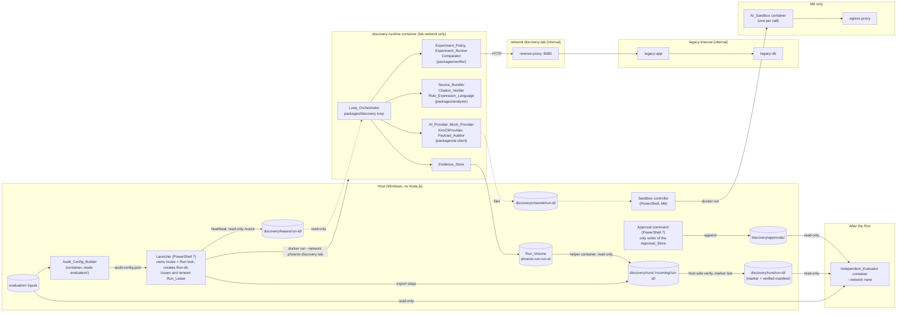
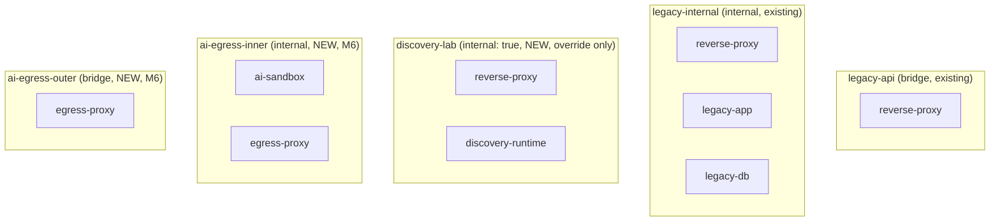
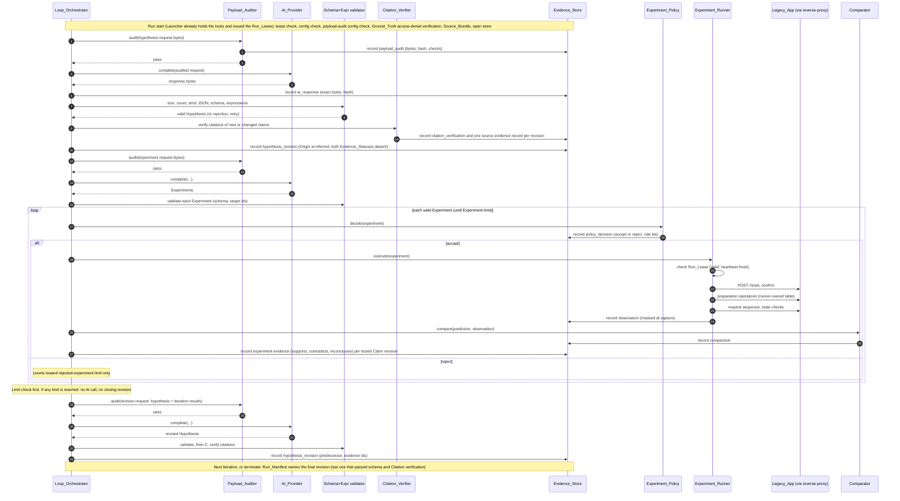
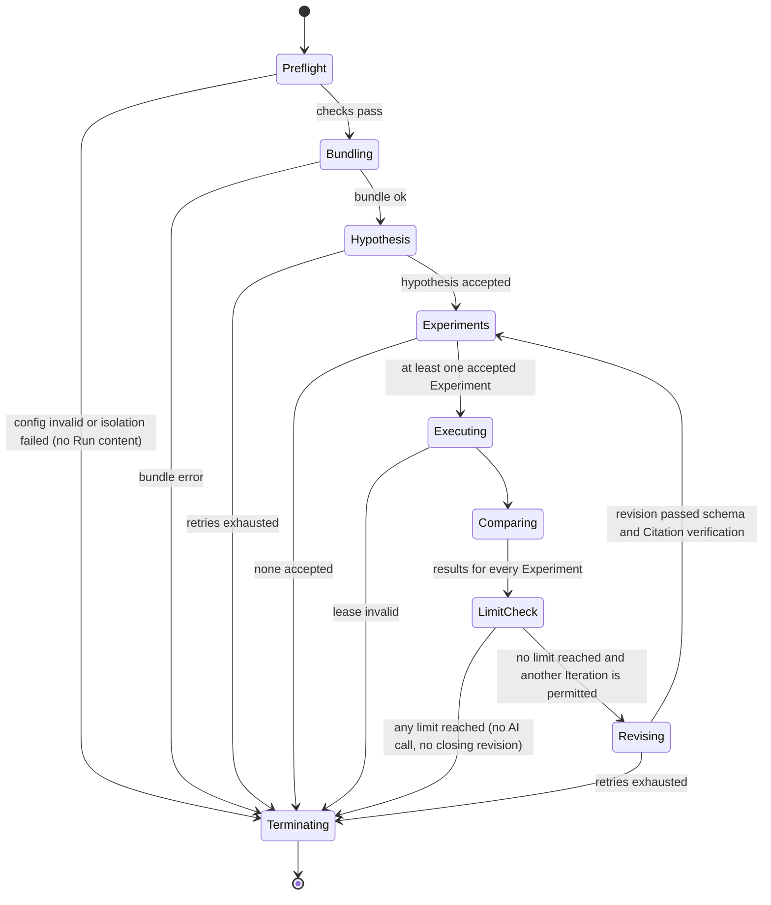
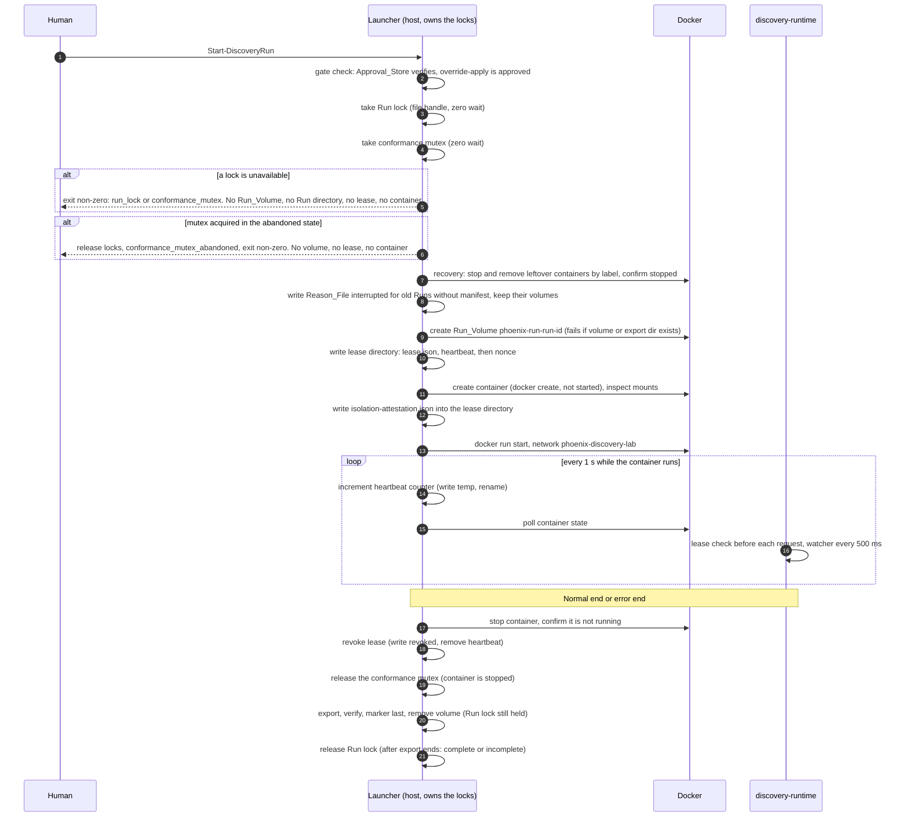

# Design Document — discovery-loop

## Overview

The `discovery-loop` feature lets Project Phoenix discover the business rules of the synthetic legacy-sample app by hypothesis and experiment. The AI proposes structured Hypotheses from the Source_Bundle. A deterministic Experiment_Runner tests them against the running Legacy_App through the Test API. The AI revises the Hypotheses from the Observations. An Independent_Evaluator, in a separate container that runs after the Run, scores the saved result against the approved Ground_Truth.

This document is **rule-agnostic**. It contains no business-rule value (threshold, tier, price, expected output) of the legacy app. Every example uses a fictitious "widget" API (`POST /widgets`, fields `count`, `label`, `unit_cost`) so that the design cannot hand the answer to the AI. Prompts, schemas, fixtures and examples derived from this design must stay equally generic.

### Design principles

1. **Environment rights over code checks.** Isolation from `evaluation/` is enforced by container mounts, not by path-string filters (R15.2, R15.13).
2. **Deterministic core, untrusted AI.** Everything except hypothesis and experiment proposals is deterministic code. All AI output is untrusted input that passes size, parse, schema, expression and policy gates (R17).
3. **Evidence is append-only and chained.** Every decision is a record in a SHA-256 hash chain. Nothing is overwritten (R6.12, R12, R23).
4. **Three separate concepts, four separate facts.** Origin (who produced the content), Evidence (what was checked: `source` and `experiment`, each with its own status) and Approval (what a human decided) are stored, derived and reported separately. An observation of legacy behavior never becomes "correct specification". Only an Approval_Record written by a human through the host-side command does, and the loop can neither write nor read it (R6, R23).
5. **Fail closed.** A missing, empty or unreadable configuration blocks the call or refuses the Run (R2.9, R8.6, R11.8, R15.11).
6. **Reproducible by construction.** No wall-clock value, random value or host path enters a record. Identifiers are counters derived from Run inputs (R22).

### Scope of this document

In scope: design of M1 to M7 including the M6 sandbox design. The design itself implements nothing. M0 (approved) created the files listed in the M0 artifacts section and edited `.gitignore`, `.env.example` and the steering files; `legacy/`, the base `infra/docker-compose.yml`, the Ground Truth and the decision registry are unchanged. Everything marked **UNVERIFIED** must be verified in the named milestone before use.

### Design decisions at a glance

| ID | Decision | Alternatives considered | Status |
|----|----------|------------------------|--------|
| D1 | Run the Loop_Orchestrator and the analyzer, ai-client, verifier libraries in a dedicated `discovery-runtime` container (pinned Node LTS image, non-root, read-only root, no repository mount) | Host process under a separate OS account (needs Node on host, violates R20.10; Windows ACL setup is fragile); in-process path checks (rejected by R15.13) | Recommended |
| D2 | Reach the Test API over a new `internal: true` network with the fixed name `phoenix-discovery-lab` (short name `discovery-lab`). The network and the `reverse-proxy` membership are defined **only** in the separate override file `infra/docker-compose.discovery.yml`, which defines no service. `discovery-runtime` is not a Compose service: the Launcher starts it with `docker run --network phoenix-discovery-lab` (A10, R18.13). Only `discovery-runtime` and `reverse-proxy` are members; the Test API is at `http://reverse-proxy:8080`. `infra/docker-compose.yml` stays byte-identical (R18.12) | Edit the base file (rejected by R18.12); `host.docker.internal` to `127.0.0.1:8056` (UNVERIFIED on Docker Desktop, and a loopback bind is not reachable from a container); join `legacy-api` (rejected: not internal) | **Decided** (override file). Applying it is a **Gate** that needs a separate explicit human approval recorded as an Approval_Record (R18.20) |
| D3 | Independent_Evaluator is a separate container image built from `evaluation/spec-restoration-evaluator/`, run after the Run with `--network none`, read-only mounts, one writable output directory | Host process (needs Node on host); same image as runtime (shares code and rights) | Recommended |
| D4 | Evaluator re-implements canonical JSON, chain verification and the expression evaluator; correctness is tied to the runtime by shared golden vectors (data only) | Shared pure package used by both (less code, but a shared bug hides from the evaluator) | Recommended; OD-5 |
| D5 | Run-level mutual exclusion by a host-side **Launcher** (PowerShell 7). It owns, in its own process, the existing mutex `Local\ProjectPhoenixGroundTruthEvaluation` (zero wait, so the conformance runner is unchanged and exits with status 2) and a Run-vs-Run exclusive file handle (scope: one host and one Windows logon session, A11). It issues a **Run_Lease** (lease directory with a Launcher-renewed heartbeat, mounted read-only) that the runtime must see valid before every request (R24) | Lock file per Experiment mounted into the container (replaced: it needed a change to the conformance runner and could not protect a whole Run); TCP lock service (new attack surface); Node.js on the host (violates R20.10) | **Decided** |
| D6 | AI_Sandbox: one fresh container per call, started by a small host-side controller; the runtime never gets the Docker socket | Long-lived sandbox with an in-container agent (weaker per-call isolation); Docker socket in the runtime (root-equivalent, rejected) | Recommended for M6; OD-2 |
| D7 | Rule_Expression_Language is a JSON AST with total, bounded evaluation and generic operator names | A string DSL (needs a parser and invites ambiguity); embedding JavaScript or JSONLogic (not total, not generic) | Decided |
| D8 | Test framework: Vitest (unit, integration) and fast-check (property tests). Versions pinned before implementation (R20.6, R20.12) | Jest (heavier TypeScript setup); node:test (no built-in property testing) | Recommended |
| D9 | Boundary cases that need a fixture the Source_Bundle does not contain are expected to be `uncovered`. They are reported with a reason, never hidden | Excluding them from the denominator (would hide a real gap) | Decided |
| D10 | Mock_Provider fixtures are hand-written, neutral, and about a fictitious API | Fixtures derived from observed behavior (forbidden by R3.10) | Decided |
| D11 | Observations are stored **masked at capture** (same masking function as the Comparator, which is idempotent) so records stay byte-reproducible | Store raw bodies (contain wall-clock values, would break R22.1) | Decided |
| D12 | Fingerprints for restricted files are n-gram hashes built host-side, minus n-grams of everything the runtime may legitimately send | Path or canary matching alone (rejected by R2.8) | Decided; OD-4 |
| D13 | Approval_Store is one hash-chained JSONL file under `discovery/approvals/`, written only by a host-side **PowerShell 7 command** run by the human. It is not mounted into the runtime container at all. The Independent_Evaluator mounts it read-only | Node.js command in a container run by the human (shares the TypeScript canonical-JSON code, but needs a read-write mount of the store into a container, uses a container clock that can drift on Docker Desktop, and weakens R23.5 "host clock"); read-only mount into the runtime (rejected: R6.11 forbids reading it while payloads are built) | **Decided** |
| D14 | Payload_Audit (content of what is sent) and Ground_Truth access-denial verification (rights of the runtime) are separate modules, separate tests, separate Run_Manifest fields (`payload_audit`, `ground_truth_access_denial`). A Run starts only if both passed; neither is evidence for the other | One combined "isolation" check (rejected by R2.14 and R15.16) | **Decided** |
| D15 | Limit-reached stop never makes a closing AI call. The final state is the last revision that passed schema validation and Citation verification, named in the Run_Manifest (R11.18, A8) | Closing revision after the last Iteration (the earlier design; removed) | **Decided** |
| D16 | Run records are written during the Run to a per-Run Docker **named volume** (`phoenix-run-<run-id>`) that is the only read-write mount of `discovery-runtime`. After the container has stopped, the Launcher exports the volume to `discovery/runs/.incoming/<run-id>/`, verifies it on the host, and writes the Completion_Marker last. A directory rename is a convenience only (A9, R12.17 to R12.24) | Bind-mounted `discovery/runs/<run-id>/` (the earlier design). Reason: a reported WSL issue says that non-root writes on NTFS bind mounts can appear root-owned and cannot be reopened for append (https://github.com/microsoft/WSL/issues/41991). This report is **locally unverified**; the design does not depend on whether it reproduces, it only avoids that path | **Decided** (A9) |
| D17 | The runtime container is started only by the Launcher with `docker run`, never as a Compose service (A10). The override file defines the network and the proxy membership only | `discovery-runtime` as a profiled Compose service in the override (the earlier design; removed) | **Decided** (A10) |
| D18 | Export verification runs **on the host in PowerShell 7** (file list, SHA-256 of each file, chain walk, manifest comparison, marker content). The evaluator image in verify-only mode is not used for the export check | Evaluator image in verify-only mode: reuses the TypeScript chain code, but needs a container with the export mounted, and the export gate would then depend on the component that is itself a reader of verified Runs, so a bug there could hide itself. Cost of the choice: a second implementation of chain verification, which is checked against the same golden vectors as the TypeScript one (D4). The evaluator still re-verifies every Run it reads (R13.4) | **Decided** (R12.19) |
| D19 | Mutual exclusion covers one host and one Windows logon session. An abandoned conformance mutex stops the start attempt (A11, A12) | Claiming cross-session exclusion (the `Local\` namespace does not provide it) | **Decided** |
| D20 | A separate Discovery_Override isolation test, `tests/discovery-loop/test_discovery_network_isolation.ps1`, covers the applied state. It does not replace `tests/legacy-sample/test_network_isolation.ps1` (A13) | Extending the legacy-sample test (rejected: it expects exactly two networks for `reverse-proxy`) | **Decided** (A13) |

### Requirement interpretation notes

Some requirements interact. These notes record how the design resolves them. Each one is open to the human reviewer.

| ID | Interaction | Resolution in this design |
|----|-------------|--------------------------|
| C1 | R4.11, R6.16 and R23.6 say AI-supplied Origin, Evidence_Status or approval-like values are ignored (and recorded without the value), while R17.6 rejects unknown fields and R23.4 says the AI schemas have no approval field | The AI-facing schemas define **no** `origin`, `evidence` or `approval` field. A response that carries such a field is not rejected as a whole for that reason alone: the strict gate (R17.6) first removes exactly the reserved names `origin`, `evidence`, `evidence_status`, `approval`, `approved` at the Claim level (the only place they can legally be ignored), writes an `ai_content_discarded` record that names the field and omits the value, and then validates the remainder against the closed schema. Any other undefined field still rejects the whole response, and so does a reserved name at any nested level or at the Hypothesis or response top level (M1 review resolution 9). The stored Claim revision always carries an orchestrator-assigned Origin |
| C2 | R10.2 masks in the Comparator. R10.10 forbids modifying an Observation. R22.1 forbids wall-clock values in records | The Experiment_Runner captures the Observation already masked (same pure function). The Comparator masks again, which is a no-op by R10.12 |
| C3 | R12.1 and R24.7 make the Launcher create the Run_Volume. The runtime may write Run records only to that volume (R12.17), and the export directory is created only after the Run has ended (R12.18) | The Launcher creates the volume after it holds both locks and fails if a volume, a `discovery/runs/<run-id>/` or a `discovery/runs/.incoming/<run-id>/` of the same name exists (R12.2). The Evidence_Store inside the runtime refuses to start unless the mounted volume is empty |
| C4 | R11.1 revises after every Iteration. R11.11 and R11.18 say that after a limit no new AI_Provider call is made (A8) | The revision call of Iteration *n* is made only if no limit has been reached when the comparison results of Iteration *n* are complete and a further Iteration is permitted. After the **last permitted** Iteration, after the Experiment limit, the time limit, the rejected-Experiment limit or the retry limit, there is no closing revision. The final state is the last revision that passed schema and Citation verification; later comparison results stay as Evidence records |
| C5 | R1.5 compares the allowlist JSON with `docs/ai-input-allowlist.md` | The runtime mounts the two allowlist documents read-only in addition to the 7 source files |
| C6 | R7.2 allows an Experiment to target a Hypothesis | A Hypothesis-targeted Experiment is exploratory. It produces Observation and ComparisonResult records but no per-Claim Evidence records |
| C7 | R19.1, R19.8 put API keys in provider environment variables | The runtime-side `KiroCliProvider` holds **no** credential. The host-side sandbox controller reads `KIRO_API_KEY` and reports only set or unset |
| C8 | R9.4 and R24 require the mutex of the conformance runner, which is a Windows named mutex that a container cannot observe | The Launcher owns the mutex on the host and issues a Run_Lease that the runtime can observe (D5, Mutual Exclusion). The runtime never sees the mutex itself |
| C9 | R24.12 says a subsequent Launcher start stops leftover containers after it has acquired both locks and before it creates a new Run_Volume or Run directory, identified by container label | The Launcher tries both locks with zero wait first (no side effect when it fails), and only after it holds both locks and **before** it creates a Run_Volume, issues a lease or starts a container does it stop leftover containers by label (R24.12). Stopping before holding the locks could stop the container of a **live** Run owned by another Launcher, which is why the order matters |
| C10 | R14.10 needs the Approval status in evaluator reports, but a broken Approval_Store would make that status unreliable | R13.2 includes the Approval_Store (read-only) in the evaluator inputs and R13.13 makes the evaluator refuse to score when its chain fails verification. The Independent_Evaluator verifies the chain before scoring and treats a failure like an invalid input: non-zero exit, error report, no score |
| C11 | R23.2 appends a record of a rejected modify or delete request, R23.7 leaves the store byte-identical for an invalid record | The host command has no modify or delete verb. A request that tries to modify or delete (an `--overwrite` style argument, or a `seq` that already exists) is rejected and appended as a `store_rejection` line. An invalid new Approval_Record (R23.7) is rejected with no change to the store. The two cases are different and are tested separately |

### M1 review resolutions

Decisions 1 to 9 come from the first human review of M1 (tasks 1.1 to 1.25). They are applied by task 1.26 and tested by tasks 1.26 and 1.27. Decisions 10 to 15 were confirmed in the later M1 approval and are applied and tested by task 1.29. Where a decision differs from the M1 implementation, the decision is authoritative.

1. **LocalKey format.** The format `^[a-z][a-z0-9_]{0,31}$` (`common.schema.json`, `LocalKey`) is authoritative. It applies to the Claim and Experiment `localKey`, the `$bind` value, preparation `bind` names, derived-value names and lookup-table names, in both the discovery-loop schemas and the `validateExpr` name checks of the analyzer Rule_Expression_Language (the names referenced by `derived` and `lookup`). Request-input reference paths (`InputPath`, `ElemPath`, `ResponsePath`) keep their own pattern, unchanged. The M1 widening to `^[A-Za-z_][A-Za-z0-9_]{0,63}$` (`LOCAL_KEY_PATTERN` in `schemas.ts`, `NAME_RE` in `validate.ts`) is reverted.
2. **Integer overflow.** Every intermediate arithmetic result, not only the final result, must lie within [−9007199254740991, 9007199254740991]. The first out-of-range intermediate (in evaluation order) yields `{ok: false, error: {code: 'overflow', at: <JSON pointer of that node>}}`. A result that is in range only because a later operation brought it back is still an overflow. `evaluate` never returns `ok: true` with an imprecise number.
3. **Unvalidated AST.** `evaluate` is total and never throws. For any input that `validateExpr` would reject structurally (unknown `op`, wrong arity, a non-safe-integer or non-finite number literal, a missing or extra key, a bad name, a non-object node), `evaluate` returns `{ok: false, error: {code: 'invalid_expression', at}}` and never `ok: true`. `invalid_expression` is a member of `EvalErrorCode` (see the type listing). Callers must still call `validateExpr` first; this is a defensive guarantee. Where the M1 code reports such an input with another code (for example `type_error`), the design standardizes on `invalid_expression`.
4. **Type duplication between packages.** In M1 `packages/discovery-loop` does not depend on `packages/analyzer`; the shared types and constants are duplicated locally. This is accepted provisionally. The duplication must be removed before the M5 evaluator reuse, or earlier when a shared types package is introduced. Until then a test asserts that the duplicated definitions are equal: the LocalKey pattern, the Scalar range, and the Expr operator set.
5. **Payload shapes recorded in M1.**
   - `ai_content_discarded` (`AiContentDiscardedPayload`, closed object): `aiOutputRecordId` (string, `rec-` followed by at least 6 digits, the stored `ai_output` record the Claim came from) and `fields` (array of 1 to 100 objects `{path, name}`; `path` is the JSON pointer of the object that held the field, at most 256 characters, `""` for the Claim object itself; `name` is 1 to 128 characters). There is no value field: the discarded value is never stored, hashed or echoed.
   - `store_rejection` (`StoreRejectionPayload`, closed object): `attempt` (one of `modify_record`, `delete_record`, `set_origin`, `append_evidence_disallowed_kind`, `append_evidence_disallowed_actor`, `secret_pattern`), `component` (1 to 64 characters, the identity of the requesting component; an empty name is stored as `unknown`), `reason` (1 to 500 characters), optional `targetRecordId` (`rec-` pattern), and `patternId` (1 to 64 characters), which is required exactly when `attempt` is `secret_pattern`. The rejected value is never stored. For a secret hit the pattern is named by `patternId` and the matched text is never stored. The in-memory `StoreRejectionEvent` of M1 uses only the attempts `set_origin`, `append_evidence_disallowed_kind` and `append_evidence_disallowed_actor`.
   - The Approval_Store line `store_rejection` has a different shape (see Approval_Store, Record formats) and is not an Evidence_Store payload.
6. **Source Evidence_Status derivation.** All `source` Evidence outcomes of the Claim revision are pooled across all Citations of all its `source` records (a `verified` Citation result is a `supports` outcome, a `failed` result is a `contradicts` outcome). With S the number of supporting and C the number of contradicting outcomes, and `inconclusive` ignored: `absent` if S = 0 and C = 0, `supported` if S > 0 and C = 0, `contradicted` if C > 0 and S = 0, `mixed` if both are above 0. The result depends only on the multiset of outcomes, never on record order. This replaces the "latest `source` record" wording of the status derivation table; with one verification per revision the two give the same result.
7. **Approval_Store tail truncation.** The hash chain detects modification, reordering, insertion and internal deletion. Removal of trailing records leaves a valid, shorter chain and is detectable only by comparison with an external anchor, for example a last sequence number and last-record hash held outside the store. M1 provides no anchor and no place to keep one; a later milestone decides where the anchor lives. The M1 reader accepts an optional caller-supplied anchor. The reader API and its report must not claim that the store is complete, or that tail truncation was excluded, when no anchor was supplied.
8. **Ajv `strictRequired: false`.** The validator in `schema/validator.ts` sets `strictRequired: false` because the kind-specific `if`/`then` forms (and `allOf`, `oneOf` and `$ref` branches) name required properties that the parent schema defines. Ajv's `strictRequired` flags this at compile time even though the schema is correct. The option is a compile-time lint only. Runtime `required` validation is still enforced by Ajv. Because the lint is off, a test suite must prove that each schema rejects an input that lacks each required field, for each field of each schema, including nested objects (task 1.27).
9. **AI authority-field discard (clarifies C1).** The reserved names `origin`, `evidence`, `evidence_status`, `approval`, `approved` are removed only at the top level of a Claim object (matching ignores case and the separators `_` and `-`; M1's `isAuthorityLikeName` also matches by prefix such as `evidence*` and `approv*`, which is broader than this list and stays allowed as a conservative superset). If any reserved name appears at any nested level of a Claim (inside `condition`, `effect`, `citations`, `threshold`, or any other nested object), or at the top level of the Hypothesis or of the response, it is an undefined field and the whole response is rejected, with no partial acceptance. A discarded or rejected authority field never influences Origin, either Evidence_Status, or the Approval status.
10. **Reserved-name matching rule, as implemented (Confirmed by human review).** The broad (conservative superset) range of `isAuthorityLikeName` in `packages/discovery-loop/src/model/sanitize.ts` is kept. A property name is authority-like if, after normalization, it matches any of four tests. Normalization: convert to lower case, then delete every `_` and `-` (so `evidence_status`, `evidence-status`, `evidenceStatus`, `EVIDENCE_STATUS` and `Evidence-Status` all become `evidencestatus`). Tests on the normalized name `n`: (a) `n` equals `origin`; (b) `n` starts with `evidence`; (c) `n` ends with `evidencestatus`; (d) `n` starts with `approv`. Examples that match: `origin`, `Origin`, `evidence`, `evidences`, `evidenceNote`, `source_evidence_status`, `approval`, `approved`, `approvedBy`, `approver`. Examples that do not match: `originator`, `my_origin`, `original`, `disapproved`, `proof`, `evidenc`. Only the exact separators `_` and `-` are removed (no spaces or dots). Where the rule acts: `discardAiAuthorityFields` inspects only the direct property names of the Claim object (top level of a Claim, `path` `""`); each matching property is removed, recorded as `ai_content_discarded` without its value, and the rest of the Claim is kept. It does not descend into nested objects. At every other position (nested inside a Claim, the Hypothesis top level, the response top level) the name matching is not applied; such a property is an undefined field under the defined-fields-only schema rule, and the whole response is rejected with no partial acceptance. The reserved list of R4.16 (`origin`, `evidence`, `evidence_status`, `approval`, `approved`) is therefore the guaranteed minimum for rejection, and the discard at Claim top level uses the broader matcher. Tests pin the rule (task 1.29).
11. **External anchor for the Approval_Store: OPEN decision, deadline M4 (Confirmed by human review).** Where the anchor lives, who writes it, and how it is compared with the store (R23.14) must be decided no later than M4, and implemented before the M4 checkpoint (4.19). The decision must say at least: the storage location outside the store, the writer (not the AI and not the loop), the update trigger, and the comparison rule (last sequence number and last-record hash). Until then resolution 7 applies: no completeness claim without a supplied anchor. Recorded in task 4.10.
12. **`bad_name` validation code (Confirmed by human review).** `ExprIssueCode` contains `bad_name` (a derived-value, table, or referenced name that does not match LocalKey). It is part of the validation code listing (see the type listing in the packages section).
13. **`-0` normalization (Confirmed by human review).** Negative zero is normalized to `0` wherever a number enters evaluation: `lit` values and `lookup` entry values (and, as implemented, `input` and `elem` values). `evaluate` never returns `-0`, and `eq` treats `-0` and `0` as equal. See Defined semantics, item 10.
14. **`invalid_expression` versus internal fault (Confirmed by human review).** The two are distinguishable by a public code and by a diagnostic discriminator. `EvalError` is `{ code; at; cause? }` with `cause?: 'structural' | 'internal_fault'`. A structurally invalid AST gives code `invalid_expression` with `cause: 'structural'`. An unexpected exception caught inside `evaluate` (not an `EvalAbort`, not a `RangeError`) gives the new public code `internal_error` with `cause: 'internal_fault'` and `at: ""`. No stack trace, message or exception text is placed in the result. Choice: a separate public code `internal_error` keeps callers simpler, because a caller can branch on `code` alone (reject the input versus report a defect) without reading a diagnostic field. `cause` is set only for these two codes; other codes carry no `cause`. `evaluate` never throws and never returns `ok: true` for an internal fault. Task 1.29 implements and tests this.
15. **Verification logs outside the repository (Confirmed by human review).** Verification logs are stored outside the repository and retained until the review is complete; they are never committed.

---

## Architecture

### Component diagram



### Process and container boundaries

| Process | Where | Reads | Writes | Network | Notes |
|---------|-------|-------|--------|---------|-------|
| Launcher (`discovery/tools/Start-DiscoveryRun.ps1`, PowerShell 7) | Host, human account | Anything the human can read; the Approval_Store (gate check) | Run_Volume (create, remove), lease directory, channel directory, Incoming_Export, Completion_Marker, Reason_File, Launcher record | Host (Docker CLI) | Trusted. Owns the mutex and the Run lock, issues and renews the Run_Lease, starts the runtime with `docker run`, inspects the created container (R15.12), stops it, revokes the lease, exports and verifies the Run (Evidence_Store, Run_Volume export), releases the locks (R24) |
| Approval command (`discovery/tools/Add-ApprovalRecord.ps1`, PowerShell 7) | Host, human account | Approval_Store, `records.jsonl` of Runs (target resolution only) | Approval_Store (the only writer) | None | Run by the human, or by the Kiro development agent only under R23.8. Never runs in a container |
| Audit_Config_Builder | Container, `--network none` | `evaluation/` restricted files (read-only), 7 source files, instruction templates | `discovery/config/audit-config.json` | None | Only place besides the evaluator that reads `evaluation/` before a Run |
| `discovery-runtime` | Container started by `docker run` | See mount table | Run_Volume only, channel directory (M6) | `phoenix-discovery-lab` only | Contains Loop_Orchestrator and the libraries. No repository, no `evaluation/`, no Approval_Store, no Docker socket, no HOME. Started only by the Launcher |
| `reverse-proxy`, `legacy-app`, `legacy-db` | Existing containers | Unchanged | Unchanged | Unchanged. While the Discovery_Override is applied, `reverse-proxy` is also a member of `discovery-lab` | The only legacy-sample change is the network membership of `reverse-proxy`, and only while the override is applied (R18.15) |
| Sandbox controller | Host PowerShell (M6) | `discovery/channel/<run-id>/requests/` | `discovery/channel/<run-id>/responses/` | Host | Starts one AI_Sandbox per request with a fixed argument list |
| AI_Sandbox | Container (M6) | Per-call input directory (read-only) | Per-call output directory | Egress-only network via allowlist proxy | No repository, no Docker socket, no HOME mount, not on `legacy-internal`, `legacy-api` or `discovery-lab` |
| Independent_Evaluator | Container, after the Run | Completed Run directory (marker + verified manifest only; never a Run_Volume or an Incoming_Export, R13.6), 4 evaluation inputs, Approval_Store (all read-only) | `evaluation/results/spec-restoration/` | `--network none` | Cannot reach the Legacy_App or Docker (R13.3, R18.16) |

### `discovery-runtime` container contract (R15.2, R15.3, R20.10)

| Property | Value |
|----------|-------|
| Image | Multi-stage build (`infra/discovery/runtime.Dockerfile`) from the pinned Node.js LTS image (digest in `docs/version-pinning.json`, see M0 Artifacts). The build stage runs `npm ci --ignore-scripts`; the runtime stage copies only `dist/` and production `node_modules`. The resulting image digest is recorded in the Run_Manifest (`toolVersions.runtimeImageDigest`) |
| Build context | `.dockerignore` is **deny-all**: it ignores everything and then re-allows only `package.json`, `package-lock.json`, `tsconfig*.json`, `packages/**`. `evaluation/`, `tests/`, `.kiro/`, `infra/`, `docs/`, `legacy/` and `.env` are never in the build context, so they cannot be baked into a layer |
| Start | Only by the Launcher: `docker run` with the explicit flags of this table, `--network phoenix-discovery-lab`, `--label` entries, the Run_Volume mount and the read-only mounts below. Never a Compose service (A10, R18.13) |
| User | Non-root fixed uid/gid (for example 10001) |
| Filesystem | `read_only: true`, `tmpfs: /tmp` (size-limited), `HOME=/nonexistent` |
| Capabilities | `cap_drop: [ALL]`, `security_opt: [no-new-privileges:true]` |
| Limits | CPU and memory limits (values chosen at implementation) |
| Ports | None published |
| Docker socket | Never mounted |
| Environment | Only the variable **names** listed in the run configuration, plus `PHOENIX_RUN_ID` and `PHOENIX_LEASE_NONCE` (not secrets). No credential for the Mock_Provider (R19.10) |
| Labels | `phoenix.discovery.role=runtime`, `phoenix.discovery.run-id=<run-id>`. The Launcher finds leftover containers by these labels (R24.12) |
| Networks | `phoenix-discovery-lab` only (R18.14) |

Mounts (the complete list; anything else is a violation):

| Container path | Host source | Mode | Purpose |
|----------------|-------------|------|---------|
| `/repo/legacy/src/index.php`, `db.php`, `products.php`, `orders.php`, `utils.php` | same files under `legacy/src/` | ro, per file | Allowlisted source (R1) |
| `/repo/legacy/sql/schema.sql`, `seed.sql` | same files under `legacy/sql/` | ro, per file | Allowlisted source (R1) |
| `/repo/docs/ai-input-allowlist.json`, `.md` | same files under `docs/` | ro, per file | Allowlist and its table (R1.1, R1.5, C5) |
| `/run/config/run-config.json` | `discovery/config/run-config.json` | ro | Limits, provider selection, masking paths, base address |
| `/run/config/audit-config.json` | `discovery/config/audit-config.json` | ro | Canaries, decoys, fingerprints (R2.12) |
| `/run/lease/isolation-attestation.json` | written by the Launcher into the lease directory, per Run | ro | Launcher-side measurements: `mount_inspection` of the created container (R15.12) |
| `/run/lease/` | `discovery/leases/<run-id>/` | ro (directory) | Run_Lease and heartbeat written by the Launcher (R24.7) |
| `/run/out/` | Docker named volume `phoenix-run-<run-id>` (Run_Volume, `type=volume`, no host path) | rw | Evidence_Store output (C3). The only place the runtime writes Run records (R12.17). No Windows bind mount receives Run records |
| `/run/channel/` (M6 only) | `discovery/channel/<run-id>/` | rw | Request and response files for the sandbox controller |

The Run_Volume is created empty by the Launcher and is owned by root. Before the runtime starts, the Launcher sets its ownership to the runtime uid/gid with a short-lived helper container (no network, only that volume mounted). That step is **UNVERIFIED** on Docker Desktop and is measured in M1 and M4 (OD-3).

Not mounted into the runtime: `discovery/approvals/` (R6.11, R23.3), anything under `discovery/runs/` (completed Runs, `.incoming/`), other Run_Volumes, `evaluation/`, `discovery/config/` files other than the two named above. The Experiment_Policy configuration and the preparation table are **baked into the image** as data files. A run configuration cannot widen them (R8.6).

### Network topology and permitted flows (R18.12 to R18.20)

`discovery-lab` is defined **only** in the Discovery_Override `infra/docker-compose.discovery.yml`. The base file `infra/docker-compose.yml` is not changed and stays byte-identical (R18.12).



Permitted flows. Anything not in this table is not permitted; where Docker cannot enforce a row, the column "Enforced by" says what does.

| # | Direction | Source | Destination | Port / protocol | Network | Enforced by | Status |
|---|-----------|--------|-------------|-----------------|---------|-------------|--------|
| F1 | request | `discovery-runtime` | `reverse-proxy` | 8080 / TCP | `discovery-lab` (`internal: true`) | Network membership (runtime has only this network). The **port** is limited only by what `reverse-proxy` listens on, because Docker networks do not filter ports | Permitted. Port scan from the runtime measured in M4 |
| F2 | request | `reverse-proxy` | `legacy-app` | HTTP port as configured in `nginx.conf` / TCP | `legacy-internal` (existing) | Unchanged by this spec | Existing |
| F3 | response | `reverse-proxy` | `discovery-runtime` | reply on the F1 connection | `discovery-lab` | Connection tracking | Permitted |
| F4 | request | Independent_Evaluator | none | none | `--network none` | Container flag, checked by `docker inspect` | No flow (R18.16) |
| F5 | request | `ai-sandbox` (M6) | egress proxy, then allowlisted destinations only | TCP, port from the destination list (UNVERIFIED) | `ai-egress-inner` then `ai-egress-outer` | Egress proxy allowlist (product chosen in M6). Not `discovery-lab`, `legacy-internal` or `legacy-api` (R18.17) | Not built before M6 approval |

Constraints that the override file and its checks must satisfy:

- `discovery-runtime` is on **no other network**, publishes no port, and has no external egress. `discovery-lab` is `internal: true`, so it has no route to the Internet (R18.13, R18.14). The Launcher passes exactly one `--network` argument and no `--publish`.
- No container other than `discovery-runtime` and `reverse-proxy` joins `discovery-lab`. A check lists the members of the network with `docker network inspect` and compares the list to this pair (R18.14).
- The Independent_Evaluator and the Audit_Config_Builder run with `--network none`.
- The AI_Sandbox network (M6) is a separate egress-only pair of networks and never one of the three above.

**The override file and the runtime start (A10).** The Discovery_Override `infra/docker-compose.discovery.yml` was created in M0 and is **not applied**. It defines only:

- the network `discovery-lab` with `name: phoenix-discovery-lab`, `driver: bridge`, `internal: true`, `enable_ipv6: false` and the label `phoenix.discovery.network: "discovery-lab"`;
- the membership of `reverse-proxy` in that network (the `networks` list adds `discovery-lab`).

It defines **no** `discovery-runtime` service and no other service. The earlier Compose-service form of `discovery-runtime` (profile, user, capabilities, labels) is removed from the design. Those properties are now flags of the Launcher's `docker run` command and are listed in the container contract above. The runtime is attached to the existing network by its fixed name (`--network phoenix-discovery-lab`), so the Launcher fails at once if the override has not been applied (the network does not exist).

Merge result, rendered in M0 with `docker compose config` using the draft from standard input (nothing was applied and no container or network was created): the `reverse-proxy` service lists the networks `discovery-lab`, `legacy-api` and `legacy-internal`, and its published ports are unchanged (`127.0.0.1:8056` to container port `8080`). Compose merges the `networks` list by union, so the two existing networks stay. The same comparison is repeated after any later edit of either file. The nginx `listen` and Host header behavior on the new interface is **UNVERIFIED** and is checked in M2.

**Effect on legacy-sample isolation.** While the override is applied, `reverse-proxy` is a member of three networks, not two. The legacy-sample network isolation test (`tests/legacy-sample/test_network_isolation.ps1`) expects exactly two. It must therefore be run **after the override is removed** (or after a later, separately approved change to that test, R18.18). Removing the override means re-creating `reverse-proxy` from the base file alone and removing the network `phoenix-discovery-lab` (R18.15, R18.27). This design does not edit the existing test. A skipped, missing or not-run existing test is never evidence of safety (R18.22). The applied state is covered by a separate test, specified in the next subsection.

#### Discovery_Override isolation test (A13, R18.21 to R18.28)

`tests/discovery-loop/test_discovery_network_isolation.ps1` (PowerShell 7, docker CLI only, no Node.js on the host) is a new script. It is **separate from** `tests/legacy-sample/test_network_isolation.ps1` and does not replace it. It is mandatory for M4 (R21.5). It runs only against the applied state and refuses to run (non-zero exit, message) if the network `phoenix-discovery-lab` does not exist. Every check has a **positive control** that shows the method can see the opposite result (R18.28). Every path the script does not measure is written to the result as `not measured`, and `not measured` is never read as blocked.

| Group | Checks | Positive control |
|-------|--------|------------------|
| A. Topology (R18.23) | `docker network inspect phoenix-discovery-lab`: `Internal` is true; `EnableIPv6` is false; the member set equals exactly `reverse-proxy` plus the runtime container (or the probe started with the runtime's network flags). `reverse-proxy` has exactly three networks (`legacy-internal`, `legacy-api`, `phoenix-discovery-lab`). `legacy-app` and `legacy-db` keep their network membership as recorded by a baseline taken before apply. Published ports are unchanged (`127.0.0.1:8056` only). `infra/docker-compose.yml` hash equals the recorded hash | A deliberately attached extra container is reported as an unexpected member. A comparison against a deliberately wrong expected list fails |
| B. Reachability (R18.24) | A probe container is started with the runtime's network flags (same network, no other network, no published port, same user, capability and read-only flags). It must reach the health endpoint of `reverse-proxy:8080`. It must **not** reach `legacy-app` or `legacy-db`, by name and by IP address (addresses read with `docker inspect`), an external TCP destination, an external DNS name, the host gateway, or any other `reverse-proxy` port (a bounded TCP port scan of `reverse-proxy`, expected open set: 8080 only) | The health request succeeds from the probe. The same negative probes run from a container on `legacy-api` (not internal) succeed for the external TCP destination, so the method can observe a reachable path. The negative probe runs from the probe with a time limit so a timeout is reported as `blocked`, a refused connection as `closed`, and neither as `not measured` |
| C. Forwarding (R18.25) | From the `discovery-lab` side, traffic to the legacy networks or to external destinations through `reverse-proxy` or the host is not forwarded: no route through `reverse-proxy` as a gateway (the probe has no such route), no proxying of absolute-URI or `Host`-header requests to a non-legacy upstream, `ip_forward` and NAT effects on the host side are observed from the probe only (TCP). UDP, ICMP and IPv6 paths are recorded as `not measured` unless a measurement is added | A request through `reverse-proxy` to its configured upstream succeeds (the proxy forwards what its configuration permits). A request that is expected to be forwarded in a control container on `legacy-api` is observed as forwarded |
| D. Runtime rights (R18.26) | `docker inspect` of the runtime container or a container started with the same arguments: network attachments, user, privileged flag, capabilities, mounts (equal to the mount table and the Run_Volume), published ports (none), resource limits (CPU, memory), read-only root, `no-new-privileges`, no Docker socket | **Negative fixture:** a deliberately non-compliant container definition (root user, extra network, a Docker-socket mount, a published port, no limits) that the same check function must report as a violation for each of those properties |
| E. Restoration (R18.27) | After the override is removed (the script takes the removal as a separate, approved step, and does not remove the override itself): `reverse-proxy` has exactly two networks; `phoenix-discovery-lab` no longer exists; the existing `tests/legacy-sample/test_network_isolation.ps1` is **executed** and passes | Before removal, the same checks report three networks and an existing network. The existing test is run, and a result file that is missing or older than the removal is a failure, not a skip |
| F. Not measured (R18.28) | Writes a record of each unmeasured path (for example UDP, ICMP and IPv6 paths from the probe, other hosts, symbolic-link and hard-link checks, outbound traffic of `reverse-proxy` through `legacy-api`) as `not measured` | The record format is checked: a path with no measurement cannot be written as `blocked` |

The script uses only the Docker CLI and PowerShell 7 and prints one line per check with `PASS`, `FAIL` or `NOT MEASURED`, in the style of `tests/legacy-sample/`. Its exit status is non-zero if any check fails or any positive control fails (a failing control means the check is blind). The test is a container-execution test; it runs only after the user confirms (safety.md), and the apply and remove steps are Gates (`override-apply`, R18.20).

**Gate.** The Kiro development agent does not apply the override, and does not run any command that changes the effective network membership of a container, until a human approval for the Gate `override-apply` exists as an Approval_Record (R18.20, R23). Drafting the file is a separate Gate (`override-draft`, R21.17). The Launcher refuses to start a Run unless the latest Approval_Record for `override-apply` is `approved` and the Approval_Store verifies (a mechanical backstop, not a replacement for the procedure).

**Residual outbound risks** (all `unresolved` unless a measurement record says otherwise; an unmeasured path is not assumed blocked, R18.10, R18.19):

| Risk | Status | Why it remains |
|------|--------|----------------|
| Outbound traffic of `reverse-proxy` through `legacy-api` | `unresolved` | The override does not remove `legacy-api` from `reverse-proxy` (R18.4(a)) |
| Internal-only isolation of `discovery-lab` | `unresolved` until the M4 measurement | `internal: true` is configuration, not a measurement (R18.4(h)) |
| Outbound access of the AI_Sandbox (TCP, UDP, ICMP, IPv6, DNS separately) | `unresolved` | Not built before M6; unmeasured paths are `not measured` (R18.5, R18.6) |
| UDP, ICMP, IPv6 paths; other hosts; symbolic-link and hard-link checks of legacy-sample | `unresolved` | Carried over from legacy-sample (R18.4(b) to (g)) |
| `reverse-proxy` could open connections to `discovery-runtime` on `discovery-lab` | `unresolved` | Peers on one Docker network can reach each other; the runtime has no listener, which is a property of the image and is checked by a port scan in M4 |

The AI_Sandbox is on `ai-egress-inner` only. Docker cannot filter by destination name, so a forward proxy with a destination allowlist sits between `ai-egress-inner` and `ai-egress-outer` (R18.7). The proxy product is chosen in M6 (OD-2). The destination list comes from the Kiro CLI documentation and is **UNVERIFIED** until measured (R18.9). The Run_Manifest and the M7 completion record list the residual risks above (R18.8, R18.11).

### Data flow per Iteration



---

## Components and Interfaces

All packages are TypeScript with `strict: true`. A package exposes only its public entry point (`src/index.ts`). `packages/discovery-loop` imports the others only through those entry points (R20.4). Shared data types live in the package that owns the concept, so there is no import cycle:

| Owner | Types |
|-------|-------|
| `analyzer` | `SourceBundle`, `Citation`, `Hypothesis`, `Claim`, `Expr` (Rule_Expression_Language), `CitationResult` |
| `ai-client` | `AiProvider`, `AuditedRequest`, `AuditConfig`, `PayloadEnvelope` |
| `verifier` | `Experiment`, `Prediction`, `Observation`, `ComparisonResult`, `PolicyDecision` |
| `discovery-loop` | `RecordEnvelope`, `EvidenceRecord`, `Origin`, `EvidenceStatus`, `ApprovalStatus`, `ClaimFacts`, `ApprovalRecord` (read side only), `RunManifest`, `RunConfig` |

Common primitives:

```ts
export type Sha256 = string;                 // 64 lowercase hex characters
export type Json = null | boolean | number | string | Json[] | { [k: string]: Json };
export type Result<T, E> = { ok: true; value: T } | { ok: false; error: E };
export interface Clock { nowMs(): number }   // injected; only deadlines and Run_Manifest wall-clock use it
```

### `packages/analyzer`

```ts
// Source_Bundler (R1)
export interface SourceBundleManifestEntry { path: string; sha256Lf: Sha256 }
export interface SourceBundle {
  manifest: readonly SourceBundleManifestEntry[];          // allowlist order
  files: readonly { path: string; text: string }[];        // LF-normalized text
}
export type BundleErrorCode =
  | 'allowlist_missing' | 'allowlist_invalid_json' | 'allowlist_no_files' | 'allowlist_entry_not_string'
  | 'entry_absolute' | 'entry_traversal' | 'entry_directory' | 'entry_link' | 'entry_duplicate'
  | 'entry_missing' | 'entry_unreadable' | 'allowlist_md_mismatch' | 'manifest_mismatch';
export interface BundleError { code: BundleErrorCode; path?: string; detail: string }
export interface FileSystemPort {                          // injected; the only I/O the bundler has
  readFile(path: string): Promise<Uint8Array>;
  lstat(path: string): Promise<{ kind: 'file' | 'dir' | 'symlink' | 'other'; nlink: number }>;
}
export function buildSourceBundle(
  fs: FileSystemPort, repoRoot: string, allowlistJsonPath: string, allowlistMdPath: string
): Promise<Result<SourceBundle, BundleError>>;
export function serializeManifest(m: SourceBundle['manifest']): Uint8Array;   // canonical JSON

// Citation_Verifier (R5)
export interface Citation { file: string; startLine: number; endLine: number; quote: string }
export type CitationFailure =
  | 'malformed_citation' | 'file_not_in_bundle' | 'range_out_of_bounds' | 'quote_not_found' | 'source_unavailable';
export type CitationResult = { verified: true } | { verified: false; reason: CitationFailure };
export function normalizeLf(text: string): string;                  // CRLF and lone CR -> LF
export function verifyCitation(c: Citation, bundle: SourceBundle): CitationResult;   // pure
export function verifyCitations(cs: readonly Citation[], bundle: SourceBundle): CitationResult[];

// Rule_Expression_Language (R4.6) — pure, no I/O
export type Scalar = number | string | boolean | null;
export interface EvalError {
  code: EvalErrorCode;
  at: string;                                   // JSON pointer into the AST
  cause?: 'structural' | 'internal_fault';      // diagnostic discriminator; set only for invalid_expression and internal_error
}
export type EvalErrorCode =
  | 'input_missing' | 'type_error' | 'division_by_zero' | 'overflow'
  | 'lookup_miss' | 'unknown_reference' | 'array_expected' | 'limit_exceeded'
  | 'invalid_expression'                        // defensive: an AST that validateExpr would reject (M1 review resolution 3); cause 'structural'
  | 'internal_error';                           // an unexpected exception caught in evaluate; cause 'internal_fault'; no exception text (M1 review resolution 14)
export type ExprIssueCode =                     // validateExpr / validateDeclarations issue codes
  | 'not_object' | 'missing_field' | 'unknown_field' | 'bad_type' | 'bad_value' | 'bad_path'
  | 'unknown_operator' | 'arity' | 'string_too_long' | 'node_limit' | 'depth_limit'
  | 'unknown_reference' | 'elem_outside_aggregate' | 'nested_aggregate'
  | 'too_many_declarations' | 'bad_name' | 'duplicate_name' | 'duplicate_key';
export interface ExprIssue { code: ExprIssueCode; at: string; message: string }
export type EvalResult = { ok: true; value: Scalar } | { ok: false; error: EvalError };
export interface ExprContext {
  input: Json;                                    // request-input document
  derived: readonly { name: string; expr: Expr }[];
  tables: readonly LookupTable[];
}
export function validateExpr(e: unknown, ctx: ExprShape): Result<Expr, ExprIssue[]>;   // static, total
export function evaluate(e: Expr, ctx: ExprContext): EvalResult;                       // total, never throws
export function canonicalExpr(e: Expr): string;
```

### `packages/ai-client`

```ts
export type RequestKind = 'hypothesis_generation' | 'experiment_generation' | 'hypothesis_revision';
export interface ProviderIdentity { id: string; version: string; model: string | 'not_applicable' }

/** Opaque: only Payload_Auditor can create one (R2.1). */
export interface AuditedRequest {
  readonly kind: RequestKind;
  readonly bytes: Uint8Array;
  readonly sha256: Sha256;
  readonly [auditedBrand]: true;
}
export interface AiProvider {
  readonly identity: ProviderIdentity;
  /** The provider recomputes sha256(bytes) and fails if it differs (R2.3). */
  complete(req: AuditedRequest, opts: { timeoutMs: number; signal: AbortSignal }): Promise<Result<Uint8Array, ProviderError>>;
}
export type ProviderError = { reason: 'error' | 'timeout' | 'unmatched_request' | 'tool_call_detected' | 'undeterminable'; detail: string };
export function createProvider(cfg: { provider: 'mock' | 'replay' | 'kiro-cli' } & Json): AiProvider;   // one config value (R3.1)

export class MockProvider implements AiProvider { constructor(fixtures: readonly MockFixture[]) /* ... */ }
export interface MockFixture { requestKind: RequestKind; matchRequestSha256?: Sha256; response: Uint8Array }
export class ReplayProvider implements AiProvider {          // R22.4, R22.5
  constructor(recorded: readonly { requestSha256: Sha256; response: Uint8Array }[]);
}
export class KiroCliProvider implements AiProvider { /* file channel to the sandbox controller (M6) */ }

// Payload_Auditor (R2)
export interface AuditContext {
  bundle: SourceBundle;
  allowlist: readonly string[];
  lookupRecord(recordId: string): { sha256: Sha256; canonicalJson: string } | undefined;
  instructionTemplates: ReadonlyMap<string, Sha256>;          // templateId -> hash of fixed text
  secretValues: readonly { name: string; value: string }[];   // env names; values never logged
}
export interface AuditCheck { id: AuditCheckId; outcome: 'pass' | 'fail' | 'not_run'; detail?: string }
export interface AuditResult {
  result: 'pass' | 'blocked';
  payloadSha256: Sha256;
  checks: AuditCheck[];                       // fixed order
  matches: { checkId: AuditCheckId; matchId: string }[];      // identifiers only, never values (R2.12)
}
export function auditPayload(bytes: Uint8Array, kind: RequestKind, cfg: AuditConfigLoadResult, ctx: AuditContext):
  { audit: AuditResult; request?: AuditedRequest };           // request present only on pass

// Fingerprint primitives (pure; shared with the Audit_Config_Builder)
export function tokenize(text: string): string[];
export function ngramHashes(tokens: readonly string[], n: number): Set<string>;

export function strictJsonParse(bytes: Uint8Array, opts: { maxDepth: number }): Result<Json, JsonParseIssue>; // R17.6
export function canonicalJson(v: Json): string;                                                               // R12
```

### `packages/verifier`

```ts
export interface PolicyConfig { /* see Experiment_Policy; loaded from a baked-in file */ }
export interface PolicyDecision { experimentId: string; decision: 'accept' | 'reject'; ruleIds: PolicyRuleId[] }
export function loadPolicyConfig(raw: unknown): Result<PolicyConfig, string[]>;      // rejects reset/test entries (R8.6)
export function decide(e: Experiment, cfg: PolicyConfig): PolicyDecision;             // pure (R8.2)
export function foldPath(p: string): string;                                          // used by deny rules

export interface MaskConfig { token: string; paths: readonly string[] }
export function maskJson(v: Json, cfg: MaskConfig): Json;                             // idempotent (R10.12)
export function compare(pred: Prediction, obs: Observation, cfg: MaskConfig | undefined): ComparisonResult; // pure

export interface HttpPort { send(req: HttpRequest, timeoutMs: number, signal: AbortSignal): Promise<HttpResponse> }
/** Read-only view of the Run_Lease (R24.9, R24.15). The runtime can only observe it; only the Launcher writes it. */
export interface LeasePort {
  /** Called before the Run starts and before every request. */
  check(): LeaseState;
}
export type LeaseState = { valid: true } | { valid: false; reason: 'missing' | 'malformed' | 'run_mismatch' | 'nonce_mismatch' | 'revoked' | 'heartbeat_stale' };
export interface ExperimentRunner {
  health(): Promise<Result<void, string>>;                                            // R9.1, 10 s
  execute(e: Experiment, decisionRecordId: string, signal: AbortSignal): Promise<ExecutionOutcome>;
}
export type ExecutionOutcome =
  | { status: 'executed'; observation: Observation; preparationLog: PrepLogEntry[] }
  | { status: 'timed_out'; observation: Observation }                  // responses collected so far
  | { status: 'aborted'; reason: 'lease_unavailable' | 'address_not_allowed'; observation: Observation }  // at least one request sent
  | { status: 'not_executed'; reason: NotExecutedReason; detail?: string };
export type NotExecutedReason =
  | 'policy_not_accepted' | 'lease_unavailable' | 'address_not_allowed' | 'reset_failed' | 'preparation_failed' | 'preparation_untranslatable' | 'timeout_before_requests';
export function createRunner(deps: { http: HttpPort; lease: LeasePort; prepTable: PrepTable; policy: PolicyConfig;
  mask: MaskConfig; baseAddress: string; limits: RunnerLimits; isAccepted(id: string): boolean }): ExperimentRunner;
```

### `packages/discovery-loop`

```ts
export interface RunConfig { /* see Run configuration schema */ }
export function validateRunConfig(raw: unknown): Result<RunConfig, ConfigIssue[]>;     // R11.8, R18.3, R19.6

export interface LoopOrchestrator { run(cfg: RunConfig, deps: LoopDeps): Promise<RunSummary> }
export interface RunSummary { runId: string; terminationReason: TerminationReason; manifestSha256: Sha256 }
export type TerminationReason =
  | 'iteration_limit_reached' | 'experiment_limit_reached' | 'time_limit_reached' | 'no_further_experiments'
  | 'provider_failure' | 'payload_audit_blocked' | 'policy_rejection_limit' | 'isolation_violation'
  | 'lease_unavailable' | 'launcher_killed' | 'error';

// Origin, Evidence, Approval: three concepts, four facts (R6)
export type Origin = 'ai-inferred' | 'human-authored';                 // immutable per Claim revision; the loop only creates 'ai-inferred'
export type EvidenceKind = 'source' | 'experiment';
export type EvidenceStatus = 'absent' | 'supported' | 'contradicted' | 'mixed';
export type ApprovalStatus = 'none' | 'approved' | 'rejected' | 'needs_changes';
export type EvidenceOutcome = 'supports' | 'contradicts' | 'inconclusive';
/** The four facts of one Claim revision, always four separate values (R6.10). Never merged into one. */
export interface ClaimFacts {
  claimRevisionId: string;
  origin: Origin;
  sourceEvidenceStatus: EvidenceStatus;
  experimentEvidenceStatus: EvidenceStatus;
  approvalStatus: ApprovalStatus;             // read from the Approval_Store; filled only by the report entry point (see FactsQuery)
}

// Evidence_Store (R6, R12). Holds Origin and Evidence only. Has no approval method of any kind (R6.11).
export interface EvidenceStore {
  append(kind: RecordKind, payload: Json, actor: ComponentId): Promise<Result<StoredRecord, StoreError>>;
  putBlob(bytes: Uint8Array): Promise<BlobRef>;                                   // atomic, content-addressed
  createClaimRevision(c: NewClaimRevision): Promise<Result<ClaimRevisionId, StoreError>>;  // origin 'ai-inferred', both statuses 'absent', nothing inherited (R6.14)
  setOrigin(id: ClaimRevisionId, o: Origin, actor: ComponentId): Promise<Result<never, StoreError>>;  // always rejected for a stored revision, recorded (R6.2)
  appendEvidence(e: NewEvidence, actor: ComponentId): Promise<Result<EvidenceId, StoreError>>;        // kind source: citation-verifier only; kind experiment: rules R6.6/R6.7 only (R6.15)
  /** Pure derivations over stored records. Unknown id gives an error, never a default (R6.19). */
  origin(id: ClaimRevisionId): Result<Origin, UnknownIdError>;
  evidenceStatus(id: ClaimRevisionId, kind: EvidenceKind): Result<EvidenceStatus, UnknownIdError>;
  evidenceRecords(id: ClaimRevisionId, kind?: EvidenceKind): Result<readonly EvidenceRecord[], UnknownIdError>;
  seal(input: ManifestInput): Promise<Result<RunManifest, StoreError>>;           // writes manifest.json once
}
export function openRunDirectory(dir: string): Promise<Result<EvidenceStore, StoreError>>;  // fails if not empty (C3)
export function verifyRunDirectory(dir: string): Promise<VerificationReport>;       // read-only (R12.9, R12.10)

// Pure status engine: functions of the record log only (R6.4 to R6.7, R6.18)
export function deriveExperimentStatus(outcomes: readonly EvidenceOutcome[]): EvidenceStatus;           // counts only; order-independent
export function deriveSourceStatus(citationResults: readonly ('verified' | 'failed')[] | undefined): EvidenceStatus;  // undefined: no source record

// Approval_Store, READ side (R6.9, R23.9). There is no write function in any runtime package (R6.11).
export interface ApprovalReader {
  verify(): Promise<ApprovalVerificationReport>;                                      // read-only, never writes
  approvalStatus(target: ApprovalTarget): Result<ApprovalStatus, UnknownTargetError>;  // 'none' when no record targets it
  records(target: ApprovalTarget): readonly ApprovalRecord[];                          // chain order, superseded records included
}
/** Used only by the report entry point and by the Independent_Evaluator, never by the runtime entry point (checked by dependency analysis). */
export function openApprovalReader(approvalsFile: string): Promise<Result<ApprovalReader, StoreError>>;

/** "Four facts" query, per Claim revision (R6.10, R6.19). Lives in the report entry point, which runs after the Run in a separate
 *  `--network none` container with the Run directory and the Approval_Store both mounted read-only. */
export interface FactsQuery {
  facts(claimRevisionId: ClaimRevisionId): Result<ClaimFacts, UnknownIdError>;      // unknown id: error, no default (R6.19)
  allFacts(runId: string): readonly ClaimFacts[];                                    // ordered by claim id, then revision
  contradictingEvidence(id: ClaimRevisionId): readonly EvidenceId[];                 // no cap (R6.13)
}
export function renderLoopReport(q: FactsQuery, run: RunManifest): LoopReport;      // format in Data Models

export type ComponentId = 'orchestrator' | 'citation-verifier' | 'comparator' | 'status-engine' | 'payload-auditor' | 'policy' | 'runner';
export type MismatchKind = 'modified' | 'missing' | 'unlisted' | 'chain_break';
export interface VerificationReport {
  result: 'success' | 'failure';
  incomplete: boolean;                                                            // no Run_Manifest (R12.11)
  mismatches: { where: string; kind: MismatchKind }[];
}

// Ground_Truth access-denial verification (R15.11, R15.12, R15.14). A module separate from the Payload_Auditor (R2.14, D14).
export interface IsolationCheck { id: 'import_analysis' | 'read_denial' | 'mount_inspection' | 'uid' | 'rootfs_readonly' | 'env_names';
  status: 'verified' | 'failed'; measuredBy: 'runtime' | 'launcher'; measured: Json }
export interface AccessDenialResult { status: 'verified' | 'failed'; checks: IsolationCheck[] }  // 'verified' needs read_denial and mount_inspection both verified in this Run
export function verifyGroundTruthAccessDenial(deps: IsolationDeps): Promise<AccessDenialResult>;   // no waiver parameter, no config flag (R15.14)

// Start gate (R2.16, R15.15): both inputs are independent results; neither is derived from the other.
export function mayStartRun(payloadAuditConfig: 'pass' | 'blocked', accessDenial: AccessDenialResult['status']): boolean;
// true only when payloadAuditConfig === 'pass' && accessDenial === 'verified'

// Reproducibility (R22)
export function compareRuns(dirA: string, dirB: string): Promise<{ result: 'identical' } | { result: 'different'; firstDifferingRecord: string }>;
export function replayRun(dir: string, cfg: RunConfig, deps: LoopDeps): Promise<{ result: 'identical' | 'diverged'; firstDifferingRecord?: string }>;
```

### Independent_Evaluator (`evaluation/spec-restoration-evaluator/`, own `package.json`)

```ts
export interface EvaluatorConfig { maskToken: string; runDir: string; groundTruthPath: string;
  decisionsPath: string; baselinePath: string; approvalsPath: string /* read-only mount, verified first (R13.2, R13.13) */; outputDir: string }
export function evaluateRun(cfg: EvaluatorConfig): Promise<EvaluatorOutcome>;       // exit code 0 only when a report was written
export type EvaluatorOutcome =
  | { status: 'scored'; reportBytes: Uint8Array }
  | { status: 'refused'; errors: { artifact: string; kind: MismatchKind | 'no_manifest' | 'input_invalid' | 'approval_store_invalid' }[] };
// Pure scoring core (unit and property tested without I/O)
export function derivePrediction(claims: readonly FinalClaim[], unitInputs: Json): UnitPrediction;
export function scoreUnit(pred: UnitPrediction, refA: Reference | undefined, refB: Reference | undefined, mask: MaskConfig): UnitScore;
export type UncoveredReason = 'no_applying_claim' | 'fixture_not_reproducible' | 'unsupported_request_form';   // R14.6, R14.13, R14.14
export function classifyUncovered(unit: ScoringUnit, claimsApplying: number): UncoveredReason | undefined;     // pure, from unit metadata
```

### Audit_Config_Builder (`evaluation/audit-config-builder/`, run in a container, `--network none`)

Reads the restricted evaluation files, the 7 allowlisted files and the instruction templates. Writes `discovery/config/audit-config.json`. Imports only the pure `tokenize` and `ngramHashes` functions from `packages/ai-client` so that the builder and the auditor cannot disagree on tokenization.

---

## Data Models

All schemas are JSON Schema draft 2020-12. They set `additionalProperties: false` wherever an object is closed (R4.3, R17.6). Identifiers are deterministic counters (R22.2).

### Common definitions

```json
{
  "$id": "common.schema.json",
  "$defs": {
    "Sha256": { "type": "string", "pattern": "^[0-9a-f]{64}$" },
    "Id": { "type": "string", "pattern": "^[a-z][a-z0-9-]{0,63}$" },
    "LocalKey": { "type": "string", "pattern": "^[a-z][a-z0-9_]{0,31}$" },
    "Scalar": { "oneOf": [
      { "type": "integer", "minimum": -9007199254740991, "maximum": 9007199254740991 },
      { "type": "string", "maxLength": 256 },
      { "type": "boolean" },
      { "type": "null" } ] },
    "Origin": { "enum": ["ai-inferred", "human-authored"] },
    "EvidenceKind": { "enum": ["source", "experiment"] },
    "EvidenceStatus": { "enum": ["absent", "supported", "contradicted", "mixed"] },
    "ApprovalStatus": { "enum": ["none", "approved", "rejected", "needs_changes"] },
    "ApprovalDecision": { "enum": ["approved", "rejected", "needs_changes"] },
    "Facts": {
      "description": "The four facts of one Claim revision. Four separate values, never merged (R6.10)",
      "type": "object", "additionalProperties": false,
      "required": ["claimRevisionId", "origin", "sourceEvidenceStatus", "experimentEvidenceStatus", "approvalStatus"],
      "properties": {
        "claimRevisionId": { "$ref": "#/$defs/Id" },
        "origin": { "$ref": "#/$defs/Origin" },
        "sourceEvidenceStatus": { "$ref": "#/$defs/EvidenceStatus" },
        "experimentEvidenceStatus": { "$ref": "#/$defs/EvidenceStatus" },
        "approvalStatus": { "$ref": "#/$defs/ApprovalStatus" } } }
  }
}
```

### Source_Bundle manifest (R1.6)

```json
{
  "$id": "source-bundle-manifest.schema.json",
  "type": "object", "additionalProperties": false,
  "required": ["schemaVersion", "hashRule", "files"],
  "properties": {
    "schemaVersion": { "const": 1 },
    "hashRule": { "const": "sha256 over UTF-8 bytes after CRLF and lone CR are replaced by LF" },
    "files": { "type": "array", "minItems": 1, "items": {
      "type": "object", "additionalProperties": false, "required": ["path", "sha256Lf"],
      "properties": { "path": { "type": "string" }, "sha256Lf": { "$ref": "common.schema.json#/$defs/Sha256" } } } }
  }
}
```

The manifest holds no byte count, no timestamp and no host path, so identical inputs give identical bytes (R1.8). The bundle payload text format is the reference builder's `=== FILE: <path> ===` header followed by the LF-normalized text and one LF; it is a port of `tests/legacy-sample/lib/ai-input-builder.ps1`. The port tightens one rule: the reference checks that each entry matches `^legacy/(src/[^/]+\.php|sql/[^/]+\.sql)$`; the TypeScript port keeps that check as an **additional** shape check and also compares with the allowlist exactly as R1 requires.

### Hypothesis, Claim, Citation

The AI-facing schema is `HypothesisProposal`. The stored form adds identifiers and the Origin (C1).

```json
{
  "$id": "hypothesis-proposal.schema.json",
  "type": "object", "additionalProperties": false,
  "required": ["claims"],
  "properties": {
    "derived": { "type": "array", "maxItems": 32, "items": { "$ref": "#/$defs/DerivedValue" } },
    "tables": { "type": "array", "maxItems": 16, "items": { "$ref": "#/$defs/LookupTable" } },
    "claims": { "type": "array", "minItems": 1, "maxItems": 50, "items": { "$ref": "#/$defs/Claim" } }
  },
  "$defs": {
    "DerivedValue": { "type": "object", "additionalProperties": false, "required": ["name", "expr"],
      "properties": { "name": { "$ref": "common.schema.json#/$defs/LocalKey" }, "expr": { "$ref": "rule-expression.schema.json#/$defs/Expr" } } },
    "LookupTable": { "type": "object", "additionalProperties": false, "required": ["name", "entries"],
      "properties": { "name": { "$ref": "common.schema.json#/$defs/LocalKey" },
        "entries": { "type": "array", "minItems": 1, "maxItems": 64, "items": {
          "type": "object", "additionalProperties": false, "required": ["key", "value"],
          "properties": { "key": { "oneOf": [ { "type": "integer" }, { "type": "string", "maxLength": 256 } ] },
                          "value": { "$ref": "common.schema.json#/$defs/Scalar" } } } } } },
    "Citation": { "type": "object", "additionalProperties": false,
      "required": ["file", "startLine", "endLine", "quote"],
      "properties": { "file": { "type": "string", "minLength": 1, "maxLength": 256 },
        "startLine": { "type": "integer", "minimum": 1 }, "endLine": { "type": "integer", "minimum": 1 },
        "quote": { "type": "string", "minLength": 1, "maxLength": 4000 } } },
    "ExpectedField": { "type": "object", "additionalProperties": false, "required": ["path", "value"],
      "properties": { "path": { "$ref": "#/$defs/ResponsePath" },
                      "value": { "$ref": "rule-expression.schema.json#/$defs/Expr" } } },
    "ResponsePath": { "type": "string", "pattern": "^[A-Za-z_][A-Za-z0-9_]*(\\.[A-Za-z_][A-Za-z0-9_]*|\\[[0-9]{1,4}\\])*$" },
    "Claim": { "type": "object", "additionalProperties": false,
      "required": ["localKey", "condition", "effect", "confidence", "openQuestions", "citations"],
      "properties": {
        "localKey": { "$ref": "common.schema.json#/$defs/LocalKey" },
        "revises": { "$ref": "common.schema.json#/$defs/Id" },
        "condition": { "type": "object", "additionalProperties": false, "required": ["description", "expression"],
          "properties": { "description": { "type": "string", "minLength": 1, "maxLength": 1000 },
                          "expression": { "$ref": "rule-expression.schema.json#/$defs/Expr" } } },
        "effect": { "type": "object", "additionalProperties": false, "required": ["description", "response"],
          "properties": { "description": { "type": "string", "minLength": 1, "maxLength": 1000 },
            "response": { "type": "object", "additionalProperties": false, "required": ["status", "fields"],
              "properties": {
                "step": { "oneOf": [ { "type": "integer", "minimum": 0, "maximum": 9 }, { "const": "last" } ], "default": "last" },
                "status": { "$ref": "rule-expression.schema.json#/$defs/Expr" },
                "fields": { "type": "array", "maxItems": 32, "items": { "$ref": "#/$defs/ExpectedField" } } } } } },
        "threshold": { "type": "string", "minLength": 1, "maxLength": 200 },
        "confidence": { "enum": ["low", "medium", "high"] },
        "openQuestions": { "type": "array", "maxItems": 20, "items": { "type": "string", "minLength": 1, "maxLength": 500 } },
        "citations": { "type": "array", "minItems": 1, "maxItems": 5, "items": { "$ref": "#/$defs/Citation" } }
      } }
  }
}
```

The schema defines **no** `origin`, `evidence`, `evidence_status` or `approval` field (R23.4). Reserved names at Claim level are handled before validation as described in C1: removed, recorded as `ai_content_discarded` (field name only, never the value), and never copied into any stored record. `threshold` is omitted, never `null` or empty (R4.5). The limits shown are defaults; configured limits (R17.2) are applied by the orchestrator before schema validation, so the schema file is generated from the effective limits at start.

Stored forms (written to the Evidence_Store, never sent by the AI). Origin is a field of the stored revision and is written once. Evidence and Approval are **not** fields of the Claim revision; they live in separate records:

```ts
interface StoredHypothesis { hypothesisId: string; revision: number; predecessor?: string;
  derived: DerivedValue[]; tables: LookupTable[]; claims: StoredClaimRevision[]; promptedByEvidence: string[] }
interface StoredClaimRevision { claimId: string;
  claimRevisionId: string;               // 'clm-<n>-r<revision>', matches the Id pattern, unique per Run; the key for every query
  revision: number; predecessorRevision?: number;
  semanticSha256: Sha256;                // hash of condition, effect, threshold, citations
  claim: Omit<Claim, 'localKey' | 'revises'>;
  aiStated: { confidence: 'low'|'medium'|'high'; openQuestions: string[] };   // R4.12: label only, never used for decisions
  origin: Origin }                       // 'ai-inferred' for every revision the loop creates; immutable (R6.1, R6.2)
```

A revised Claim keeps its `claimId` through `revises` (R4.10). **Every change creates a new Claim revision with a new `claimRevisionId`.** There is no carry-over rule: a Claim that the AI re-submits unchanged (same `semanticSha256`) is still stored as a new revision of the new Hypothesis revision, with Origin `ai-inferred`, both Evidence_Statuses `absent` and Approval status `none`, and none of the Evidence records or Approval_Records of the earlier revision are copied or re-linked to it (R6.14). The earlier revision keeps its records. This replaces the earlier "same hash keeps its statuses" rule, which R6.14 forbids. The new confidence and open questions are stored with the new revision, and the earlier values stay in the earlier record (R4.13).

### Rule_Expression_Language AST

Defined in full in the next major section; the schema is `rule-expression.schema.json`.

```json
{
  "$id": "rule-expression.schema.json",
  "$defs": {
    "InputPath": { "type": "string", "pattern": "^[A-Za-z_][A-Za-z0-9_]*(\\.[A-Za-z_][A-Za-z0-9_]*|\\[[0-9]{1,4}\\])*$", "maxLength": 128 },
    "ElemPath": { "type": "string", "pattern": "^$|^[A-Za-z_][A-Za-z0-9_]*(\\.[A-Za-z_][A-Za-z0-9_]*|\\[[0-9]{1,4}\\])*$", "maxLength": 128 },
    "Expr": { "oneOf": [
      { "$ref": "#/$defs/Lit" }, { "$ref": "#/$defs/Input" }, { "$ref": "#/$defs/Elem" }, { "$ref": "#/$defs/Derived" },
      { "$ref": "#/$defs/Lookup" }, { "$ref": "#/$defs/Nary" }, { "$ref": "#/$defs/Binary" }, { "$ref": "#/$defs/Idiv" },
      { "$ref": "#/$defs/Not" }, { "$ref": "#/$defs/If" }, { "$ref": "#/$defs/IsType" },
      { "$ref": "#/$defs/Sum" }, { "$ref": "#/$defs/Count" } ] },
    "Lit": { "type": "object", "additionalProperties": false, "required": ["op", "value"],
      "properties": { "op": { "const": "lit" }, "value": { "$ref": "common.schema.json#/$defs/Scalar" } } },
    "Input": { "type": "object", "additionalProperties": false, "required": ["op", "path"],
      "properties": { "op": { "const": "input" }, "path": { "$ref": "#/$defs/InputPath" } } },
    "Elem": { "type": "object", "additionalProperties": false, "required": ["op", "path"],
      "properties": { "op": { "const": "elem" }, "path": { "$ref": "#/$defs/ElemPath" } } },
    "Derived": { "type": "object", "additionalProperties": false, "required": ["op", "name"],
      "properties": { "op": { "const": "derived" }, "name": { "$ref": "common.schema.json#/$defs/LocalKey" } } },
    "Lookup": { "type": "object", "additionalProperties": false, "required": ["op", "table", "key"],
      "properties": { "op": { "const": "lookup" }, "table": { "$ref": "common.schema.json#/$defs/LocalKey" }, "key": { "$ref": "#/$defs/Expr" } } },
    "Nary": { "type": "object", "additionalProperties": false, "required": ["op", "args"],
      "properties": { "op": { "enum": ["add", "mul", "and", "or"] },
                      "args": { "type": "array", "minItems": 2, "maxItems": 16, "items": { "$ref": "#/$defs/Expr" } } } },
    "Binary": { "type": "object", "additionalProperties": false, "required": ["op", "left", "right"],
      "properties": { "op": { "enum": ["sub", "eq", "ne", "lt", "le", "gt", "ge"] },
                      "left": { "$ref": "#/$defs/Expr" }, "right": { "$ref": "#/$defs/Expr" } } },
    "Idiv": { "type": "object", "additionalProperties": false, "required": ["op", "left", "right", "round"],
      "properties": { "op": { "const": "idiv" }, "left": { "$ref": "#/$defs/Expr" }, "right": { "$ref": "#/$defs/Expr" },
                      "round": { "enum": ["floor", "trunc", "ceil"] } } },
    "Not": { "type": "object", "additionalProperties": false, "required": ["op", "arg"],
      "properties": { "op": { "const": "not" }, "arg": { "$ref": "#/$defs/Expr" } } },
    "If": { "type": "object", "additionalProperties": false, "required": ["op", "cond", "then", "else"],
      "properties": { "op": { "const": "if" }, "cond": { "$ref": "#/$defs/Expr" },
                      "then": { "$ref": "#/$defs/Expr" }, "else": { "$ref": "#/$defs/Expr" } } },
    "IsType": { "type": "object", "additionalProperties": false, "required": ["op", "ref", "type"],
      "properties": { "op": { "const": "is_type" }, "ref": { "oneOf": [ { "$ref": "#/$defs/Input" }, { "$ref": "#/$defs/Elem" } ] },
                      "type": { "enum": ["int", "real", "string", "bool", "null", "array", "object", "missing"] } } },
    "Sum": { "type": "object", "additionalProperties": false, "required": ["op", "over", "each"],
      "properties": { "op": { "const": "sum" }, "over": { "$ref": "#/$defs/InputPath" }, "each": { "$ref": "#/$defs/Expr" } } },
    "Count": { "type": "object", "additionalProperties": false, "required": ["op", "over"],
      "properties": { "op": { "const": "count" }, "over": { "$ref": "#/$defs/InputPath" }, "where": { "$ref": "#/$defs/Expr" } } }
  }
}
```

The schema checks shape only. Depth, node count, `elem` placement, derived-value order and nesting of aggregates are checked by `validateExpr`, because JSON Schema cannot express them.

### Experiment, Prediction, preparation steps

```json
{
  "$id": "experiment.schema.json",
  "type": "object", "additionalProperties": false,
  "required": ["localKey", "target", "requests", "prediction"],
  "properties": {
    "localKey": { "$ref": "common.schema.json#/$defs/LocalKey" },
    "target": { "oneOf": [
      { "type": "object", "additionalProperties": false, "required": ["kind", "id"],
        "properties": { "kind": { "const": "claim" }, "id": { "$ref": "common.schema.json#/$defs/Id" } } },
      { "type": "object", "additionalProperties": false, "required": ["kind", "id"],
        "properties": { "kind": { "const": "hypothesis" }, "id": { "$ref": "common.schema.json#/$defs/Id" } } } ] },
    "preparation": { "type": "array", "maxItems": 10, "items": { "$ref": "#/$defs/PrepStep" } },
    "requests": { "type": "array", "minItems": 1, "maxItems": 10, "items": { "$ref": "#/$defs/RequestSpec" } },
    "stateChecks": { "type": "array", "maxItems": 5, "items": { "$ref": "#/$defs/RequestSpec" } },
    "prediction": { "$ref": "#/$defs/Prediction" }
  },
  "$defs": {
    "RequestSpec": { "type": "object", "additionalProperties": false, "required": ["method", "path"],
      "properties": {
        "method": { "enum": ["GET", "POST"] },
        "path": { "type": "string", "maxLength": 128 },
        "pathParams": { "type": "object", "maxProperties": 4, "additionalProperties": { "$ref": "#/$defs/ParamValue" } },
        "headers": { "type": "object", "maxProperties": 4, "additionalProperties": { "type": "string", "maxLength": 128 } },
        "body": { "description": "any JSON value; serialized canonically by the runner" } } },
    "ParamValue": { "oneOf": [
      { "type": "integer", "minimum": 1, "maximum": 2147483647 },
      { "type": "object", "additionalProperties": false, "required": ["$bind"],
        "properties": { "$bind": { "$ref": "common.schema.json#/$defs/LocalKey" } } } ] },
    "PrepStep": { "type": "object", "additionalProperties": false, "required": ["kind", "params"],
      "properties": { "kind": { "$ref": "common.schema.json#/$defs/LocalKey" },
                      "bind": { "$ref": "common.schema.json#/$defs/LocalKey" },
                      "params": { "type": "object" } },
      "description": "No method, path, URL or header field exists here (R7.3). The kind is resolved by the runner-owned table" },
    "Prediction": { "type": "object", "additionalProperties": false, "required": ["target", "status", "fields"],
      "properties": {
        "target": { "type": "object", "additionalProperties": false, "required": ["list", "index"],
          "properties": { "list": { "enum": ["requests", "stateChecks"] }, "index": { "type": "integer", "minimum": 0, "maximum": 9 } } },
        "status": { "type": "integer", "minimum": 100, "maximum": 599 },
        "fields": { "type": "array", "minItems": 1, "maxItems": 32, "items": {
          "type": "object", "additionalProperties": false, "required": ["path", "value"],
          "properties": { "path": { "type": "string", "maxLength": 128 }, "value": {} } } } } }
  }
}
```

Illustrative Experiment, in the fictitious widget API (not the legacy API):

```json
{
  "localKey": "try_small_batch",
  "target": { "kind": "claim", "id": "clm-0001" },
  "preparation": [ { "kind": "widget_exists", "bind": "w1", "params": { "label": "x", "count": 1 } } ],
  "requests": [ { "method": "POST", "path": "/widgets/{id}/archive", "pathParams": { "id": { "$bind": "w1" } } } ],
  "prediction": { "target": { "list": "requests", "index": 0 }, "status": 200, "fields": [ { "path": "data.state", "value": "archived" } ] }
}
```

The AI cannot name `POST /reset`, any `/test/...` path, an absolute URL, or a host: the schema has no such field, and the policy rejects them again by rule (R7.5, R8). A request body is always a JSON value. The MVP therefore supports neither non-JSON request bodies nor control of the lexical form of a number (for example `5.0`, a leading sign or an exponent form; canonical JSON writes `5`). This is approved decision A7 and becomes the evaluator reason code `unsupported_request_form` (see Independent_Evaluator).

The AI names a `claimId` in `target`. The orchestrator resolves it to the Claim revision that is current in the accepted Hypothesis revision and stores that `claimRevisionId` in the `experiment` record as `testedClaimRevisionId`. Evidence records link to the revision, never to the bare `claimId` (R6.3).

### Observation and ComparisonResult

```json
{
  "$id": "observation.schema.json",
  "type": "object", "additionalProperties": false,
  "required": ["experimentId", "outcome", "preparation", "responses", "stateChecks", "maskSha256"],
  "properties": {
    "experimentId": { "$ref": "common.schema.json#/$defs/Id" },
    "outcome": { "enum": ["executed", "timed_out", "aborted", "not_executed"] },
    "abortReason": { "enum": ["lease_unavailable", "address_not_allowed"] },
    "notExecuted": { "type": "object", "additionalProperties": false, "required": ["reason"],
      "properties": { "reason": { "type": "string" }, "step": { "type": "integer" }, "detail": { "type": "string", "maxLength": 500 } } },
    "preparation": { "type": "array", "items": { "type": "object", "additionalProperties": false,
      "required": ["stepIndex", "operation", "status"],
      "properties": { "stepIndex": { "type": "integer" }, "operation": { "type": "string" }, "status": { "type": "integer" } } } },
    "responses": { "type": "array", "items": { "$ref": "#/$defs/Resp" } },
    "stateChecks": { "type": "array", "items": { "$ref": "#/$defs/Resp" } },
    "maskSha256": { "$ref": "common.schema.json#/$defs/Sha256" }
  },
  "$defs": { "Resp": { "type": "object", "additionalProperties": false, "required": ["status", "bodyKind"],
    "properties": { "status": { "type": "integer" }, "bodyKind": { "enum": ["json", "text", "empty"] },
                    "body": { "description": "masked parsed JSON when bodyKind is json; masked text otherwise" } } } }
}
```

```json
{
  "$id": "comparison-result.schema.json",
  "type": "object", "additionalProperties": false,
  "required": ["experimentId", "result", "differences", "maskSha256"],
  "properties": {
    "experimentId": { "$ref": "common.schema.json#/$defs/Id" },
    "result": { "enum": ["match", "mismatch", "not_comparable"] },
    "reason": { "enum": ["not_executed", "timed_out", "aborted", "prediction_missing", "observation_unparseable", "mask_config_invalid"] },
    "differences": { "type": "array", "items": { "type": "object", "additionalProperties": false,
      "required": ["path", "predicted", "observed"],
      "properties": { "path": { "type": "string" }, "predicted": {}, "observed": {} } } },
    "maskSha256": { "$ref": "common.schema.json#/$defs/Sha256" }
  }
}
```

A missing observed value is encoded as `{"$absent": true}`. The first difference, when present, is the status difference with path `$status`. The rest are ordered by path in ascending code-point order (R10.7).

### Origin, Evidence and Approval: three concepts, four facts (R6)

| Concept | Question it answers | Where stored | Written by | Values |
|---------|--------------------|--------------|-----------|--------|
| Origin | Who produced the content of this Claim revision? | Field `origin` of the stored Claim revision, in the Run's Evidence_Store | Orchestrator at creation, once. Immutable | `ai-inferred` \| `human-authored` (the loop only writes `ai-inferred`) |
| Evidence | What was checked, and how did it turn out? | Append-only `evidence` records in the Run's Evidence_Store, one Evidence_Kind per record | `source`: Citation_Verifier only. `experiment`: the rules of R6.6 and R6.7 only | Per kind, derived status `absent` \| `supported` \| `contradicted` \| `mixed` |
| Approval | What did a human decide? | Approval_Records in the Approval_Store, **outside** every Run directory | Host-side human command only (R23) | Derived status `none` \| `approved` \| `rejected` \| `needs_changes` |

The facts are queried per `claimRevisionId` (R6.10). Origin and both Evidence_Statuses are never stored as a status field: they are **derived** from the records by pure functions (a stored status could drift from the records, and nothing in R6 needs one). `Origin` is read from the revision, the Evidence_Statuses from the `evidence` records of the revision, and the Approval status from the Approval_Store.

#### Evidence record

```json
{
  "$id": "evidence.schema.json",
  "type": "object", "additionalProperties": false,
  "required": ["evidenceId", "kind", "claimRevisionId"],
  "properties": {
    "evidenceId": { "$ref": "common.schema.json#/$defs/Id" },
    "kind": { "$ref": "common.schema.json#/$defs/EvidenceKind" },
    "claimRevisionId": { "$ref": "common.schema.json#/$defs/Id" },
    "outcome": { "enum": ["supports", "contradicts", "inconclusive"] },
    "citationRecordId": { "type": "string" },
    "citations": { "type": "array", "minItems": 1, "maxItems": 5, "items": { "type": "object", "additionalProperties": false,
      "required": ["index", "result"],
      "properties": { "index": { "type": "integer", "minimum": 0 }, "result": { "enum": ["verified", "failed"] },
                      "reason": { "enum": ["malformed_citation", "file_not_in_bundle", "range_out_of_bounds", "quote_not_found", "source_unavailable"] } } } },
    "experimentId": { "$ref": "common.schema.json#/$defs/Id" },
    "comparisonRecordId": { "type": "string" }, "observationRecordId": { "type": "string" }, "predictionRecordId": { "type": "string" }
  },
  "allOf": [
    { "if": { "properties": { "kind": { "const": "source" } } },
      "then": { "required": ["citationRecordId", "citations"], "not": { "anyOf": [ { "required": ["experimentId"] }, { "required": ["comparisonRecordId"] } ] } } },
    { "if": { "properties": { "kind": { "const": "experiment" } } },
      "then": { "required": ["outcome", "experimentId", "comparisonRecordId", "observationRecordId", "predictionRecordId"], "not": { "required": ["citations"] } } }
  ]
}
```

A `source` record carries the per-Citation results of one verification of one Claim revision and has no `outcome` (the mixed case is expressed by the per-Citation list, so no extra outcome value is needed). An `experiment` record carries the outcome and the Experiment, Comparison, Observation and Prediction ids. An Evidence record of any other `kind` is rejected by the store and the rejection is recorded (R6.3).

#### Status derivation (pure; R6.4 to R6.7, R6.18)

Both functions take only the records of one kind linked to one Claim revision. They use no clock, no other kind, and no record order.

| Evidence_Kind | Input | Rule |
|---------------|-------|------|
| `source` | The per-Citation results of **all** `source` records of the revision, pooled (a `verified` result counts as `supports`, a `failed` result as `contradicts`; see M1 review resolution 6) | Count `supports` = s, `contradicts` = c. s = 0 and c = 0 (including no `source` record): `absent`. s > 0 and c = 0: `supported`. s = 0 and c > 0: `contradicted`. s > 0 and c > 0: `mixed` |
| `experiment` | The multiset of `outcome` values of the revision's `experiment` records | Count `supports` = s, `contradicts` = c; `inconclusive` counts as neither. s = 0 and c = 0: `absent`. s > 0 and c = 0: `supported`. s = 0 and c > 0: `contradicted`. s > 0 and c > 0: `mixed` |

`inconclusive` is a legal `outcome` only for `experiment` records, and is written for each tested Claim revision when the Comparator returns `not_comparable` (R6.7). Because the `experiment` rule uses only counts, the result is independent of the order of appending (R6.18). Approval status is derived from the Approval_Store, not from this module (see Approval_Store).

```ts
export function deriveExperimentStatus(outcomes: readonly ('supports'|'contradicts'|'inconclusive')[]): EvidenceStatus {
  const s = outcomes.filter(o => o === 'supports').length;
  const c = outcomes.filter(o => o === 'contradicts').length;
  return s === 0 && c === 0 ? 'absent' : c === 0 ? 'supported' : s === 0 ? 'contradicted' : 'mixed';
}
```

The loop that appends Evidence is:

| Event | Records appended | Facts that change |
|-------|------------------|-------------------|
| Claim revision created | `hypothesis_revision` (holds the revision with `origin`) | none; both Evidence_Statuses start `absent`, Approval `none` (R6.4, R6.14) |
| Citation_Verifier result | one `citation_verification` and one `evidence` (kind `source`) | `sourceEvidenceStatus` only (R6.5) |
| Comparator `match` / `mismatch` | one `evidence` (kind `experiment`, `supports` / `contradicts`) per tested Claim revision | `experimentEvidenceStatus` only (R6.6) |
| Comparator `not_comparable` | one `evidence` (kind `experiment`, `inconclusive`) per tested Claim revision | none (R6.7) |
| Approval_Record appended by a human | one line in the Approval_Store; nothing in any Run directory | `approvalStatus` only (R6.9, R6.17) |

A requested change of an existing Origin is rejected and recorded with the component identity (`store_rejection`, R6.2). An `evidence` append by a component that is not allowed for that kind is rejected and recorded (R6.15). A query for a `claimRevisionId` that does not exist returns `UnknownIdError` and never `absent` or `none` (R6.19).

### Evidence_Store record envelope

```json
{
  "$id": "record-envelope.schema.json",
  "type": "object", "additionalProperties": false,
  "required": ["schemaVersion", "seq", "id", "kind", "prevHash", "payload", "hash"],
  "properties": {
    "schemaVersion": { "const": 1 },
    "seq": { "type": "integer", "minimum": 1 },
    "id": { "type": "string", "pattern": "^rec-[0-9]{6,}$" },
    "kind": { "enum": [
      "run_started", "isolation_checks", "source_bundle_manifest", "payload_audit", "ai_call", "ai_output", "ai_rejected",
      "ai_content_discarded", "hypothesis_revision", "citation_verification", "experiment", "experiment_invalid",
      "policy_decision", "experiment_dropped", "observation", "comparison", "evidence", "store_rejection", "lease_event", "termination", "error" ] },
    "prevHash": { "$ref": "common.schema.json#/$defs/Sha256" },
    "payload": { "type": "object" },
    "hash": { "$ref": "common.schema.json#/$defs/Sha256" }
  }
}
```

`id` is `rec-` plus the zero-padded `seq` (deterministic, unique). `hash = SHA-256(canonicalJson(envelope without "hash"))`. The first record has `prevHash` of 64 zero characters (R12.6). Blob references inside a payload are `{ "blob": "<sha256>", "bytes": <n> }`; the blob lives at `blobs/<sha256>`.

### Run configuration (summary)

```json
{
  "$id": "run-config.schema.json",
  "type": "object", "additionalProperties": false,
  "required": ["schemaVersion", "provider", "limits", "testApi", "mask", "envNames"],
  "properties": {
    "schemaVersion": { "const": 1 },
    "provider": { "enum": ["mock", "kiro-cli"] },
    "mockFixtureSet": { "type": "string" },
    "limits": { "type": "object", "additionalProperties": false, "required": ["iterations", "experiments"],
      "properties": {
        "iterations": { "type": "integer", "minimum": 1, "maximum": 10, "default": 3 },
        "experiments": { "type": "integer", "minimum": 1, "maximum": 100, "default": 20 },
        "rejectedExperiments": { "type": "integer", "minimum": 1, "default": 20 },
        "runSeconds": { "type": "integer", "minimum": 1, "default": 1800 },
        "providerCallSeconds": { "type": "integer", "minimum": 1, "default": 120 },
        "providerRetries": { "type": "integer", "minimum": 0, "default": 2 },
        "responseBytes": { "type": "integer", "minimum": 1, "default": 262144 },
        "claimsPerHypothesis": { "type": "integer", "minimum": 1, "default": 50 },
        "citationsPerClaim": { "type": "integer", "minimum": 1, "default": 5 },
        "experimentsPerResponse": { "type": "integer", "minimum": 1, "default": 10 },
        "requestsPerExperiment": { "type": "integer", "minimum": 1, "default": 10 },
        "requestBodyBytes": { "type": "integer", "minimum": 1, "default": 8192 },
        "perRequestSeconds": { "type": "integer", "minimum": 1, "default": 10 },
        "perExperimentSeconds": { "type": "integer", "minimum": 1, "default": 60 } } },
    "testApi": { "type": "object", "additionalProperties": false, "required": ["baseAddress"],
      "properties": { "baseAddress": { "enum": ["http://127.0.0.1:8056", "http://reverse-proxy:8080"] } } },
    "mask": { "type": "object", "additionalProperties": false, "required": ["token", "paths"],
      "properties": { "token": { "type": "string" }, "paths": { "type": "array", "items": { "type": "string" } } } },
    "envNames": { "type": "array", "items": { "type": "string" } }
  }
}
```

The run configuration holds no lock setting and no attestation: locking belongs to the Launcher (Mutual Exclusion). The interim attestation of R24.2 is recorded by the Launcher, not taken from the run configuration.

A missing limit uses the documented default only when the key is **absent**. A present but invalid value (non-integer, out of range) refuses the Run and is never replaced by a default (R11.8). The `baseAddress` enumeration is the closed set of R18.2/R18.3. The `mask.paths` values are chosen by a human from the public Test API design, not read from evaluation files at run time.

### Run_Manifest (R12.8, R22.3)

```json
{
  "$id": "run-manifest.schema.json",
  "type": "object", "additionalProperties": false,
  "required": ["schemaVersion", "runId", "wallClock", "excludedFields", "terminationReason", "finalHypothesisRevision", "config", "limitsUsed",
               "provider", "toolVersions", "sourceBundle", "legacyStartState", "envVarsRead", "payload_audit", "ground_truth_access_denial",
               "isolationChecks", "mutualExclusion", "aiSandbox", "residualRisks", "chain", "artifacts"],
  "properties": {
    "schemaVersion": { "const": 1 },
    "runId": { "type": "string" },
    "wallClock": { "type": "object", "additionalProperties": false, "required": ["startedAt", "finishedAt"],
      "properties": { "startedAt": { "type": "string" }, "finishedAt": { "type": "string" } } },
    "excludedFields": { "const": ["runId", "wallClock"] },
    "terminationReason": { "enum": ["iteration_limit_reached", "experiment_limit_reached", "time_limit_reached", "no_further_experiments",
      "provider_failure", "payload_audit_blocked", "policy_rejection_limit", "isolation_violation", "lease_unavailable", "launcher_killed", "error"] },
    "finalHypothesisRevision": { "type": "string", "description": "id of the last revision that passed schema validation and Citation verification, or the value none (R11.18)" },
    "config": { "type": "object" },
    "limitsUsed": { "type": "object", "additionalProperties": false,
      "required": ["iterations", "acceptedExperiments", "rejectedExperiments"],
      "properties": { "iterations": { "type": "integer" }, "acceptedExperiments": { "type": "integer" }, "rejectedExperiments": { "type": "integer" } } },
    "provider": { "type": "object", "additionalProperties": false, "required": ["id", "version", "model", "isMock"],
      "properties": { "id": { "type": "string" }, "version": { "type": "string" }, "model": { "type": "string" }, "isMock": { "type": "boolean" } } },
    "toolVersions": { "type": "object", "required": ["node", "npm", "dependencies", "runtimeImageDigest"],
      "description": "runtimeImageDigest is the digest of the built discovery-runtime image that executed the Run (sha256:...), read by the Launcher from docker inspect" },
    "sourceBundle": { "$ref": "source-bundle-manifest.schema.json" },
    "legacyStartState": { "type": "object", "additionalProperties": false, "required": ["identity"],
      "properties": { "identity": { "type": "string", "description": "hash of the GET /products response after the first reset, masked" } } },
    "envVarsRead": { "type": "array", "items": { "type": "object", "additionalProperties": false, "required": ["name", "set"],
      "properties": { "name": { "type": "string" }, "set": { "type": "boolean" } } } },
    "payload_audit": { "type": "object", "additionalProperties": false,
      "required": ["configCheck", "audits", "passed", "blocked", "auditConfigSha256"],
      "properties": { "configCheck": { "enum": ["pass", "blocked"] }, "audits": { "type": "integer" }, "passed": { "type": "integer" },
                      "blocked": { "type": "integer" }, "auditConfigSha256": { "$ref": "common.schema.json#/$defs/Sha256" } },
      "description": "Result of the Payload_Audit (content of what is sent). Says nothing about runtime access rights (R2.14, R2.15)" },
    "ground_truth_access_denial": { "type": "object", "additionalProperties": false,
      "required": ["status", "executedInThisRun", "checks"],
      "properties": { "status": { "enum": ["verified", "failed"] }, "executedInThisRun": { "const": true },
                      "checks": { "type": "array", "items": { "enum": ["read_denial", "mount_inspection"] } } },
      "description": "Result of the Ground_Truth access-denial verification (rights of the runtime). Mandatory in every Run, no waiver (R15.14, R15.15). Says nothing about the Payload_Audit" },
    "isolationChecks": { "type": "array", "items": { "type": "object", "required": ["id", "status", "measuredBy", "measured"] } },
    "mutualExclusion": { "type": "object", "additionalProperties": false, "required": ["mode"],
      "properties": { "mode": { "enum": ["mechanical", "attestation"] },
                      "lease": { "type": "object", "additionalProperties": false, "required": ["nonceSha256", "launcherPid", "heartbeatIntervalMs", "staleAfterMs"],
                        "properties": { "nonceSha256": { "$ref": "common.schema.json#/$defs/Sha256" }, "launcherPid": { "type": "integer" },
                                        "heartbeatIntervalMs": { "type": "integer" }, "staleAfterMs": { "type": "integer" } } },
                      "attestation": { "type": "object", "additionalProperties": false, "required": ["approver", "timestamp"],
                        "properties": { "approver": { "type": "string" }, "timestamp": { "type": "string" } } } },
      "description": "mechanical: the Launcher held the mutex and the Run lock for the whole Run (R24.4 to R24.6). attestation: interim human statement only, allowed until the Launcher locking exists (R24.2)" },
    "aiSandbox": { "type": "object", "additionalProperties": false, "required": ["safetyStatus", "permittedDestinations"],
      "properties": { "safetyStatus": { "enum": ["UNVERIFIED", "verified", "not_applicable"] },
                      "permittedDestinations": { "type": "array", "items": { "type": "string" } } } },
    "residualRisks": { "type": "array", "items": { "type": "object", "additionalProperties": false, "required": ["id", "status"],
      "properties": { "id": { "type": "string" }, "status": { "enum": ["unresolved", "measured"] } } } },
    "chain": { "type": "object", "additionalProperties": false, "required": ["records", "lastHash"],
      "properties": { "records": { "type": "integer" }, "lastHash": { "$ref": "common.schema.json#/$defs/Sha256" } } },
    "artifacts": { "type": "array", "items": { "type": "object", "additionalProperties": false, "required": ["path", "sha256"],
      "properties": { "path": { "type": "string" }, "sha256": { "$ref": "common.schema.json#/$defs/Sha256" } } } }
  }
}
```

`artifacts` lists `records.jsonl` and every file under `blobs/`, sorted by path. It does not list `manifest.json` itself. `isolationChecks` entries use `verified` only when the check ran in this Run (R15.12). Credentials appear only as `envVarsRead` names with a set flag (R19.3). The manifest contains no canary, decoy or fingerprint value (R2.12); only `auditConfigSha256` and counts. It lists no Approval_Record and no approval status (R12.16): approvals live only in the Approval_Store. A Run needs both `payload_audit.configCheck = "pass"` and `ground_truth_access_denial.status = "verified"` to start (`mayStartRun`); the two fields are produced by different modules and neither is read to fill the other. A Run that was cut off before it could write a manifest has no `manifest.json` in its Run_Volume; the next Launcher start writes a Reason_File with the reason `interrupted` into `discovery/runs/.incoming/<run-id>/` (creating it if needed) and keeps the Run_Volume (see Mutual Exclusion, R24.12). Verification reports such a Run as `incomplete` (R12.11). The Completion_Marker, the Reason_File and the Launcher record are the only files the Run_Manifest need not list (R12.9), so none of them is counted as `unlisted`. The Run_Manifest does not list itself.

### Evaluator report (R13, R14)

```json
{
  "$id": "evaluator-report.schema.json",
  "type": "object", "additionalProperties": false,
  "required": ["schemaVersion", "kind", "inputs", "providerIdentity", "notEvidenceOfDiscovery", "axisA", "axisB", "units", "approvedDivergences",
               "claimsWithoutSupportingEvidence", "contradictions", "evaluationLimitations", "uncoveredBreakdown", "warnings"],
  "properties": {
    "schemaVersion": { "const": 1 },
    "kind": { "const": "Spec_Restoration_Evaluation" },
    "inputs": { "type": "object", "additionalProperties": false,
      "required": ["runId", "manifestSha256", "groundTruthSha256", "decisionsSha256", "baselineSha256", "approvalStoreSha256", "approvalStoreLastSeq"] },
    "providerIdentity": { "type": "object" },
    "notEvidenceOfDiscovery": { "type": "boolean", "description": "true when the provider is the Mock_Provider (R3.14)" },
    "axisA": { "$ref": "#/$defs/Axis" },
    "axisB": { "$ref": "#/$defs/Axis" },
    "units": { "type": "array", "items": { "$ref": "#/$defs/UnitReport" } },
    "approvedDivergences": { "type": "array", "items": { "type": "object", "additionalProperties": false,
      "required": ["scenarioId", "decisionId", "axisA", "axisB", "referenceA", "referenceB"] } },
    "claimsWithoutSupportingEvidence": { "type": "array", "items": { "$ref": "common.schema.json#/$defs/Facts" },
      "description": "Applying Claim revisions where neither Evidence_Status is supported. Listed separately from the others. An Approval status never moves a revision out of this list (R14.10)" },
    "contradictions": { "type": "array", "items": { "type": "object", "additionalProperties": false,
      "required": ["facts", "contradictingEvidenceIds"],
      "properties": { "facts": { "$ref": "common.schema.json#/$defs/Facts" }, "contradictingEvidenceIds": { "type": "array", "items": { "type": "string" } } } } },
    "uncoveredBreakdown": { "type": "object", "additionalProperties": false,
      "required": ["no_applying_claim", "fixture_not_reproducible", "unsupported_request_form"],
      "properties": { "no_applying_claim": { "type": "array", "items": { "type": "string" } },
                      "fixture_not_reproducible": { "type": "array", "items": { "type": "string" } },
                      "unsupported_request_form": { "type": "array", "items": { "type": "string" } } },
      "description": "Unit ids per reason code. All three lists exist even when empty (R14.9, R14.13, R14.14)" },
    "evaluationLimitations": { "type": "array", "items": { "type": "object", "additionalProperties": false,
      "required": ["unitId", "reasonCode", "note"],
      "properties": { "unitId": { "type": "string" }, "reasonCode": { "enum": ["fixture_not_reproducible", "unsupported_request_form"] },
                      "note": { "type": "string", "description": "fixed text: this unit is an evaluation limitation, not an AI failure" } } },
      "description": "Every unit affected by R14.13 or R14.14. Names the unit and the reason code (R14.15)" },
    "mergedScore": { "type": "object", "description": "present only next to both axis values (R14.9)" },
    "warnings": { "type": "array", "items": { "type": "string" } }
  },
  "$defs": {
    "Axis": { "type": "object", "additionalProperties": false,
      "required": ["correct", "denominator", "incorrect", "uncovered", "baselineNotCovered", "baselineNotCoveredIds"],
      "properties": { "correct": { "type": "integer" }, "denominator": { "type": "integer" }, "incorrect": { "type": "integer" },
        "uncovered": { "type": "integer" }, "baselineNotCovered": { "type": "integer" },
        "baselineNotCoveredIds": { "type": "array", "items": { "type": "string" } } } },
    "UnitReport": { "type": "object", "additionalProperties": false,
      "required": ["unitId", "unitKind", "applyingClaims", "conflicts", "notEvaluable", "scoreA", "scoreB", "uncoveredReason"],
      "properties": {
        "unitId": { "type": "string" }, "unitKind": { "enum": ["scenario", "boundary_case"] },
        "applyingClaims": { "type": "array", "items": { "type": "object", "additionalProperties": false,
          "required": ["facts", "evidenceIds", "contradictingEvidenceIds", "approvalRecordSeqs"],
          "properties": {
            "facts": { "$ref": "common.schema.json#/$defs/Facts", "description": "Four separate values. No combined or ranked field exists (R6.10)" },
            "evidenceIds": { "type": "array", "items": { "type": "string" } },
            "contradictingEvidenceIds": { "type": "array", "items": { "type": "string" }, "description": "no cap (R6.13)" },
            "approvalRecordSeqs": { "type": "array", "items": { "type": "integer" } } } } },
        "conflicts": { "type": "array", "items": { "type": "string" } },
        "notEvaluable": { "type": "array", "items": { "type": "object", "required": ["claimRevisionId", "errorCode"] } },
        "scoreA": { "enum": ["correct", "incorrect", "uncovered", "baseline_not_covered", "no_reference"] },
        "scoreB": { "enum": ["correct", "incorrect", "uncovered", "no_reference"] },
        "uncoveredReason": { "enum": ["none", "no_applying_claim", "fixture_not_reproducible", "unsupported_request_form"] } } }
  }
}
```

The report holds no wall-clock value, process id, random value or absolute path (R13.11). The report file name is `spec-restoration-<runId>.json`. Units with reason `fixture_not_reproducible` or `unsupported_request_form` stay in the denominator of each axis that has a reference, are listed in `uncoveredBreakdown`, and are repeated in `evaluationLimitations`. A unit whose only cause is one of these two reasons is never listed as an AI failure without that note (R14.15). In a Markdown rendering of the report, the section "Evaluation limitations" comes before the score tables, so a reader sees the limitation before the number.

### Loop_Orchestrator report (R6.10, R6.13)

The runtime cannot read the Approval_Store and has no Approval status to show. The Loop_Orchestrator report is therefore produced **after** the Run by the `report` entry point of `packages/discovery-loop`, started by the human (or the Launcher) as a separate `--network none` container with the Run directory and the Approval_Store both mounted read-only (see the `FactsQuery` interface). The runtime entry point does not import the module, which a dependency-analysis rule checks.

```json
{
  "$id": "loop-report.schema.json",
  "type": "object", "additionalProperties": false,
  "required": ["schemaVersion", "kind", "runId", "terminationReason", "finalHypothesisRevision", "claimRevisions", "approvalStoreLastSeq"],
  "properties": {
    "schemaVersion": { "const": 1 },
    "kind": { "const": "Loop_Report" },
    "runId": { "type": "string" },
    "terminationReason": { "type": "string" },
    "finalHypothesisRevision": { "type": "string" },
    "approvalStoreLastSeq": { "type": "integer" },
    "claimRevisions": { "type": "array", "items": { "type": "object", "additionalProperties": false,
      "required": ["facts", "contradictingEvidenceIds", "evidenceIds"],
      "properties": { "facts": { "$ref": "common.schema.json#/$defs/Facts" },
                      "evidenceIds": { "type": "array", "items": { "type": "string" } },
                      "contradictingEvidenceIds": { "type": "array", "items": { "type": "string" }, "description": "every one, no cap, shown in the same entry as any supported status or approved Approval status (R6.13)" } } } }
  }
}
```

Both reports show the four facts as four fields of `Facts`. No field of either report is a sum, rank, score or label that combines them. A Claim revision with a `contradicted` or `mixed` Evidence_Status, or any `contradicts` Evidence record, shows that status and the id of every contradicting record in the same array element as its `supported` status or `approved` Approval status, so the contradiction cannot be separated from the positive fact when the report is rendered (R6.13).

---

## Rule_Expression_Language

A small, total, side-effect-free expression language. The AST is plain JSON. The operator names are generic arithmetic, comparison and boolean names. None names or hints at a business concept (R4.7, open item 8).

### Evaluation environment

- **Input document.** A JSON document `{ "requests": [ {method, path, pathParams, body} ... ], "preparation": [ {kind, params} ... ] }`. For the Independent_Evaluator the document is projected from the unit's recorded requests in the Conformance_Baseline. For an Experiment it is the Experiment itself. An `input` node reads a path into this document, for example `requests[0].body.count`.
- **Derived values.** The Hypothesis declares an ordered list of `{name, expr}`. A derived expression may refer only to derived values **declared before it**, so there is no recursion and no cycle.
- **Lookup tables.** The Hypothesis declares tables of literal `{key, value}` entries with unique keys.
- **No function, loop, recursion, I/O, clock or random source exists** in the language.

### Node kinds

| Node | Meaning | Result type |
|------|---------|-------------|
| `{op:"lit", value}` | Literal integer, string, boolean or null | scalar |
| `{op:"input", path}` | Read from the input document by path. Arrays and objects are allowed only as `over` of an aggregate | scalar |
| `{op:"elem", path}` | Read inside the current element of an aggregate (`""` is the element itself) | scalar |
| `{op:"derived", name}` | Value of an earlier declared derived value | scalar |
| `{op:"lookup", table, key}` | Entry value for `key` in a declared table | scalar |
| `add`, `mul` | N-ary integer arithmetic (2 to 16 args) | int |
| `sub` | `left - right` | int |
| `idiv` | Integer division with a mandatory `round` of `floor`, `trunc` or `ceil` | int |
| `eq`, `ne` | Equality on scalars | bool |
| `lt`, `le`, `gt`, `ge` | Ordering on integers | bool |
| `and`, `or` | N-ary boolean, left to right, short-circuit | bool |
| `not` | Boolean negation | bool |
| `if` | `cond ? then : else`, evaluates only the chosen branch | scalar |
| `is_type` | Type test of an `input` or `elem` reference without raising on a missing path | bool |
| `sum` | Sum of `each` over the array at input path `over` | int |
| `count` | Number of elements of `over` for which `where` is true (all elements when `where` is absent) | int |

### Defined semantics

1. **Integers.** All integer values are within ±(2^53 − 1). Arithmetic is computed exactly (BigInt) and range-checked at every node, so every intermediate result must be in range; the first out-of-range intermediate is `overflow` at that node, even if a later operation would bring the value back into range (M1 review resolution 2).
2. **Division.** `idiv` rounds the exact quotient: `floor` toward negative infinity, `trunc` toward zero, `ceil` toward positive infinity. A zero divisor is `division_by_zero`.
3. **Equality.** `eq` and `ne` accept scalars of any kind. Different kinds are unequal (`eq` false, `ne` true), with no coercion. An operand that is a non-integer number (kind `real`), an array or an object gives `type_error`.
4. **Ordering.** `lt`, `le`, `gt`, `ge` accept integers only; anything else is `type_error`.
5. **Boolean.** `and`, `or`, `not` and the `cond` of `if` require booleans, else `type_error`. `and` and `or` evaluate left to right and stop at the first `false` or `true`, so a later error is not raised when it is not evaluated. The order is part of the definition and is the same for every implementation.
6. **Missing input.** An `input` or `elem` path that does not exist is `input_missing`. `is_type` with `type: "missing"` is the way to test absence.
7. **Aggregates.** `over` must resolve to an array (else `array_expected`; missing is `input_missing`). `each` must give an integer and `where` a boolean. Aggregates cannot be nested. `elem` is valid only inside `each` or `where`.
8. **Lookup.** A key with no entry, or a key of a different kind than the table keys, is `lookup_miss`.
9. **Unknown reference.** A reference to an undeclared derived value or table is rejected statically; at run time it is `unknown_reference` as a second line of defense.
10. **Negative zero.** `-0` is normalized to `0` for `lit` values, `lookup` entry values, and values read from `input` and `elem`. No result of `evaluate` is `-0` (M1 review resolution 13, confirmed by human review).
11. **Error causes.** An unexpected internal exception inside `evaluate` yields `{ok: false, error: {code: 'internal_error', at: '', cause: 'internal_fault'}}`; a structurally invalid AST yields code `invalid_expression` with `cause: 'structural'` (M1 review resolution 14, confirmed by human review).

### Limits

| Limit | Value |
|-------|-------|
| Nodes per expression | 200 |
| Depth | 12 |
| `add` and `mul` and `and` and `or` arguments | 16 |
| String literal length | 256 characters |
| Derived values per Hypothesis | 32 |
| Lookup tables per Hypothesis, entries per table | 16, 64 |
| Array elements visited by one aggregate | 1,000 |
| Evaluation steps per expression (node visits, aggregates multiply) | 50,000 |

Exceeding a static limit is a validation issue and rejects the whole Hypothesis (R4.8). Exceeding the step or element limit at run time gives `limit_exceeded`.

### Totality

For every expression accepted by `validateExpr` and every JSON input document, `evaluate` terminates within the step limit and returns either `{ok: true, value}` or `{ok: false, error}`. It never throws and never returns `undefined`. The same expression and input always give the same result (R4.6). This is Property 24.

For an AST that `validateExpr` would reject structurally, `evaluate` also never throws and never returns `ok: true`: it returns `{ok: false, error: {code: 'invalid_expression', at, cause: 'structural'}}` (M1 review resolution 3). Callers still call `validateExpr` first. An unexpected internal exception returns `internal_error` with `cause: 'internal_fault'` (M1 review resolution 14), also without throwing.

### Neutral example (fictitious widget API)

Condition "the first request body has a positive `count`" and effect "response status is a constant":

```json
{ "op": "gt",
  "left": { "op": "input", "path": "requests[0].body.count" },
  "right": { "op": "lit", "value": 0 } }
```

A derived value that multiplies a unit cost by a count and a lookup of a label:

```json
{ "derived": [ { "name": "cost", "expr": { "op": "mul", "args": [
    { "op": "input", "path": "requests[0].body.count" },
    { "op": "lookup", "table": "unit_cost_by_label", "key": { "op": "input", "path": "requests[0].body.label" } } ] } } ],
  "tables": [ { "name": "unit_cost_by_label", "entries": [ { "key": "x", "value": 7 }, { "key": "y", "value": 9 } ] } ] }
```

The numbers in this example are placeholders for the fictitious widget API and have no relation to the legacy app.

---

## Experiment_Policy

The Experiment_Policy is a pure function of the Experiment content and the policy configuration (R8.2). The configuration is data, baked into the runtime image.

### Policy configuration

```json
{
  "schemaVersion": 1,
  "operations": [
    { "method": "GET",  "path": "/products",            "readOnly": true },
    { "method": "GET",  "path": "/products/{id}",       "readOnly": true },
    { "method": "GET",  "path": "/orders",              "readOnly": true },
    { "method": "GET",  "path": "/orders/{id}",         "readOnly": true },
    { "method": "POST", "path": "/orders",              "readOnly": false },
    { "method": "POST", "path": "/orders/{id}/cancel",  "readOnly": false }
  ],
  "denyFolded": { "equals": ["/reset"], "prefixes": ["/test/"] },
  "headers": [ { "name": "content-type", "value": "application/json" }, { "name": "accept", "value": "application/json" } ],
  "limits": { "requests": 10, "stateChecks": 5, "preparationSteps": 10, "bodyBytes": 8192 },
  "pathParam": { "min": 1, "max": 2147483647 }
}
```

`/reset` and `/test/orders/{id}/ship` are not allowlisted and are rejected for the AI. If the configuration lists either of them, lists any operation whose folded path matches `denyFolded`, is missing or is malformed, `loadPolicyConfig` fails, every Experiment is rejected, and the Loop_Orchestrator refuses to start (R8.6).

### Matching rules

- **Exact operation match.** A request is allowed only if `method` equals an allowlist method and `path` equals an allowlist path **string** exactly. A placeholder path such as `/orders/{id}` is written literally and the concrete value comes from `pathParams`. A concrete path such as `/orders/1` therefore does not match, and neither does any encoded, cased or suffixed variant. No normalization, decoding or case folding is done for the allow decision (R8.1).
- **Deny after folding.** For the deny rules only, `foldPath(p)` is computed: replace `\` with `/`, percent-decode repeatedly (at most 3 rounds, invalid sequences stay as they are), lowercase, cut at the first `?` or `#`, collapse repeated `/`, remove trailing `/`. If the folded path equals an entry of `denyFolded.equals` or starts with an entry of `denyFolded.prefixes`, the Experiment is rejected even if the allowlist would match (R8.4, R8.5).
- **Path parameters.** Every `{name}` placeholder must have exactly one entry in `pathParams`, no extra entries. A value is an integer in the configured range or a `$bind` of a name declared by an earlier preparation step.

### Rules and fixed order

The decision lists every violated rule once per location, ordered by rule order, then request index, then step index.

| Order | Rule id | Violation |
|-------|---------|-----------|
| 1 | `POL-001` | More requests than the limit |
| 2 | `POL-002` | More preparation steps than the limit, or more state checks than the limit |
| 3 | `POL-003` | Method and path do not equal an allowlist entry exactly |
| 4 | `POL-004` | Folded path equals a denied path (reset) |
| 5 | `POL-005` | Folded path is in the denied namespace (`/test/...`) |
| 6 | `POL-006` | Absolute URL, scheme, `//` authority, or a host other than the configured base address |
| 7 | `POL-007` | Path traversal: `..` or a percent-encoded form of it (checked on the raw and the folded path) |
| 8 | `POL-008` | Header name not in the allowlist, header value not the allowed value, duplicate header |
| 9 | `POL-009` | Canonical request body larger than the limit |
| 10 | `POL-010` | Path parameter missing, extra, out of range, or an unknown `$bind` |
| 11 | `POL-011` | Preparation step with an unknown kind or invalid parameters (checked against the baked-in table schema) |
| 12 | `POL-012` | A body on a GET request |
| 13 | `POL-013` | A state check that is not a read-only operation |
| 99 | `POL-099` | The decision could not be computed (an internal error) |

An Experiment is accepted if and only if the list is empty. A reject never throws; any internal failure becomes `POL-099` (R8.9). The decision record contains the Experiment id, the decision and the ordered rule ids. Identical content and configuration give a byte-identical decision (R8.3).

Header names are compared case-insensitively as HTTP requires; the folding exception applies only to paths. The runner adds the `Host` and length headers itself.

### Runner-owned preparation table

The preparation table is a second data file, owned by the Experiment_Runner and baked into the image. An Experiment can only name a `kind` and `params`; the runner translates them. The AI never sees a method, path or response-field name from this table (R7.3, R9.9).

```json
{
  "schemaVersion": 1,
  "internalOperations": [
    { "method": "GET",  "path": "/health" },
    { "method": "POST", "path": "/reset" },
    { "method": "POST", "path": "/test/orders/{id}/ship" }
  ],
  "steps": [
    { "kind": "order_exists",
      "params": { "customer_id": "positive integer", "lines": "array of {product_id, quantity}, 1 to 10 items" },
      "translate": [
        { "op": "POST /orders", "body": "params", "expect": 201, "capture": { "bindTo": "step.bind", "fromResponse": "<created id field>" } } ] },
    { "kind": "order_shipped",
      "params": { "customer_id": "positive integer", "lines": "array of {product_id, quantity}, 1 to 10 items" },
      "translate": [
        { "op": "POST /orders", "body": "params", "expect": 201, "capture": { "bindTo": "step.bind", "fromResponse": "<created id field>" } },
        { "op": "POST /test/orders/{bound}/ship", "expect": 200 } ] },
    { "kind": "order_cancelled",
      "params": { "customer_id": "positive integer", "lines": "array of {product_id, quantity}, 1 to 10 items" },
      "translate": [
        { "op": "POST /orders", "body": "params", "expect": 201, "capture": { "bindTo": "step.bind", "fromResponse": "<created id field>" } },
        { "op": "POST /orders/{bound}/cancel", "expect": 200 } ] }
  ]
}
```

The `<created id field>` placeholder is a path in the Test API response; the concrete path is written into the data file at implementation and reviewed with it. The table holds only HTTP shapes and expected statuses, never a business value. The `/test/orders/{id}/ship` operation is reachable **only** through `order_shipped`; the runner checks that every operation it sends is in `internalOperations` or in the policy allowlist. The table translates into at most 3 operations per step, and the time limit of R9.13 covers reset, preparation and requests together.

### Runner behavior summary (R9)

1. Health check within 10 seconds before the first Experiment; otherwise the Run stops with an error and executes nothing.
2. Execute only if the policy accept record exists for this Experiment id (`isAccepted`); otherwise `not_executed: policy_not_accepted`.
3. Check the Run_Lease (`LeasePort.check()`) before the Experiment starts and again **before every request, including reset and preparation operations**. The Run holds the Run_Lock for its whole duration through the Launcher, so the runner acquires and releases no lock per Experiment (R9.4). If the lease is invalid before any request-sequence request was sent: `not_executed: lease_unavailable`. If at least one request-sequence request was sent: `aborted: lease_unavailable` with the responses so far (R9.5).
4. `POST /reset`, require HTTP 200 and success; otherwise `not_executed: reset_failed`.
5. Translate and run the preparation steps in order; a step that cannot be translated or returns a non-expected status gives `not_executed` with the failing step.
6. Send the requests in order, then the state checks. Record each status and the masked body.
7. Enforce the per-request and per-Experiment time limits with `AbortSignal`. A timeout before the request sequence is `not_executed`; a timeout during it is `timed_out` with the responses so far.
8. Before each request, check that the target address is the configured one. Otherwise send nothing: `not_executed: address_not_allowed`, or `aborted: address_not_allowed` if a request-sequence request was already sent (R9.16).
9. No SQL, no direct database access, no fixtures (R9.10). Experiments run strictly one at a time, in submitted order (R9.7).

The runner takes the base address only from the validated run configuration. An address that is not the loopback reverse-proxy address or the internal reverse-proxy address refuses the start, records the configured value and sends no request (R18.3).

---

## Comparator Masking

```ts
interface MaskConfig { token: string; paths: string[] }   // path syntax: a.b, [n], [*]
```

- `maskJson(v, cfg)` replaces the value at each configured path with `token`. A path that does not exist is left absent (the value is not inserted). `[*]` applies to every array element.
- It is applied to the Prediction fields and to the Observation by `path`. A predicted field whose path is configured is masked on both sides, so a non-deterministic field can be named in a prediction without causing a false mismatch.
- **Idempotence.** `maskJson(maskJson(v)) = maskJson(v)`, because masking sets values at fixed paths to a constant and does not move or add any path (R10.12).
- **Capture-time masking (C2/D11).** The runner masks while it builds the Observation. The record stores the mask configuration hash. The Comparator masks again.
- **Comparison.** For every predicted field, the observed value at the same path is compared by deep equality with exact types (integer, string, boolean, null, array, object) and no coercion, trimming, case folding or tolerance (R10.3). The status code is compared first. Observed fields that the Prediction does not name are ignored (R10.4). The differences list is ordered with `$status` first and then by ascending code-point order of the path (R10.7).
- **Not comparable.** `not_executed`, `timed_out` or `aborted` Experiment, missing Prediction, a body that is not parseable JSON when a field is predicted, or a missing or invalid mask configuration: result `not_comparable` with the reason, never `match` or `mismatch` (R10.8, R10.9).
- The Comparator is pure and has no AI call, clock or random source (R10.1, R10.11).

---

## Loop Control

### Phases and transitions



`Hypothesis` is entered for generation in Iteration 1 and is skipped for later Iterations, where `Revising` produces the Hypothesis used by the next `Experiments` phase. `LimitCheck` is the single place where limits are evaluated after the comparison of an Iteration: Iteration limit, Experiment limit, total Run time, rejected-Experiment limit. If any of them has been reached, the Run goes straight to `Terminating`. There is **no closing revision** (R11.18, A8). The final state is the last Hypothesis revision that passed schema validation and Citation verification. `Terminating` writes its identifier into `finalHypothesisRevision` of the Run_Manifest, or the value `none` if no revision passed. Comparison results of Experiments executed after that revision stay in the store as Evidence records and are never summarized into a new revision.

### Termination reasons

| Reason | Trigger | Where decided |
|--------|---------|---------------|
| `iteration_limit_reached` | The last permitted Iteration has been compared. No further Iteration, no AI call (R11.11) | `LimitCheck` |
| `experiment_limit_reached` | Accepting the next Experiment would exceed the limit. The Experiments already accepted finish without a further AI call (R11.9) | `Experiments`, then `LimitCheck` |
| `time_limit_reached` | Run deadline passed. In-flight provider call and Experiment are aborted, no new work starts, stop within 30 seconds (R11.12) | Any phase, at the deadline |
| `no_further_experiments` | An Iteration produced no accepted Experiment (R7.8, R11.14) | `Experiments` |
| `provider_failure` | All attempts of a provider call fail, or every Hypothesis request fails validation (R4.9, R11.13). The saved final state is the last revision that passed validation | Any provider call |
| `payload_audit_blocked` | Any audit result `blocked`; no retry, not counted toward the retry limit | Before any provider call |
| `policy_rejection_limit` | The rejected-Experiment count reaches its limit (R8.11) | `Experiments` |
| `isolation_violation` | A denied read of an evaluation location, or a startup isolation check fails after the Run_Volume exists (R15.6) | Any phase |
| `lease_unavailable` | The Run_Lease became invalid mid-run for a reason other than a stale heartbeat (R24.15) | Any phase |
| `launcher_killed` | The heartbeat of the Run_Lease went stale mid-run (R24.12). Written by the runtime if it can; otherwise the next Launcher writes a Reason_File `interrupted` into the Incoming_Export and keeps the Run_Volume | Any phase |
| `error` | Any other unrecoverable error, including a record write failure (R12.14) | Any phase |

Every limit of the first rows (Iteration, Experiment, total time, rejected-Experiment, provider retry) has the same effect on the final state: no new AI_Provider call, no closing revision, and `finalHypothesisRevision` names the last revision that passed schema validation and Citation verification (R11.18).

If a startup check fails before the Run directory is used (invalid configuration, either start-gate input of `mayStartRun`, R15.11, R15.15, R8.6, R19.6), the Run does not start, no Run directory content is created, and an error is reported on standard error. The Run directory created by the Launcher remains empty.

Exactly one reason is recorded. The loop is sequential, so the first condition detected wins; the deadline is a clock check at every await point plus an `AbortController` that fires at the deadline, which bounds termination to the Run time limit plus the abort and seal time (R11.17, target 30 seconds).

### Counters (R8.10, R11.7, R11.9)

- `iterations` increases when an Iteration starts. `iterations <= iterationLimit` always.
- `acceptedExperiments` increases when the policy accepts an Experiment. If the count already equals the limit, further valid Experiments from the same response are recorded as `experiment_dropped` (reason `experiment_limit`), not evaluated by the policy, and not executed.
- `rejectedExperiments` increases for every policy reject and does not touch `acceptedExperiments`.
- Provider retries are counted per call. A `blocked` audit is not a retry.

### Identifiers (R22.2)

All identifiers other than the run id are counters: `hyp-<n>`, `clm-<n>` (assigned in order of appearance in the response), `clm-<n>-r<revision>` (the Claim revision identifier, the key of every Origin, Evidence and Approval query), `exp-<iteration>-<n>`, `evd-<n>`. A revised Claim keeps its `claimId` through `revises` (R4.10). The AI only ever sees ids after the orchestrator assigned them; the AI's own `localKey` is used only to map a response entry to an id.

---

## Evidence_Store

### Layout

The same tree exists in three places over the life of a Run: the Run_Volume (written by the runtime), the Incoming_Export (copy being verified) and the completed Run directory.

```
phoenix-run-<run-id>  (Docker named volume, mounted at /run/out/ in the runtime)
discovery/runs/.incoming/<run-id>/   (Incoming_Export; never a source of complete Runs, R12.24)
discovery/runs/<run-id>/             (completed Run; readers accept it only with marker + verified manifest)
  records.jsonl          one canonical-JSON record per line, hash-chained
  blobs/<sha256>         exact bytes: audited payloads, AI outputs
  manifest.json          Run_Manifest, written last by the runtime, not listed in its own artifacts
  COMPLETE               Completion_Marker: the SHA-256 of manifest.json; written last by the Launcher (export only)
  REASON.json            Reason_File: failing step or `interrupted` (incomplete Runs only)
discovery/runs/<run-id>.launcher.json  Launcher record next to the export: `removed_after_verified_export` or `kept_for_diagnosis`
```

`COMPLETE` and `REASON.json` are written by the Launcher, are not Run artifacts, and are not listed in the Run_Manifest. The Launcher record is written beside the export, outside the Run directory, so `COMPLETE` stays the last file written inside it (R12.9, R12.20, R12.22). `discovery/runs/` is added to `.gitignore` during implementation (R12.12).

### Canonical JSON

`canonicalJson(v)`: UTF-8; object keys sorted by UTF-16 code-unit order (the order of RFC 8785); no whitespace between tokens; strings escaped with the shortest standard JSON escapes; integers in plain decimal; no `-0`; non-finite numbers rejected; lone surrogates rejected. Records use integers only. Floating numbers can appear only inside copied JSON values from requests and are written in the ECMAScript shortest round-trip form. `canonicalJson` is its own inverse on its image: `canonicalJson(parse(canonicalJson(v))) == canonicalJson(v)`.

### Hash chain

```
hash(n)  = SHA-256( canonicalJson( record(n) without "hash" ) )
record(n).prevHash = hash(n-1)        n >= 2
record(1).prevHash = "0" * 64         (genesis, R12.6)
```

Sequence numbers start at 1 and increase by exactly 1.

### Atomic write

1. Build the new line in memory.
2. Write all previous bytes plus the new line to `records.jsonl.tmp` in the same directory and `fsync` it.
3. `rename` over `records.jsonl` (atomic on the same file system), then `fsync` the directory where the platform supports it.
4. Blobs are written to `blobs/<sha256>.tmp`, renamed to `blobs/<sha256>`, and only then referenced by a record.

Whole-file rewrite is acceptable because records are small and few (the limits bound a Run to a few hundred records) and large content lives in blobs. A failed write leaves the old `records.jsonl`, so no partial record is visible; the store reports an unrecoverable error to the orchestrator (R12.14). A stale `*.tmp` file is reported as `unlisted` by verification. The runtime writes to a Linux-side named volume, not to a Windows bind mount (A9), so these steps run on a Linux file system. Whether the volume gives the `fsync` and rename guarantees assumed here is still **UNVERIFIED** and is measured in M1 (fault-injection test, Property 17).

### Append-only rules

- The API has `append` and `putBlob` only. A modify or delete request is rejected, the record is left byte-identical, and a `store_rejection` record names the attempt (R12.5).
- `setOrigin` on a stored Claim revision is always rejected and recorded with the component identity; the Origin stays byte-identical (R6.2). `appendEvidence` of kind `source` by any component other than `citation-verifier`, or of kind `experiment` by anything other than the rules of R6.6 and R6.7, or of any other kind, is rejected and recorded with the actor (R6.3, R6.15).
- The Evidence_Store has no function that reads or writes an Approval_Record, and the Run directory never holds one (R6.11, R12.3).
- Secret scan: before writing, the canonical record and its blobs are searched for the values of configured secret environment variables (length of 8 or more) and for configured secret patterns. A hit rejects the whole record and appends a `store_rejection` with the pattern id only (R12.13, R19.7).
- Exact received AI bytes go to a blob with a hash; any display escapes it as plain text (R17.8).

### Verification operation (read-only)

`verifyRunDirectory(dir)` works on any directory tree: a mounted Run_Volume, an Incoming_Export or a completed Run directory (R12.9):

1. If `manifest.json` is absent: failure with `incomplete: true` (R12.11). For a completed Run directory, a missing `COMPLETE` file is also `incomplete`.
2. Recompute the hash of every file listed in `artifacts`; report `modified` or `missing`.
3. List the directory; any file not listed, including `.tmp` files, is `unlisted`. The only exceptions are `COMPLETE` and `REASON.json` (and a Launcher record, which normally lies outside the directory).
4. Walk `records.jsonl`: check `seq` continuity, `prevHash`, recomputed `hash`, and that `chain.records` and `chain.lastHash` equal the manifest; report `chain_break` with the record id.
5. Check that each blob reference resolves to a listed blob.

It opens files read-only and never creates or modifies a file (R12.10).

### Run_Volume and the Launcher export procedure (A9, R12.1, R12.17 to R12.24)

**Why a named volume.** The earlier design bind-mounted `discovery/runs/<run-id>/` read-write into the runtime. The Evidence_Store reopens and rewrites `records.jsonl` for every record. A reported WSL issue (https://github.com/microsoft/WSL/issues/41991) says that non-root writes on NTFS bind mounts can appear root-owned and cannot be reopened for append. That report is **locally unverified**: it has not been reproduced here, and the design does not rely on its truth. It only avoids the path that would be affected. During the Run, the runtime therefore writes only to a Docker named volume on the Linux side. The only bind-mounted write target after the Run is a one-shot copy destination that is written once and never reopened for append.

**Steps (all by the Launcher, on the host, in this order).** Locks: the conformance mutex was already released when the container stopped (R24.6); the Run lock stays held until step 9 ends.

| # | Step | Detail | On failure |
|---|------|--------|-----------|
| 1 | Stop the runtime | `docker stop`, then `docker kill` if needed; confirm with `docker inspect` that it is not running (R24.11). Revoke the lease, release the mutex | Not an export failure; Run ends as `error`; the volume is kept |
| 2 | Create the export directory | Create `discovery/runs/.incoming/<run-id>/` only now (R12.18). Fail if it already exists (R12.2) | Reason_File (`create_export`); keep volume |
| 3 | Copy | Start a short-lived **helper container**: the pinned base image (already pulled for the toolchain), `--network none`, `--read-only`, non-root, `--cap-drop ALL`, no published port, the Run_Volume mounted **read-only**, the export directory mounted read-write, and nothing else. It copies the volume content to the export directory, then exits. The Launcher checks the exit code and removes the helper | Reason_File (`copy`); keep volume; the partial export stays in `.incoming/` and is never read as a Run |
| 4 | Verify on the host | The Launcher runs the verification operation (R12.9) on the export in PowerShell 7: file list against `manifest.json` (`modified`, `missing`, `unlisted`), SHA-256 of every listed file, hash-chain walk, chain count and last hash against the manifest. No file is modified | Reason_File (`verify`) with the mismatch list; keep volume |
| 5 | Write the Completion_Marker last | Write `COMPLETE`, containing the SHA-256 of `manifest.json`, as the last file written into the export. Nothing is written into the export after it | If writing fails: remove any partial `COMPLETE`, Reason_File (`marker`); keep volume |
| 6 | Move (convenience only) | Move `discovery/runs/.incoming/<run-id>/` to `discovery/runs/<run-id>/`. The design **does not assume** that this directory rename is atomic on Windows/NTFS through Docker Desktop (unmeasured, OD-3). Completion rests on step 7, not on the rename | If it fails: remove `COMPLETE` from wherever it is, Reason_File (`move`); keep volume |
| 7 | Re-verify the final location | Repeat step 4 on `discovery/runs/<run-id>/` and check that `COMPLETE` equals the SHA-256 of `manifest.json` | If it fails: remove `COMPLETE`, Reason_File (`final_verify`); keep volume. A half-moved directory is therefore reported `incomplete` by every reader |
| 8 | Remove the volume | Only after step 7 succeeded: `docker volume rm phoenix-run-<run-id>`. If removal fails, keep the volume | The Run stays `complete`; the Launcher record says `kept_for_diagnosis` |
| 9 | Write the Launcher record, release the Run lock | Write `<run-id>.launcher.json` next to the export (in `discovery/runs/`, or in `discovery/runs/.incoming/` for an incomplete Run) with `removed_after_verified_export` or `kept_for_diagnosis` (R12.22). It is outside the Run directory, so `COMPLETE` stays the last file written there. Then release the Run lock | If writing the record fails, report it on the console and in the exit status; the Run stays as established by step 7 |

A **complete** Run is exactly: a directory `discovery/runs/<run-id>/` with `COMPLETE`, whose content equals the SHA-256 of `manifest.json`, and for which the verification operation succeeds. The Launcher never presents any other state as complete (R12.21). An **incomplete** Run keeps its Reason_File (`REASON.json`: failing step, mismatch list, no secret) in the export directory. A Run whose Launcher was killed during the export is not resumed automatically: the next explicit start performs the leftover-container stop and writes a Reason_File `interrupted` (R24.12), and the volume is kept.

**Readers.** The Independent_Evaluator, the reproducibility check (R22.7), the replay (R22.4) and the report entry point call one acceptance function (R12.23): `COMPLETE` exists, its content equals the hash of `manifest.json`, and `verifyRunDirectory` succeeds; otherwise the Run is `incomplete`. They never read a Run_Volume, and never treat anything under `discovery/runs/.incoming/` as a Run (R12.24, R13.6).

**Why the host verifies, not the evaluator image (D18).** The check is a gate on the Launcher's own side and must not depend on the evaluator container, the Approval_Store mount or the Docker socket. PowerShell 7 already has `Get-FileHash` (SHA-256) and the Launcher's JSON handling. The cost is a second chain implementation, tested against the shared golden vectors. The evaluator re-verifies independently when it reads the Run.

**Tests (M4).** A positive control (a complete Run is accepted) and one negative case each for: missing marker, marker hash different from the manifest hash, one modified blob, one unlisted file, a missing listed file, a broken chain link, copy failure (helper made to fail), and a Launcher killed before step 5. The failure cases assert no `COMPLETE`, a `REASON.json` with the right step, the volume kept, and no Run accepted by any reader.

### Approval_Store (R23)

Human approvals of Claim revisions, Runs and Gates are stored apart from every Run, in a store that no AI process can write and that the runtime container cannot even see.

#### Location and form

| Property | Design |
|----------|--------|
| Location | `discovery/approvals/approvals.jsonl`, outside every `discovery/runs/<run-id>/` directory (R23.1, R12.16) |
| Format | JSON Lines, one canonical-JSON record per line (same canonical form as the Evidence_Store: keys sorted, no insignificant whitespace, UTF-8 without BOM) |
| Chain | Each record carries `seq` (starts at 1, +1, no gaps) and `prev_hash`. The first record has `prev_hash` = 64 zeros (genesis). `hash` = SHA-256 of the canonical JSON of the record without `hash` (R23.2) |
| Git | The file is **tracked** by Git (not in `.gitignore`): it is small, text, and a hash chain is most useful when its history is kept. Run directories stay ignored (R12.12), so a target `run_id` may refer to a Run that exists only on the machine that made it. Rationales must not contain secrets; the human is responsible. The Kiro development agent never commits (steering) |
| Runtime access | **Not mounted** into `discovery-runtime` (R6.11 forbids reading it while payloads are built, and R23.3 forbids writing). The Independent_Evaluator and the `report` container mount it read-only. The AI_Sandbox never sees it |
| Writer | Exactly one: `discovery/tools/Add-ApprovalRecord.ps1`, run on the host (D13) |

#### Record formats

```json
{
  "type": "approval",
  "seq": 3,
  "prev_hash": "<64 hex>",
  "approver": "<1 to 100 characters, non-empty>",
  "timestamp": "2025-01-01T12:00:00.000+09:00",
  "target": { "kind": "claim_revision", "run_id": "<run id>", "claim_revision_id": "clm-0001-r2" },
  "decision": "approved",
  "rationale": "<1 to 2000 code points, at least one non-whitespace>",
  "recorded_by": "human",
  "supersedes": 2,
  "hash": "<64 hex>"
}
```

`target.kind` is one of `claim_revision` (needs `run_id` and `claim_revision_id`), `run` (needs `run_id`) or `gate` (needs `gate_id`). `supersedes` is present only on a correction or withdrawal (R23.12). Field names are snake_case here because R23 names them (`recorded_by`, `supersedes`); the example timestamp is a placeholder.

A second line type exists for refused tampering: `{ "type": "store_rejection", "seq", "prev_hash", "reason", "attempted_seq"?, "hash" }`. It is appended only when a caller asks to modify or delete a stored record (R23.2, C11). It carries no approval content and is ignored by status derivation.

The defined Gate identifiers are fixed by this design from Requirement 21 and 18.20. The command rejects any other `gate_id` (R23.7):

| `gate_id` | Source | What the approval allows |
|-----------|--------|--------------------------|
| `start-implementation` | R21.19 | Start of M0 to M5 implementation |
| `container-runtime` | R20.11, R21.17 | Container-based Node.js runtime and build/test runs |
| `override-draft` | R21.17 | Drafting `infra/docker-compose.discovery.yml` |
| `override-apply` | R18.20 | Applying the override (changes `reverse-proxy` membership) |
| `install-kiro-cli` | R21.14 | Installing Kiro CLI on the host (if ever needed) |
| `m6-start` | R21.10 | Start of M6 |
| `m7-start` | R21.10 | Start of M7 |
| `transmit-source` | R21.11 | Transmitting the Source_Bundle to a named AI_Provider. The rationale must name the AI_Provider and the manifest hashes it covers; the command cannot check that, so the Launcher's gate check compares the hashes at Run start |

Approval applies to the single action presented (R21.12). A Gate approval is therefore consumed by humans reading the latest record, not by a time window; a withdrawal is a superseding record with decision `rejected` or `needs_changes`.

#### Host-side command

| Choice | PowerShell 7 script `Add-ApprovalRecord.ps1`, run by the human on the host. It never runs in the runtime container |
|--------|-----------------------------------------------------------|
| Why not Node.js in a container run by the human | The store would need a read-write mount into a container, and the timestamp would come from the container clock, which can drift from the host on Docker Desktop (R23.5 asks for the host clock). The A2 rule (no Node.js on the host) also rules out the host-run Node.js option |
| Why PowerShell | The project already runs its host tooling in PowerShell (`tests/legacy-sample/`, the conformance runner) and the Launcher is PowerShell 7 anyway. It reads the host clock directly, can hold a Windows named mutex for the append, and needs no mount |
| Cost | A second implementation of canonical JSON and SHA-256 chaining exists (PowerShell, here) next to the TypeScript reader (evaluator and `report`). The records contain only strings and integers, which keeps canonicalization small. Shared **golden vectors** (a data file of records with their expected canonical bytes and hashes) are used by both test suites, and the TypeScript `ApprovalReader.verify()` re-checks every chain the PowerShell command wrote |

Parameters (all mandatory except `-Supersedes`; there is no default and no environment fallback for any of them, R23.5):

```
Add-ApprovalRecord.ps1 -Approver <string> -Decision <approved|rejected|needs_changes>
                       -Target <claim:<run-id>/<claim-revision-id> | run:<run-id> | gate:<gate-id>>
                       -Rationale <string> -Actor <human|kiro-development-agent>
                       [-Supersedes <seq>]
Add-ApprovalRecord.ps1 -Verify
```

- `-Actor` is a mandatory `ValidateSet`; a missing or other value is rejected under R23.7. The command sets `recorded_by` to the declared actor and cannot authenticate it: it records a declaration (see the residual risk below).
- There is no `-Timestamp` parameter. The command sets the timestamp from the host clock in ISO 8601 with offset (`[DateTimeOffset]::Now`) (R23.5).
- **Target resolution (R23.7).** `run:` must name a directory under `discovery/runs/` that exists. `claim:` must name an existing Run directory and a `claim_revision_id` that occurs in a `hypothesis_revision` record of that Run's `records.jsonl` (read-only parse on the host). `gate:` must be in the table above. A target that does not resolve is rejected. Resolution reads the Run directory but never writes it.
- **Validation (R23.7).** Every rule of R23.1 and R23.7 is checked before anything is written. On any failure the command prints each missing or invalid field by name on stderr, leaves the store byte-identical (it validates before taking the file), and exits with a non-zero status.
- **Supersedes (R23.12).** `-Supersedes <seq>` must name an existing record of `type` `approval`, with the same `target`, that no later record already supersedes. The new record must carry all mandatory fields and pass every other check. The superseded record stays in the chain, unchanged and readable.
- **Concurrency (R23.13).** The command holds a Windows named mutex `Local\ProjectPhoenixApprovalStore` (wait up to 10 seconds; failing to get it is an error and a non-zero exit, nothing written). Under the mutex it reads the last record, builds the new record (`seq` = last + 1, `prev_hash` = last hash), writes the whole new content to `approvals.jsonl.tmp` in the same directory, flushes it, and atomically replaces the file (`File.Replace`). Two concurrent invocations get distinct `seq` values and valid links, because the second one reads the file after the first has replaced it. A failed write removes the temp file, prints an error, exits non-zero, and is never reported as stored. A stale `.tmp` is reported by verification.
- **Verify (R23.9).** `-Verify` opens the file read-only, recomputes every link and hash, and reports each mismatch with `seq` and kind `modified`, `missing` or `chain_break`. It exits 0 only if there is no mismatch. The TypeScript `ApprovalReader.verify()` performs the same check for the evaluator and the `report` container. Verification without an external anchor cannot detect removal of trailing records (M1 review resolution 7); a zero exit status then means "no mismatch in the records present", not "the store is complete".
- **Modify or delete.** The command has no such verb. An attempt (an existing `seq`, an `-Overwrite`-style argument, a hand edit found by `-Verify`) is refused and, for a request through the command, a `store_rejection` line is appended (R23.2).

#### Approval status (R6.9)

For a target, the Approval status is `none` if no `approval` record has that target, otherwise the `decision` of the record with the highest `seq` among them. A superseding record always has a higher `seq` than the record it supersedes, so the "latest for its target" rule of R23.12 holds by construction. The status depends only on the Approval_Store, never on Origin or Evidence. A Claim revision has its own target; a new revision has no records and so has status `none` (R6.14).

#### Who can and cannot write

| Actor | Can write the Approval_Store? | Why |
|-------|-------------------------------|-----|
| Runtime AI, AI_Provider, Mock_Provider, AI_Sandbox | No | No mount, no Docker socket; AI schemas have no approval field (R23.4) |
| Loop_Orchestrator and every runtime package | No | No write function exists; the directory is not mounted (R6.11, R23.3). The test suite checks both, with a positive control that the host command can write |
| Independent_Evaluator, `report` container | No | Read-only mount |
| Human, running the host command | Yes | Supplies every value |
| Kiro development agent | Only when it runs the command with values the human stated explicitly; `recorded_by` is then `kiro-development-agent` (R23.8) | Never on its own initiative, never from a spec, design or task approval |

AI output that contains approval-like content (a field or text that claims an approval) is not stored as an approval: the strict gate discards it, no Approval_Record is created, and `ai_content_discarded` is recorded with the field name and no value (R23.6, R6.16).

**Residual risk, stated plainly.** The command cannot prove who runs it or whether `-Actor human` is true. If the Kiro development agent were to run it with `-Actor human`, no mechanism here would catch that. The protections are the explicit-values rule of R23.8, the visible `recorded_by` field, the Git history of the tracked file, and the human reading the output. Hash chaining detects later edits, not a false declaration at write time.

---

## Mutual Exclusion between the Run and the Conformance Runner (R24)

### Why a lease exists

The conformance runner (`evaluation/runner/Invoke-GroundTruthEvaluation.ps1`) holds the Windows named mutex `Local\ProjectPhoenixGroundTruthEvaluation`, acquired with `WaitOne(0)`; if it cannot get it, it prints a message and exits with status 2 before it touches the Legacy_App. The runner is not changed. A Windows named mutex lives in the host kernel. **The runtime container cannot observe it.** So the mutex can only be held by a host process, and the container needs a different, observable signal that the host process is still alive and still holds the locks. That signal is the Run_Lease with its heartbeat.

### Launcher (`discovery/tools/Start-DiscoveryRun.ps1`, PowerShell 7)

PowerShell 7 is chosen because it can own a .NET `Mutex` in its own process, and a Windows named mutex is released by the operating system when its owner process ends, however it ends (R24.10). Node.js on the host is excluded (A2). The Launcher is the only supported way to start the runtime container (R24.7).

| Lock | Mechanism | Why |
|------|-----------|-----|
| Conformance mutex | `[System.Threading.Mutex]` named `Local\ProjectPhoenixGroundTruthEvaluation`, `WaitOne(0)` | The same object the runner uses, so the runner needs no change and exits with 2 while a Run holds it (R24.4) |
| Run-vs-Run lock | An **exclusive file handle** on `discovery/locks/discovery-run.lock`, opened with `FileShare.None`, zero wait (fail at once if another process holds it) | Chosen over a second named mutex because the `Local\` namespace is per logon session, so two Launchers started from two sessions would not exclude each other, while a file handle does. The OS closes the handle when the process ends, there is no "abandoned" state to handle, and no extra object has to be kept consistent. Cost: one lock file on the host disk (not mounted into any container) |

**Scope of the guarantee (A11, R24.16, R24.19).** The `Local\` named-mutex namespace belongs to one Windows logon session. The exclusion between the Run and the conformance runner therefore holds for **one host and one logon session only**. A conformance runner or a Launcher started from another logon session, another user or another host is not excluded. The Run-vs-Run file handle does exclude two Launchers across sessions on the same host (it is a file lock), but that does not extend the mutex guarantee. This single-session scope is documented as a residual risk with status `unresolved` in the documentation, the Run_Manifest `residualRisks` and the open decisions.

**Abandoned mutex (A12, R24.17, R24.18).** A previous owner that ended without releasing the mutex leaves it abandoned. The next `WaitOne` then returns the mutex to the caller and raises `System.Threading.AbandonedMutexException` in .NET; the caller owns the mutex. The Launcher catches that exception and handles it as a start-attempt failure, not as a normal acquisition:

1. start no Experiment and no runtime container for this attempt, create no Run_Volume, issue no lease;
2. release the mutex and any Run-level lock it holds;
3. report `conformance_mutex_abandoned` and exit non-zero;
4. leave recovery to the **next explicit start**, which (holding both locks) performs the leftover-container stop and writes the Reason_File `interrupted` for the affected Run (R24.12).

The existing conformance runner (`evaluation/runner/Invoke-GroundTruthEvaluation.ps1`, not changed by this spec) calls `$runLock.WaitOne(0)` with no `try`/`catch` and no handling of the abandoned state. By reading the script, an abandoned mutex raises `AbandonedMutexException` at that call, before the health check and before any scenario, so it would run no scenario. This is a **reading of the script, not a measurement**: the exit status (2 or an error exit) and the absence of any request to the Legacy_App are measured in test (d) (open item 20). If the measurement shows that a scenario ran, the finding is reported and the runner is not changed by this spec (R24.18).

The Launcher keeps the work on the main thread. A .NET mutex must be released by the thread that owns it, so no runspace or thread job is used to hold it or to run the heartbeat.



**Lock timing (R24.6, R24.11).** The conformance mutex is held from before the Run_Volume is created until the runtime container has stopped (confirmed by `docker inspect`) and the lease is revoked; it is then released. The Run-level lock is held until the export has ended with the outcome `complete` or `incomplete`. The export does not touch the Legacy_App, so releasing the mutex before it is safe for the conformance runner, while a second Run cannot start until the export is done.

#### Run_Lease (R24.7, R24.9)

The lease is a directory `discovery/leases/<run-id>/`, mounted read-only at `/run/lease/` (a directory mount, because replacing a single mounted file by rename would break the mount).

| File | Content | Written |
|------|---------|---------|
| `lease.json` | `{ "run_id", "launcher_pid", "launcher_start_ticks", "nonce_sha256", "issued_by": "launcher" }` | Once, before the container is created |
| `heartbeat` | A counter (decimal integer), incremented by the Launcher every 1 second; write to a temp file, then rename in the same directory | Every second |
| `revoked` | Created by the Launcher at revocation. Its presence makes the lease invalid | At the end of the Run |
| `isolation-attestation.json` | The Launcher's `mount_inspection` result for the created container | Before the container starts |

The random 128-bit nonce is held by the Launcher and passed to the container in the environment variable `PHOENIX_LEASE_NONCE` together with `PHOENIX_RUN_ID`. It is not a secret (it protects against a stale or copied lease directory, not against an attacker in the container). The runtime accepts the lease only if `lease.json` parses, `run_id` equals `PHOENIX_RUN_ID`, `SHA-256(PHOENIX_LEASE_NONCE)` equals `nonce_sha256`, `revoked` does not exist, and the heartbeat counter has **changed** within the staleness window.

The runtime measures staleness with its own monotonic clock: "the counter value has not changed for 4 seconds". It never compares the Launcher's timestamps with its own clock, so host/container clock drift cannot invalidate a live lease or keep a dead one alive. The Launcher renews every 1 second and the runtime watches every 500 ms (defaults, configurable inside fixed bounds).

`LeaseState.reason` and what the runtime does:

| Reason | When | Runtime action |
|--------|------|----------------|
| `missing`, `malformed`, `run_mismatch`, `nonce_mismatch`, `revoked` at **start** | Container started without a valid lease | Refuse to start the Run, exit non-zero, no request to the Legacy_App, no Experiment record (R24.9) |
| any reason, mid-run | Lease becomes invalid while a Run is in progress | Abort any in-flight request, start no next Experiment, record the remaining Experiments `not_executed: lease_unavailable` (and an Experiment with requests already sent as `aborted: lease_unavailable`), stop with termination reason `lease_unavailable` (R24.15, R9.5), write the Run_Manifest if it can, exit non-zero |
| `heartbeat_stale` mid-run | The Launcher stopped renewing | As above, with termination reason `launcher_killed` (R11.16, R24.12), because the Launcher process is the only thing that stops renewing |

`launcher_pid` and `launcher_start_ticks` are recorded for diagnosis. The container cannot verify a host PID, so "bound to the Launcher process" means: only that process renews the heartbeat, and the Run stops when it stops.

### Normal end, error end, kill

1. **Normal or error end.** The Launcher stops the container (`docker stop`, then `docker kill` if needed), confirms with `docker inspect` that it is not running, only then revokes the lease, and only then releases the mutex (R24.11). It then runs the export (Evidence_Store, Run_Volume procedure) and releases the Run lock last, after the export ended as `complete` or `incomplete` (R24.6). If anything in the Launcher throws, a `finally` block runs the same sequence, and a failure of the export never skips the lock release.
2. **Launcher killed.** The OS closes the file handle and releases the mutex immediately (a mutex whose owner is killed is abandoned, see above). The heartbeat stops. The runtime sees a stale counter after 4 seconds, aborts and exits, so the container is not running within 10 seconds (R24.12). The runtime writes its manifest with `launcher_killed` if it still can. The Run_Volume stays; nothing is exported or removed.
3. **Next Launcher start.** It takes both locks with zero wait first. If the mutex is returned in the abandoned state, it stops as described under *Abandoned mutex* and the **following** explicit start continues. Once it holds both locks normally, it stops containers carrying the label `phoenix.discovery.role=runtime`, confirms they are stopped, and, for every Run_Volume that has no verified completed export, writes a Reason_File `interrupted` into `discovery/runs/.incoming/<run-id>/` (creating it if needed), keeps the volume, and writes no Completion_Marker (R24.12). Then it creates a new Run_Volume. This is the order required by R24.12 (note C9): stopping containers before holding the locks could stop the container of a live Run owned by another Launcher.

**Honest window.** Between the kill and the runtime's detection (about 4 to 5 seconds, plus Docker file-change propagation, UNVERIFIED, OD-3) the mutex is already free but the container may still send a request. A conformance runner started in that gap would not be stopped by the mutex. The window is bounded by the staleness setting and is accepted as a residual risk until a measurement shows its real size. A new Launcher is not affected, because it stops the leftover container before it creates a Run.

### Interim until the Launcher locking exists (R24.1 to R24.3, R9.6)

Before the mechanical lock exists, concurrent use of the loop and the conformance runner is prohibited by procedure. Integration tests of earlier milestones (the Legacy_App is touched in M2) run only after the human states that no conformance run is active. Any Run started in that mode records `mutualExclusion.mode = "attestation"` with the approver identity and an ISO 8601 timestamp with offset, stated by the human. The Launcher accepts that mode only until its locking is implemented and tested, and then rejects it. This is an attestation by a person, not a measurement.

MVP completion requires the mechanical lock and the test plan below (R21.18, R24.3).

### Test plan for R24.13 and R24.14 (real named mutex, no mock, no external AI)

The tests are PowerShell 7 scripts in `tests/discovery-loop/` in the style of `tests/legacy-sample/`. They use the real Launcher, the real conformance runner script (unmodified), the real named mutex, and a lease-probe container (the runtime image with an entry point that runs only the lease watcher module and waits), so a long-running "Run" is available without an AI provider. A full Mock Run is tested separately in M4.

| Case | Setup | Expected result |
|------|-------|-----------------|
| (a) | Start a Launcher so that a "Run" holds the locks. Start `Invoke-GroundTruthEvaluation.ps1` unmodified | Runner exits with status 2, prints its message, runs no scenario (no request to the Legacy_App is observed) |
| (b) | A helper process holds the mutex. Start the Launcher | Non-zero exit, message names `conformance_mutex`, no new directory under `discovery/runs/`, no new Run_Volume, no new lease directory, no container with the runtime label |
| (c) | One Launcher holds the Run lock. Start a second Launcher | Non-zero exit, message names `run_lock`, no new Run directory, no new Run_Volume, no container |
| (d) | Three variants: normal end, error end (the container is made to exit with an error), `Stop-Process -Force` on the Launcher | In each, a new helper process gets both locks within 10 seconds (an acquisition in the abandoned state counts as acquired), the runtime container is not running, and a runtime started with the old lease directory refuses to start |
| (d, abandoned) | After the kill variant: the mutex is abandoned. (1) Start the Launcher. (2) Separately, start the unmodified conformance runner against the abandoned mutex | (1) No Experiment, no runtime container, no Run_Volume, the mutex is released, message `conformance_mutex_abandoned`, non-zero exit; a following explicit start performs the leftover stop and writes the `interrupted` Reason_File. (2) The runner runs no scenario (no request to the Legacy_App is observed); exit status 2 or an error exit is accepted (R24.18). The observed status and message are recorded, because this behavior is unmeasured |
| (e) | Same variants, with timestamps logged | Normal and error end: the container-stop confirmation is logged before the lock release. Kill: no container with the runtime label is running 10 seconds after the kill |
| R24.14 | Static check of the test scripts | They use `System.Threading.Mutex` with the real name; no mock mutex type appears |

Further unit-level tests (Vitest) cover the lease watcher module: states `missing`, `malformed`, `run_mismatch`, `nonce_mismatch`, `revoked`, `heartbeat_stale`, and a fake monotonic clock for the 4-second rule. A fault-injection test checks that an invalid lease before a request means no `HttpPort.send` call.

### Limits stated honestly

1. The runtime cannot observe the mutex. The lease is a stand-in signal that the Launcher, which does own the mutex, is alive.
2. The window described above is real until measured.
3. Bind-mount change propagation for the lease directory on Docker Desktop for Windows is **UNVERIFIED** (OD-3). If propagation is slow, the staleness setting must be raised or the 10-second target is missed; M2 measures this before the Launcher is trusted.
4. The conformance runner's behavior on an abandoned mutex is **UNVERIFIED** and observed in test (d, abandoned). It is read from the script (`WaitOne(0)` with no handling) as "throws, runs no scenario", which is not a measurement.
5. The Launcher protects against concurrent use by itself and the unmodified runner. It does not stop a person from calling `docker compose` or `docker run` by hand; that path is outside the supported way (R24.7) and is covered by the procedure.
6. The guarantee covers one host and one Windows logon session only (A11, `Local\` namespace). Exclusion across sessions, users or hosts is not provided and is a residual risk with status `unresolved`.

---

## Payload_Auditor

The Payload_Audit checks the **content of what is sent**. It is not evidence about the runtime's access rights; that is a separate verification (see Isolation).

### What is audited

The Loop_Orchestrator serializes every request as a `PayloadEnvelope` in canonical JSON:

```json
{
  "schemaVersion": 1,
  "kind": "hypothesis_revision",
  "instruction": { "templateId": "revise-v1", "sha256": "<hash of the fixed text>" },
  "parts": [
    { "partId": "p1", "type": "source_file", "path": "legacy/src/utils.php", "sha256Lf": "<hash>", "text": "..." },
    { "partId": "p2", "type": "hypothesis_revision", "recordId": "rec-000007", "recordSha256": "<hash>", "content": { } },
    { "partId": "p3", "type": "experiment_result", "recordId": "rec-000012", "recordSha256": "<hash>", "content": { } }
  ]
}
```

`auditPayload` parses the exact bytes to be sent and runs the checks in a fixed order. All checks run even after a failure so the record lists every outcome. The audited bytes are stored as a blob with their hash (R2.2).

| Id | Check | Requirement |
|----|-------|-------------|
| `A01` | Audit configuration loaded: canaries, decoys, fingerprints and allowlist are present and non-empty | R2.9 |
| `A02` | Envelope is canonical, strictly parsed, and has no undefined field | R2.7 |
| `A03` | Composition: every part is a `source_file`, a stored artifact of this Run (`hypothesis_revision`, `experiment`, `observation`, `comparison`), or the fixed instruction text. A stored part's content must hash to the record in the Evidence_Store (`lookupRecord`) | R2.7 |
| `A04` | Source files: each part's `sha256Lf` equals the Source_Bundle manifest, and the full set, order and count match | R2.6 |
| `A05` | Paths: each `path` field is an exact allowlist path. No string outside `source_file` text contains a configured restricted path prefix (the `evaluation/` locations and `discovery/approvals/`) | R2.5 |
| `A06` | Canary and decoy: none of the configured values occurs anywhere in the bytes. A match is reported by identifier | R2.4 |
| `A07` | Fingerprints: no n-gram hash of a restricted file occurs in the payload tokens | R2.8 |
| `A08` | Secrets: no value of a configured secret environment variable occurs in the bytes | R19.7 |
| `A09` | Hash binding: the transmitted bytes hash to the audited hash (checked again by the provider) | R2.3 |

`A06` and `A07` scan the whole payload, including `source_file` text, because a canary must never occur anywhere. `A03` and `A04` make sure that the parts of a payload are only content that already exists in the Run, so a payload cannot carry content from outside.

### Audit configuration (prepared outside the runtime)

```json
{
  "$id": "audit-config.schema.json",
  "type": "object", "additionalProperties": false,
  "required": ["schemaVersion", "allowlist", "canaries", "decoys", "fingerprints", "restrictedPathPrefixes", "tokenizer"],
  "properties": {
    "schemaVersion": { "const": 1 },
    "allowlist": { "type": "array", "minItems": 1, "items": { "type": "string" } },
    "canaries": { "type": "array", "minItems": 1, "items": { "type": "object", "additionalProperties": false,
      "required": ["id", "value"], "properties": { "id": { "type": "string" }, "value": { "type": "string", "minLength": 8 } } } },
    "decoys": { "type": "array", "minItems": 1, "items": { "type": "object", "additionalProperties": false,
      "required": ["id", "value"], "properties": { "id": { "type": "string" }, "value": { "type": "string", "minLength": 8 } } } },
    "fingerprints": { "type": "array", "minItems": 4, "items": { "type": "object", "additionalProperties": false,
      "required": ["id", "fileId", "n", "hashes"],
      "properties": { "id": { "type": "string" }, "fileId": { "type": "string" }, "n": { "type": "integer", "minimum": 6 },
        "hashes": { "type": "array", "minItems": 1, "items": { "type": "string", "pattern": "^[0-9a-f]{12}$" } } } } },
    "restrictedPathPrefixes": { "type": "array", "items": { "type": "string" } },
    "tokenizer": { "const": "token-ngram-sha256-v1" }
  }
}
```

The file is mounted read-only at `/run/config/audit-config.json`. It holds canary and decoy values (the auditor needs them to search) but no restricted-file content. The Run_Manifest and every record refer to canaries only by `id`. `discovery/config/audit-config.json` is git-ignored (proposed). At least one fingerprint set per restricted file under `evaluation/` is required (R2.8): Ground_Truth, Migration_Decisions, Conformance_Baseline, review package, and the evaluation results.

### How fingerprints are produced without giving the runtime access to `evaluation/`

A host-side preparation step, the **Audit_Config_Builder**, produces the file before the Run:

1. The human runs a launcher script that starts the builder container with `--network none`, read-only mounts of the restricted evaluation files, the 7 allowlisted source files and the instruction templates, and one writable output directory. The runtime container is not involved.
2. The builder tokenizes each restricted file with `tokenize` (lowercase; tokens are runs of `[a-z0-9_]` or single non-space symbols) and computes `ngramHashes(tokens, n)` with SHA-256 truncated to 12 hex characters, with `n = 12` by default.
3. **Subtraction.** From each set it removes every n-gram that also occurs in the allowed corpus: the 7 source files, the instruction templates, and the Test API operation names. What remains is material that occurs in the restricted file and not in anything the runtime may legitimately send.
4. **Observed-behavior exclusion (D12, OD-5).** The Conformance_Baseline contains legacy responses that the Experiment_Runner also observes legitimately. For that file the builder excludes configured JSON subtrees that hold observed responses from the fingerprint set (otherwise a legitimate Observation would block a Run). Expected-specification, decision and comparison parts stay fingerprinted. This is a recorded residual: observed legacy responses of the baseline are not distinguishable from legitimate Observations.
5. It generates canaries from the Ground_Truth canary field and generates decoys with a random source, so that decoys exist only in this file.
6. The builder is run again whenever an evaluation file or an allowlisted file changes. The Run_Manifest records `auditConfigSha256`.

The tokenizer and the hash function come from the same pure module that the auditor uses, so the two cannot drift. A positive-control test feeds the auditor a payload built from a fixture restricted file and requires `blocked`.

---

## Isolation and AI_Sandbox

### Ground_Truth access-denial verification and runtime isolation checks (R15, R2.14)

Two different things are verified, by two different modules, in two different tests, and recorded in two different Run_Manifest fields:

| | Payload_Audit (R2) | Ground_Truth access-denial verification (R15.14) |
|---|---|---|
| Question | Does the content that is about to be sent contain forbidden content? | Can the runtime process read, list or stat `evaluation/`? |
| Looks at | The bytes of one payload | Operating-system and container rights of the runtime |
| Module | `Payload_Auditor` in `packages/ai-client` | `verifyGroundTruthAccessDenial` in `packages/discovery-loop` (isolation), with the Launcher's `docker inspect` |
| Frequency | Before every provider call | Once at the start of every Run, before the first AI_Provider call or Experiment. Mandatory also with the Mock_Provider. No flag, setting or approval waives it |
| Manifest field | `payload_audit` | `ground_truth_access_denial` (plus the individual `isolationChecks`) |
| Tests | Property 19, 20 and unit tests | Container read/list/stat probes with a positive control (R15.8), mount inspection, import analysis |

A passing result of one is never counted as evidence for the other (R2.15, R15.16). `mayStartRun` takes both results as independent inputs, and the Launcher and the orchestrator both refuse to start a Run unless both passed in that Run. The access-denial verification is verified `verified` only if `read_denial` and `mount_inspection` both ran in this Run and passed.

| Check id | Measured by | What is measured | Counts as `verified` only if |
|----------|-------------|------------------|-----------------------------|
| `import_analysis` | runtime, at start | The compiled bundle in the image is scanned for any import specifier or string that names the evaluator or an evaluation reader | The scan ran in this Run |
| `read_denial` | runtime, at start | `stat`, `readdir` and `open` of a fixed list of evaluation locations (for example `/repo/evaluation`, `/evaluation`, `/repo/evaluation/ground-truth`) | Each attempt returned not-found or permission-denied |
| `mount_inspection` | launcher, before start | `docker inspect` of the created container: mount list equals the table above, no Docker socket, no symlink or junction source, environment names only | The launcher ran it for this container |
| `uid` | runtime | Effective uid is not 0 | Measured |
| `rootfs_readonly` | runtime | A write to `/` fails | Measured |
| `env_names` | runtime | No environment variable name or value refers to evaluation locations | Measured |

The runtime refuses to start and creates no Run content if any check cannot complete (R15.11). Because the runtime has no `evaluation/` mount, the in-container denial can only show "not found". The **positive control** runs the same probe list in the evaluator container (which does have the mounts) and requires success, so a wrong path or a missing file cannot pass as a denial (R15.8). A path-string check in code is never counted (R15.13). The test suite additionally inspects the built image layers for restricted file names.

### AI_Sandbox (M6, gated)

Not built or run until the human approves M6 (R21.10). All Kiro CLI details below are taken from the public documentation at https://kiro.dev/docs/cli/headless/ and are **documented but unverified** on a real install. They must be verified in M6 before use (R16.6, R16.13).

**Per-call container, started by a host-side controller (D6).** The runtime container has no Docker socket and so cannot start a container. The options were:

| Option | Per-call isolation | New attack surface | Verdict |
|--------|--------------------|--------------------|---------|
| Long-lived sandbox with an agent reading a request queue | Fresh directories only; the same process and kernel namespace persist across calls | An agent listener inside the sandbox | Rejected as the default |
| Docker socket in the runtime | Strong | Root-equivalent access from the runtime | Rejected |
| Host-side controller starts one container per call | Fresh container, empty HOME and workdir per call (R16.3) | A small host script that reads request files | **Chosen** |

Channel (file based, no network between runtime and controller):

1. `KiroCliProvider` writes `/run/channel/requests/<call-id>.json` containing the audited bytes, their hash and the timeout.
2. The controller (PowerShell, `discovery/sandbox-controller/`) validates the file (name pattern, size, hash equals SHA-256 of the bytes), writes the bytes to a fresh host temp directory, and starts `docker run --rm` with a **fixed argument list** that no request field can change: image digest, non-root user, `--read-only`, `--cap-drop ALL`, `--security-opt no-new-privileges`, CPU and memory limits, no published port, `--network ai-egress-inner`, empty `tmpfs` for HOME and workdir, the temp input directory mounted read-only, and one output directory mounted read-write. `KIRO_API_KEY` is passed by name from the controller's own environment; no other host variable is passed (R19.8).
3. The controller enforces the call timeout, kills the container and all children on expiry (R16.10), and writes `/run/channel/responses/<call-id>.json` with `{status, stdout bytes, stderr class}`.
4. The provider reads the response, fails the call if the output contains a tool-call event or if tool-call detection is undeterminable (R16.7, R16.8), and returns the model output bytes to the orchestrator, which stores them unmodified.

The runtime holds **no** credential (C7). The controller reports only whether `KIRO_API_KEY` is set. The channel directory is outside the Run directory; the exact bytes of every request and response are recorded through the Evidence_Store (`ai_call`, `ai_output`), so channel files need not be listed in the manifest.

Kiro CLI settings to verify in M6 (nothing here is assumed to work):

| Item | Documented source | Status |
|------|-------------------|--------|
| Headless run with `--no-interactive` and instruction from piped stdin | kiro.dev docs, headless page | UNVERIFIED |
| Harness selection `--v3` or `--v2` so the run does not depend on the default | same | UNVERIFIED |
| Tools: no `--trust-all-tools`; zero tools as target state; `--trust-tools` with an empty list | same | UNVERIFIED |
| `chat.enableKnowledge` and `chat.enableCodeIntelligence` set to `false` (documented as on by default for V3 headless) | same | UNVERIFIED |
| `--output-format stream-json` to detect tool-call events | Not found on the fetched page | UNVERIFIED; if absent, the call fails closed (R16.8) |
| `KIRO_API_KEY` as the credential | same | UNVERIFIED |
| Installation: pinned Kiro CLI version in the image, installer script reviewed by a human first | supply-chain rule of `safety.md` | Open until M6 |

The sandbox image has no `.kiro` directory, spec, hook or MCP configuration (R16.4). Until a verification record produced on the real Kiro CLI shows zero tools and zero MCP servers, the manifest says `UNVERIFIED` (R16.13, R16.14), and the orchestrator refuses to transmit the synthetic source unless the human gave the explicit approval of R21.11 for that Run (R16.16).

**Egress.** The sandbox is on a separate egress-only network pair that is none of `discovery-lab`, `legacy-internal` or `legacy-api` (R18.17): `ai-egress-inner` (internal) with an egress proxy that allows `CONNECT` only to the destination names the Kiro service needs. The destination list is not known yet. If it cannot be determined, the Run with the Kiro_CLI_Provider is refused (R18.9). The outbound measurement record covers TCP, UDP, ICMP, IPv6 and DNS separately and marks anything unmeasured as `not measured` (R18.6). A path that is not measured is not assumed blocked (R18.10).

---

## Independent_Evaluator

### Process

```
docker run --rm --network none --read-only --cap-drop ALL --security-opt no-new-privileges --user <non-root>
  -v <run dir>:/in/run:ro
  -v evaluation/ground-truth/ground-truth.json:/in/gt.json:ro
  -v evaluation/migration-decisions.json:/in/decisions.json:ro
  -v evaluation/results/ground-truth-conformance.json:/in/baseline.json:ro
  -v discovery/approvals:/in/approvals:ro
  -v evaluation/spec-restoration-evaluator/config/evaluator-config.json:/in/config.json:ro
  -v evaluation/results/spec-restoration/:/out:rw
  <evaluator image>
```

The four evaluation inputs and the Run directory are read-only. Only the output directory is writable, and it is outside every Run directory and does not overlap the conformance or compatibility result files (R13.9). The evaluator has no Docker socket and no network, so it cannot start containers or reach the Legacy_App (R13.3). It starts only after the Run_Manifest exists (R15.4).

### Steps

1. **Verify first (R13.4 to R13.6).** Recompute every artifact hash and the chain with the evaluator's own implementation. Any difference, missing or unlisted artifact gives exit code non-zero, an error report naming each artifact, and no score. Then verify the Approval_Store chain read-only; a failure is an invalid input and gives the same refusal (R13.2, R13.13).
2. **Check inputs (R13.7, R14.11).** Ground_Truth must be valid JSON with approved authoring status. Baseline and decisions must be consistent with it (same unit ids; the number of Approved_Divergence entries equals the number of decided `follow_expected_specification` decisions).
3. **Final Hypothesis.** Take the last `hypothesis_revision` record.
4. **Per unit.** Project the unit's recorded request inputs from the Baseline into the input document. For each Claim, evaluate the condition. True means the Claim applies. A condition that cannot be evaluated means the Claim does not apply, with the reason recorded (R14.4 (d)). Evaluate the effect of each applying Claim. Union the statuses and fields. Different values for one status or field are `conflicting` and count as correct on neither axis (R14.4 (c)).
5. **Score both axes from the same Prediction (R14.7).** Axis A reference is the observed legacy response in the Baseline. Axis B reference is the Ground_Truth expectation, or the approved target of the decision for a covered unit. `correct` if every status and field of the reference equals the Prediction after masking the Ground_Truth non-deterministic field list; `incorrect` if at least one Claim applies and that condition fails; `uncovered` if no Claim applies (reason `no_applying_claim`), or if the unit is an evaluation limitation (below); `baseline_not_covered` on axis A when the Baseline holds no observation (excluded from both numerator and denominator, listed by id, never inferred, R14.2).
6. **Report.** Axis A and B separately with counts, with `uncovered` broken down by reason code. The Approved_Divergence list. For every applying Claim revision, the four facts as four separate values (Origin, `source` Evidence_Status, `experiment` Evidence_Status, Approval status read from the verified Approval_Store) and the supporting and contradicting Evidence ids. Applying revisions where neither Evidence_Status is `supported` go into a separate list, and an Approval status never moves a revision out of that list (R14.10). Every contradiction is shown in the same entry as any `supported` or `approved` fact (R6.13). An evaluation-limitations section lists every limited unit with its reason code (R14.15). A merged score appears only next to both axis values (R14.9).

### Reference matcher kinds (UNVERIFIED mapping)

The Ground_Truth reference may contain non-literal matchers (type-only checks, captured placeholders) described in `evaluation/ground-truth/README.md`. The design treats a literal as exact equality, a type-only matcher as equality of the JSON type, and a captured-placeholder value as masked. The exact mapping and the way the evaluator projects request inputs from each Baseline unit are verified against the real files in M5, with a golden test on the committed baseline.

### Evaluation limitations and reason codes (A6, A7; R14.13 to R14.15)

Some scoring units cannot be reproduced through the MVP Experiment interface. They are not AI failures, so they carry their own reason codes and a separate report section:

| Reason code | Cause | How the evaluator recognizes it |
|-------------|-------|---------------------------------|
| `fixture_not_reproducible` | The unit needs state that Experiments cannot create, for example a Ground_Truth boundary case that used a temporary fixture product that is not in the seed data (A6) | The unit's recorded setup in the Conformance_Baseline names a setup step that is not in the runner-owned preparation table or the seed data. The mapping is data (`evaluator-config.json`), reviewed in M5 (OD-5) |
| `unsupported_request_form` | The unit needs a request body that is not JSON, or control of the lexical form of a number such as digits, a leading sign or an exponent (A7) | The unit's recorded request has a non-JSON content type, or its body text does not equal the canonical serialization of its parsed value |
| `no_applying_claim` | No Claim applies to the unit (R14.6). This is an ordinary coverage gap, not a limitation | Computed from the Claims |

The first two reason codes keep the unit in the denominator of each axis that has a reference, list it in `uncoveredBreakdown`, and repeat it in `evaluationLimitations` with a fixed note that it is a limitation and not an AI error. If a unit has both causes, the evaluator reports `fixture_not_reproducible` first and lists the second in `note`; the unit is counted once. `classifyUncovered` is a pure function so that a property test can check the partition.

### Boundary cases (D9, open item 9)

The boundary cases were executed with a temporary fixture product that is not in the seed data (approved decision A6). A Hypothesis built from the Source_Bundle may not mention it, and an Experiment cannot create it. Those units are reported `uncovered` with the reason code `fixture_not_reproducible`, are kept in the denominator, are shown in the separate limitations list, and are never hidden or excluded (D9). A unit whose Claims all fail to evaluate (for example `lookup_miss`) is `uncovered` with `no_applying_claim`. A Run that scores well on scenarios and shows many `fixture_not_reproducible` boundary units is reported as exactly that.

### Independence from the runtime (D4)

The evaluator has its own `package.json`, is not a workspace dependency of any runtime package, and re-implements canonical JSON, the chain verification and the expression evaluator. It shares **data only**: golden test vectors in `packages/analyzer/test-vectors/` used by the tests of both implementations. A differential property test (Property 26) compares the two evaluators on generated expressions. The static dependency check (below) proves that no runtime package imports the evaluator.

### Static dependency check (R15.1, R15.7)

Chosen: **dependency-cruiser** with forbidden-edge rules (runtime packages may not reach `evaluation/**`, transitively), plus a small custom scanner based on the TypeScript compiler API that fails on any computed `import()` or `require()` specifier and on string literals naming evaluation paths in runtime source. Reasons: dependency-cruiser expresses transitive reachability rules declaratively and is widely used; it cannot see a computed specifier, so the custom scanner covers that gap. Alternatives: madge (graph and cycles, no forbidden-edge rules), a custom scanner alone (fewer dependencies but more code to trust). Versions are pinned before implementation (R20.6). A positive control adds a fixture file that imports an evaluation module and requires a reported violation.


---

## Correctness Properties

*A property is a characteristic or behavior that should hold true across all valid executions of a system-essentially, a formal statement about what the system should do. Properties serve as the bridge between human-readable specifications and machine-verifiable correctness guarantees.*

Testing by properties applies to the deterministic modules: bundler, citation verifier, expression language, policy, comparator, masking, canonical JSON, Evidence_Store, status derivation, payload auditor, strict response gate, loop control (with a scripted provider and a fake clock and fake HTTP), and the evaluator scoring core. It does not apply to container flags, mounts, network measurements, the real Kiro CLI, or documentation requirements. Those use integration and smoke tests (see Testing Strategy).

The reflection step removed redundancy: the encoding cases of R7.5, R8.4 and R8.5 are one property; the tamper, chain, sequence and read-only verification clauses of R12 are one property; the limit and termination clauses of R8.10 and R11 are one loop-control property; the status rules of R6.4 to R6.7 form one derivation property (Property 5, which also covers order independence, R6.18), the independence of the four facts is its own property (Property 6, R6.17), origin immutability and the no-inheritance rule of R6.14 are one property (Property 7), and the unknown-id error is its own property (Property 31, R6.19). The Approval_Store has its own properties (32, 33) and the Run_Lease check has Property 34. The mutex and Run-lock behavior (R24.4 to R24.13) is OS behavior and is tested by integration tests with the real named mutex, not by PBT.

### Property 1: Source_Bundle determinism and manifest equality

*For any* valid allowlist and any set of file contents (with any mix of CRLF, lone CR and LF), building the Source_Bundle twice produces byte-identical manifests and bundle content; the manifest lists exactly the allowlist paths in order, each with the SHA-256 of the content after CRLF and lone CR are replaced by LF; and the reads performed are exactly the listed files.

**Validates: Requirements 1.1, 1.2, 1.6, 1.7, 1.8**

### Property 2: Source_Bundler fails closed on any invalid allowlist

*For any* valid allowlist into which exactly one defect is introduced (absolute path, traversal segment, directory, link, duplicate, missing file, unreadable file, non-string entry, empty list, missing `files`, invalid JSON, or a difference from the Markdown table), the Source_Bundler returns an error naming the defect and produces no bundle and no manifest.

**Validates: Requirements 1.3, 1.4, 1.5**

### Property 3: Citation verification is sound and complete

*For any* file content, line range of at most 100 lines inside the file, and quote, `verifyCitation` returns `verified` if and only if the quote, after LF normalization, is a contiguous exact substring of the LF-joined text of that range; and for any substring taken from that text the result is `verified`. The result is identical on repeated calls with the same inputs.

**Validates: Requirements 5.2, 5.5, 5.7**

### Property 4: Citation failures are classified by the first failing check and stay local

*For any* Claim with several Citations and any bundle, each Citation yields exactly one result; a failed Citation carries the reason of the first failing check in the fixed order (`malformed_citation`, `file_not_in_bundle`, `range_out_of_bounds`, `quote_not_found`), or `source_unavailable` when the cited file's hash, readability or UTF-8 validity fails; the Claim content and every other Claim's results and statuses are unchanged.

**Validates: Requirements 5.1, 5.2, 5.3, 5.4, 5.9**

### Property 5: Evidence statuses are derived per kind, from counts, and independent of order

*For any* set of Citation results of a Claim revision, `deriveSourceStatus` pools the results of all `source` records (`verified` counts as `supports`, `failed` as `contradicts`) and is `absent` when both counts are 0 (including no `source` record), `supported` when only `verified` results exist, `contradicted` when only `failed` results exist, and `mixed` when both exist; and *for any* multiset of Evidence outcomes (`supports`, `contradicts`, `inconclusive`) of one Claim revision, including the empty multiset, `deriveExperimentStatus` is `absent` when there is no `supports` and no `contradicts`, `supported` with `supports` only, `contradicted` with `contradicts` only, and `mixed` with both, counting `inconclusive` as neither; the result is identical for every ordering of the same records and for repeated derivation, and depends on no other input.

**Validates: Requirements 5.8, 6.4, 6.5, 6.6, 6.7, 6.18**

### Property 6: The four facts are independent

*For any* set of Claim revisions and *for any* sequence of single updates, each being one of "append a `source` Evidence record", "append an `experiment` Evidence record" or "append an Approval_Record", the stored representation of the other three facts of the updated Claim revision, and of all four facts of every other Claim revision, is byte-identical before and after each update; and the Approval status of a revision is a function of the Approval_Store only, while neither Evidence_Status is a function of Approval_Records.

**Validates: Requirements 6.5, 6.6, 6.9, 6.17**

### Property 7: Origin is immutable and Claim revisions inherit nothing

*For any* sequence of Hypothesis revisions, including revisions whose Claim content is identical to an earlier revision, every Claim revision the loop creates has a new revision identifier, Origin `ai-inferred`, both Evidence_Statuses `absent` and Approval status `none`, and no Evidence record, Evidence_Status or Approval_Record of an earlier revision is copied, re-linked or counted for it; the earlier revisions keep their own records readable; the Claim identifier stays the same across revisions; each new Hypothesis revision records its predecessor and the Evidence ids that prompted it; *for any* request to change the Origin of a stored Claim revision, the request is rejected, the Origin is byte-identical afterwards and the rejection is recorded with the component identity; and *for any* AI-supplied Origin, Evidence_Status or approval-like value, the value is ignored and a record that omits the value is written.

**Validates: Requirements 4.10, 4.11, 4.13, 6.1, 6.2, 6.4, 6.14, 6.16, 11.5, 12.7**

### Property 8: Evidence is append-only, written only by its owners, and contradictions are never hidden

*For any* sequence of Evidence appends, revisions and reports, the set of Evidence records only grows; an append of kind `source` by any component other than the Citation_Verifier, an append of kind `experiment` by anything other than the rules for `match`, `mismatch` and `not_comparable`, and an append of any other kind are each rejected with all records unchanged and the rejection recorded; and every rendered report entry for a Claim revision that has an Evidence record with outcome `contradicts`, or a `contradicted` or `mixed` Evidence_Status of either kind, shows that status and the id of every contradicting record, with no cap, in the same entry as any `supported` Evidence_Status or `approved` Approval status of that revision.

**Validates: Requirements 6.3, 6.12, 6.13, 6.15**

### Property 9: Experiment_Policy decisions are deterministic

*For any* Experiment (valid or malformed) and any valid policy configuration, `decide` returns exactly one decision with a rule-id list in the fixed order, never throws, and returns a byte-identical decision on repeated calls.

**Validates: Requirements 8.2, 8.3, 8.9**

### Property 10: Reset and the test namespace are rejected under all encodings

*For any* request whose path is `/reset`, or a path in the `/test/` namespace (including `/test/orders/{id}/ship` with any id), transformed by any combination of case changes, percent-encoding of any characters (up to two encoding rounds), backslash substitution, repeated slashes, a trailing slash, or a query or fragment suffix, the Experiment_Policy rejects the Experiment and lists the deny rule, and the Experiment schema rejects the preparation steps that carry a method or path.

**Validates: Requirements 7.3, 7.5, 8.4, 8.5**

### Property 11: Accepted Experiments contain only allowlisted, in-limit content

*For any* Experiment accepted by the policy, every request has a method and path string exactly equal to an allowlist entry, every path parameter is a valid integer or a declared bind, every header is allowlisted with its allowed value, there is no absolute URL, host or traversal, and the request, state check, preparation step and body-size counts are within the limits; and for any Experiment that violates one of these, the decision is reject.

**Validates: Requirements 8.1, 8.7, 8.8**

### Property 12: Masking is idempotent

*For any* JSON value and any mask configuration, `maskJson(maskJson(v, cfg), cfg)` equals `maskJson(v, cfg)`, and masking never adds a path that was absent.

**Validates: Requirements 10.2, 10.12**

### Property 13: Comparator results are exact, ordered and repeatable

*For any* Prediction, Observation and mask configuration, the result is `match` if and only if the status and every predicted field equal the observed values after masking with exact type and value (observed fields not named are ignored); otherwise `mismatch` with the differences ordered with `$status` first and the rest by ascending code-point path; `not_comparable` is returned for `not_executed`, `timed_out`, a missing Prediction, an unparseable body or an invalid mask configuration; the inputs are unchanged; and repeated calls give byte-identical output.

**Validates: Requirements 10.3, 10.4, 10.5, 10.6, 10.7, 10.8, 10.9, 10.10, 10.11**

### Property 14: Canonical JSON and record round trip

*For any* record built from JSON values, `parse(canonicalJson(record))` equals the record, `canonicalJson` is stable on its own output, keys are sorted, no insignificant whitespace is present, and writing the record to the Evidence_Store and loading it back produces an equal record; exact AI bytes stored as blobs read back byte-identical with a matching hash.

**Validates: Requirements 12.15, 17.8**

### Property 15: Tampering with a Run directory is always detected, and verification does not write

*For any* sealed Run and any single modification (altering, deleting, inserting, reordering or truncating a record or blob, or adding an unlisted file), `verifyRunDirectory` returns failure with the matching mismatch kind (`modified`, `missing`, `unlisted`, `chain_break`) and the affected id or path; an unmodified Run returns success; sequence numbers start at 1 without gaps; the first record's predecessor is 64 zeros; a directory without a manifest is `incomplete`; and the directory is byte-identical before and after verification.

**Validates: Requirements 12.4, 12.6, 12.8, 12.9, 12.10, 12.11**

### Property 16: Records and artifacts containing secrets are rejected whole

*For any* record or blob that contains a configured secret value or secret pattern at any position, the Evidence_Store writes no part of it and appends a rejection that names the pattern identifier and not the value; and for any Run with a secret set in the environment, that value appears in no artifact, manifest, audited payload or log.

**Validates: Requirements 12.13, 19.2, 19.7, 19.9**

### Property 17: A failed write leaves only a complete, valid prefix

*For any* append operation interrupted at any step (failure injection at each write, flush and rename step), the verification operation sees either the state before the append or the state after it, never a partial record, and the store signals an unrecoverable error to the orchestrator.

**Validates: Requirements 12.14**

### Property 18: Every Run terminates within bounds with exactly one reason

*For any* scripted provider behavior (errors, timeouts, unparseable or oversized responses, invalid Hypotheses, empty Experiment lists, blocked audits, policy-rejected or limit-exceeding Experiments) and any valid configuration, the Run ends with exactly one termination reason from the defined set; iterations never exceed the Iteration limit; policy-accepted Experiments never exceed the Experiment limit; policy rejections never count toward that limit and stop the Run at their own limit; a blocked audit is never retried and never counted as a retry; no more than retries plus one attempts are made per call; the elapsed fake-clock time is at most the Run time limit plus 30 seconds; after any limit is reached (Iteration, Experiment, total time, rejected-Experiment, provider retry) no further provider call is made and no closing revision is created; the Run_Manifest names as `finalHypothesisRevision` the last revision that passed schema validation and Citation verification, or `none` when no revision passed; Evidence records of Experiments executed after that revision are kept and are not summarized into a new revision; and a Run_Manifest is written. For any invalid configuration value the Run does not start and creates no Run content.

**Validates: Requirements 2.10, 3.8, 3.9, 4.9, 8.10, 8.11, 11.7, 11.8, 11.9, 11.10, 11.11, 11.12, 11.13, 11.14, 11.15, 11.16, 11.17, 11.18**

### Property 19: The Payload_Auditor blocks forbidden content and passes verified content

*For any* payload built from verified parts, inserting a canary, a decoy, an n-gram window of a restricted file, a non-allowlisted path field, an altered, added, missing or reordered Source_Bundle file, a part that is not a stored artifact of the Run, or a secret value at any position makes the audit return `blocked` with the matching check and an identifier (never the value) and creates no `AuditedRequest`; and a payload built only from verified parts that contains none of these returns `pass`.

**Validates: Requirements 2.4, 2.5, 2.6, 2.7, 2.8, 2.13, 11.2, 11.3**

### Property 20: Audit fails closed and binds the transmitted bytes

*For any* audit configuration that is missing, unreadable, empty, or lacks canaries, decoys, fingerprints or the allowlist, the audit returns `blocked`; and for any audited payload, mutating any byte after the audit makes the provider refuse to send, so the transmitted hash always equals the audited hash.

**Validates: Requirements 2.3, 2.9**

### Property 21: Untrusted AI responses are gated whole

*For any* provider response that exceeds the size limit, exceeds a count limit, is not valid JSON, is nested deeper than 32 levels, has a duplicate key, has a field the schema does not define, or carries a reserved authority name anywhere except the top level of a Claim, the whole response is rejected with a recorded reason, no part of it is used or passed to a later request, and the rejection counts as one failed call; and for any valid response, the parse is strict and the exact received bytes are stored.

**Validates: Requirements 4.2, 4.3, 4.8, 7.2, 7.4, 7.7, 17.1, 17.3, 17.4, 17.5, 17.6, 17.9**

### Property 22: Mock_Provider is deterministic and never fabricates

*For any* request bytes, the Mock_Provider returns byte-identical responses regardless of call count, order of earlier calls and time; for any request with no fixture it returns an error identifying the request as unmatched and no response body.

**Validates: Requirements 3.3, 3.12**

### Property 23: Runs with identical inputs produce identical records, and replay detects divergence

*For any* configuration and Mock_Provider response script, two Runs against the same fake Legacy_App starting state produce the same records in the same order with byte-identical canonical serialization after the excluded fields are removed, with identical identifiers; `compareRuns` reports `identical`; and replaying a recorded Run reports `identical` unless a request hash differs, in which case it reports `diverged` with the first differing record and calls no provider other than the Mock_Provider.

**Validates: Requirements 22.1, 22.2, 22.4, 22.5, 22.7**

### Property 24: Expression evaluation is total and deterministic

*For any* expression accepted by `validateExpr` and any JSON input document, `evaluate` returns either a value or a defined error, never throws, terminates within the step limit, and returns the same result on repeated calls; and *for any* JSON value that `validateExpr` rejects structurally, `evaluate` returns `invalid_expression` and never `ok: true`.

**Validates: Requirements 4.6**

### Property 25: Expression arithmetic matches the reference model, and expressions round trip

*For any* integer operands, `add`, `sub`, `mul` and `idiv` with each rounding mode return the value of an exact big-integer reference model or `overflow` or `division_by_zero` exactly when the model result of any node (final or intermediate) is outside ±(2^53 − 1) or the divisor is zero, with `at` naming the first such node; short-circuit `and`, `or` and `if` evaluate only the required operands; and for any valid expression, parsing its canonical serialization gives an equal expression, while an expression that exceeds the node, depth or argument limits is rejected by validation.

**Validates: Requirements 4.6, 4.8**

### Property 26: The evaluator's expression implementation agrees with the runtime's

*For any* valid expression and input document, the evaluator's own implementation and the `packages/analyzer` implementation return the same result or the same error code.

**Validates: Requirements 4.6, 14.4**

### Property 27: The evaluator is verify-first and deterministic

*For any* Run directory with a single altered, missing or unlisted artifact, or with no manifest, or an Approval_Store that fails chain verification (R13.13), the evaluator exits non-zero, names each affected artifact, and produces no score; and *for any* identical inputs (Run artifacts, Ground_Truth, Migration_Decisions, Conformance_Baseline), two executions produce byte-identical output that contains no wall-clock value, process id, random value or absolute path.

**Validates: Requirements 13.4, 13.5, 13.6, 13.11, 14.12**

### Property 28: Axes are scored independently from the same Prediction

*For any* scenario unit whose legacy reference and approved target differ, and any Prediction derived from Claims, a Prediction that equals only the legacy reference scores `correct` on axis A and `incorrect` on axis B, a Prediction that equals only the target scores the reverse, and both scores are computed from the same Prediction.

**Validates: Requirements 14.1, 14.3, 14.7, 14.8**

### Property 29: Prediction derivation is a union with explicit conflicts

*For any* set of Claims and unit inputs, a Claim applies if and only if its condition evaluates to true; a Claim whose expression cannot be evaluated does not apply and its reason is recorded; the Prediction is the union of the effects of the applying Claims; and a status or field that two applying Claims give with different values is `conflicting` and is correct on neither axis.

**Validates: Requirements 14.4**

### Property 30: Scoring is a partition with correct denominators

*For any* set of units, Predictions and references, each unit on each axis is exactly one of `correct`, `incorrect`, `uncovered` or `baseline_not_covered`; `baseline_not_covered` units are excluded from the axis A numerator and denominator and listed by id; `uncovered` units stay in the denominator of each axis that has a reference; every `uncovered` unit has exactly one reason code from `no_applying_claim`, `fixture_not_reproducible` and `unsupported_request_form`, the report counts the `uncovered` units per reason code, and every unit with the second or third code appears in the evaluation-limitations list with its code and in no AI-failure count; a unit is `incorrect` only when at least one Claim applies and the reference condition fails; and no merged score is reported without both axis values.

**Validates: Requirements 14.2, 14.5, 14.6, 14.9, 14.13, 14.14, 14.15**

### Property 31: Querying an unknown Claim revision is an error

*For any* identifier that is not the identifier of a stored Claim revision, a query for Origin, for either Evidence_Status, for the Evidence records, or for the four facts returns an error that identifies the identifier as unknown, and never returns a default value such as `absent` or `none`.

**Validates: Requirements 6.19**

### Property 32: Approval_Store records round-trip and the chain detects tampering

*For any* sequence of valid Approval_Records, serializing, storing, loading and parsing produces records equal to the originals; sequence numbers start at 1 without gaps; the first record's predecessor hash is 64 zeros; the verification operation succeeds and writes nothing; and *for any* single modification of the stored file (altering, deleting an internal record, inserting, reordering or truncating the content of a record), verification fails, reports the affected sequence number with the kind `modified`, `missing` or `chain_break`, and still writes nothing. The same golden vectors are accepted by the PowerShell writer and by the TypeScript reader.

**Validates: Requirements 23.2, 23.9, 23.11**

### Property 33: Approval validation, supersession and derived status

*For any* otherwise valid Approval_Record in which exactly one rule of R23.7 is violated (a missing mandatory field, a field outside its length limit, a decision outside the three values, a timestamp that is not ISO 8601 with offset, a missing or other actor declaration, an unresolvable target, or a `supersedes` that names a non-existent record, a record of another target, or an already superseded record), the validation rejects it, names each missing or invalid field, and leaves the store byte-identical; *for any* accepted sequence of records for one target, the Approval status is `none` when the sequence is empty and otherwise the decision of the record with the highest sequence number, a superseding record is always the latest for its target at the time it is stored, and every superseded record stays unchanged and readable; and the status of a target never changes when records of another target are appended.

**Validates: Requirements 6.9, 23.1, 23.5, 23.7, 23.12**

### Property 34: The Run_Lease gates every request

*For any* sequence of lease observations (each with any combination of lease file presence, well-formedness, Run identifier, nonce, revoked marker and heartbeat counter values) and any advance of a fake monotonic clock, the lease check reports valid exactly when the lease is present, well-formed, bound to the configured Run identifier and nonce, not revoked, and its heartbeat counter changed within the staleness window; no `HttpPort.send` call is made at a moment when the check reports invalid; an Experiment whose lease turns invalid before its first request-sequence request is `not_executed` with the reason `lease_unavailable`, and one whose lease turns invalid after at least one such request is `aborted` with that reason and the responses collected so far; and a stale heartbeat maps to the termination reason `launcher_killed` and every other mid-run invalidity to `lease_unavailable`.

**Validates: Requirements 9.4, 9.5, 24.9, 24.12, 24.15**

### Property 35: Claim revisions without supporting evidence are listed by Evidence only

*For any* set of applying Claim revisions with any four-fact values, a revision is in the "no supporting evidence" list if and only if neither its `source` nor its `experiment` Evidence_Status is `supported`, regardless of its Approval status and Origin; and each report entry carries the four facts as four separate fields with no combined field.

**Validates: Requirements 6.10, 14.10**

---

## Error Handling

| Situation | Behavior | Requirement |
|-----------|----------|-------------|
| Invalid or missing run configuration, limit out of range, unset credential for a real provider, unknown base address | Refuse to start. Report the setting by name. No Run content, no default substituted | R11.8, R18.3, R19.6 |
| Policy configuration missing, malformed, or lists reset or test operations | Every Experiment rejected; Run refuses to start | R8.6 |
| Isolation check fails or cannot complete before the Run | Refuse to start, name the check, create no Run content | R15.11 |
| Source_Bundler error | Stop, no bundle, no manifest | R1.3 to R1.5 |
| Audit result `blocked` | No call, no retry, termination `payload_audit_blocked`, manifest written | R2.10 |
| Provider error, unparseable output, timeout, oversized or over-count response | Discard the response; retry up to the limit with a new audit; then `provider_failure` | R3.8, R3.9, R17.9 |
| Hypothesis or Experiment fails schema or expression validation | Reject the whole Hypothesis, or only the invalid Experiment; record errors; keep the predecessor revision | R4.8, R7.4, R11.6 |
| Citation fails | Record the failure reason per Citation; the Claim is kept; the `source` Evidence_Status follows R6.5 and nothing else changes | R5.3, R5.4 |
| Policy reject | Record rule ids; count toward the rejected limit only; never execute or repair | R8.10 |
| Reset failure, preparation failure | `not_executed` with the reason; result `not_comparable` | R9.9, R9.12 |
| Run_Lease missing, invalid or revoked at start | Runtime refuses to start the Run, exits non-zero, no request, no Experiment record | R24.9 |
| Run_Lease invalid mid-run | No further request. Experiment not started: `not_executed: lease_unavailable`. Started: `aborted: lease_unavailable`. Termination `lease_unavailable`, or `launcher_killed` when the heartbeat went stale. Exit non-zero | R9.5, R24.12, R24.15 |
| Launcher cannot take the Run lock or the mutex | Exit non-zero, name `run_lock` or `conformance_mutex`, create no Run_Volume, no Run directory, no lease, no container | R24.8 |
| Conformance mutex returned in the abandoned state | No Experiment, no container, no Run_Volume; release the mutex and the Run lock; report `conformance_mutex_abandoned`; exit non-zero; recovery at the next explicit start | R24.17 |
| Export step fails (copy, verify, marker, move, final verify) | No `COMPLETE` (a written one is removed); Reason_File names the step; Run reported `incomplete`; Run_Volume kept; Launcher record `kept_for_diagnosis` | R12.21, R12.22 |
| Reader meets a Run without a valid Completion_Marker or with a failing verification | Run is `incomplete`; no scoring, comparison or replay; non-zero exit | R12.23, R13.6, R22.8 |
| Network `phoenix-discovery-lab` does not exist when the Launcher starts | Refuse to start; no Run_Volume; report that the override is not applied | R18.13, R18.20 |
| Approval_Store command: missing or invalid field, unresolved target, bad `supersedes`, bad actor | Store byte-identical; names each field; non-zero exit | R23.7, R23.12 |
| Approval_Store command: write fails or the store mutex is not obtained | Temp file removed, nothing reported as stored, non-zero exit | R23.13 |
| Approval_Store chain fails verification when the evaluator reads it | Evaluator refuses (no score), error report names the sequence number | R13.13, R23.9 |
| Unknown Claim revision identifier in a facts query | Error that names the identifier as unknown; no default value | R6.19 |
| Start gate: Payload_Audit configuration check or Ground_Truth access-denial verification not passed in this Run | Run does not start; no Run content | R2.16, R15.14, R15.15 |
| Request or Experiment time limit | `timed_out` (request phase) or `not_executed` (earlier phase); lock released | R9.14 |
| Legacy_App unhealthy at start | Stop with an error; execute nothing | R9.1 |
| Denied read of an evaluation location | Record the attempt; terminate with `isolation_violation` | R15.6 |
| Record write fails | No partial record is visible; unrecoverable error; termination `error`; no further provider request | R12.14, R11.15 |
| Secret found in a record | Reject the whole record; append a rejection without the value | R12.13 |
| Evaluator input mismatch, missing manifest, bad Ground_Truth | Non-zero exit, error report naming the artifact, no score | R13.5 to R13.7, R14.11 |
| Tool-call event in Kiro CLI output, or tool-call state undeterminable | Fail the call, discard the response, record the event | R16.7, R16.8 |
| Kiro_CLI_Provider safety status `UNVERIFIED` without the R21.11 approval | Refuse to transmit | R16.16 |

Error records never contain a secret, a canary, a decoy or a fingerprint value. Error text is plain text and is escaped when displayed (R17.8). An unexpected exception in a deterministic module is converted to a defined failure (`POL-099`, `error` termination); it is never swallowed silently.

---

## Testing Strategy

### Frameworks

- **Vitest** for unit and integration tests, and **fast-check** for property-based tests. Both support TypeScript strict mode and are common in the Node.js ecosystem (D8, R20.12). Exact versions are recorded in the version-pinning record before implementation (R20.6, R20.7). The JSON Schema validator (candidate: Ajv) and the Node.js LTS image digest are pinned the same way.
- The host has no Node.js (R20.10). Builds and tests run in the toolchain container (`infra/discovery/toolchain.Dockerfile`) with `--network none`; only the install step has registry-only network access, and `node_modules` lives in a named volume (see Build Reproducibility). Installing anything on the host needs separate human approval (R20.11). The Kiro development agent does not run `npm ci`, a build or a test until that approval exists.
- Test commands use single-run mode (`vitest --run`), never watch mode.

### Property-based tests

- One property-based test per Correctness Property (Properties 1 to 35), each configured for **at least 100 iterations**.
- Each test carries a comment with the tag `Feature: discovery-loop, Property N: <property title>`.
- Deterministic modules take injected ports (`FileSystemPort`, `HttpPort`, `LeasePort`, `Clock`, `AiProvider`), so properties run without Docker, network or wall-clock time. Generators produce edge cases: mixed line endings, empty files, BOM, non-BMP characters, boundary line ranges, deeply nested JSON, duplicate keys, encodings of denied paths.
- Properties 5 to 8 and 31 use generated sequences of store operations over an in-memory store with the real status functions; Property 6 compares the serialized representation of all four facts before and after each single update.
- Property 18 uses a scripted provider and a fake clock. Property 23 uses an in-memory fake Legacy_App that answers the same Test API shapes with neutral widget-style data. No legacy business value appears in a generator or fixture.
- Property 17 uses a file-system wrapper that fails at a chosen step.
- Property 26 runs both expression implementations in one test process (a third test location that imports both). Golden vectors in `packages/analyzer/test-vectors/` are data files used by both packages.
- Properties 32 and 33 run in TypeScript against the `ApprovalReader` and a reference validator. The PowerShell command is checked against the same **golden vectors** (records and their expected canonical bytes and hashes) and by example tests that run the real script on a temporary store: one case per R23.7 condition, concurrent invocations, a failed write. fast-check is not used inside PowerShell.
- Property 34 uses a fake monotonic clock and a scripted lease directory view.
- PBT is **not** used for container flags, mounts, networks, Kiro CLI behavior, the named mutex and file-handle locks, `.gitignore`, version pinning or documentation.

### Unit and example tests (kept small)

- Schema fixtures: one valid and several invalid examples per schema (M1), including: an Evidence record of kind `source` with an experiment field, a kind other than `source` or `experiment`, an AI proposal that carries a reserved field.
- Mock_Provider: fixtures exist for the three request kinds; unmatched request error (R3.13).
- Runner with fake HTTP and a fake `LeasePort`: reset first, preparation order, `not_executed` and `aborted` reasons, time limits.
- Pinning check: exact versions, mismatch reports the name and both versions (R20.9).
- Start gate truth table: `mayStartRun` is true for exactly one of the four input combinations, and the Payload_Audit result and the access-denial result are produced by different modules (R2.16, R15.15, R15.16).
- Approval flow: an approval without any mandatory field is rejected by name (R23.7); an actor other than `human` or `kiro-development-agent` is rejected; there is no timestamp parameter.
- Evaluator report: Mock-provider flag, Approved_Divergence list, `uncovered` units per reason code, the evaluation-limitations section names every limited unit, four facts as four fields.

### Integration and smoke tests (PowerShell and container checks, in the style of `tests/legacy-sample/`)

| Area | Check | Positive control |
|------|-------|------------------|
| Import isolation (R15.1, R15.7) | dependency-cruiser rules plus the computed-import scanner. Also: the runtime entry point does not import `report` or `ApprovalReader` | A fixture that imports an evaluation module is reported |
| Ground_Truth access denial (R15.2, R15.3, R15.8, R15.14) | `docker inspect` mount list equals the table; read, list, stat probes in the runtime container fail. This test is separate from the Payload_Audit tests | The same probes in the evaluator container succeed |
| Payload_Audit (R2.13) | One payload per violated check is blocked. Separate from the access-denial test | A clean payload passes |
| Canary scan (R15.9) | A Mock Run leaves no canary or decoy in any artifact, payload or log | A Run seeded with a canary through a test-only channel is detected |
| Evaluation output (R15.10) | A Run with an unreadable evaluation result file present | A test-only config naming the evaluation output location is rejected |
| Approval_Store write access (R23.3) | Under the runtime access rights, `discovery/approvals/` is not visible and not writable. Under the evaluator and `report` container, it is readable and a write fails | The host-side command can write |
| Discovery_Override isolation test (A13, R18.21 to R18.28) | `tests/discovery-loop/test_discovery_network_isolation.ps1`, groups A to F as specified in Network topology. Includes the topology of the applied state, reachability from a probe with the runtime's network flags, forwarding, runtime rights with a negative fixture, restoration and `not measured` records. Evaluator and builder have `--network none` (checked by `docker inspect`) | Each group has its own control (see the group table), including a deliberately added container on the lab network and a deliberately non-compliant container definition |
| Legacy isolation test (R18.18, R18.22, R18.27) | `tests/legacy-sample/test_network_isolation.ps1` is run **after the override is removed**; the Discovery_Override test (group E) executes it and fails if its result is missing or stale. The existing test is **not** replaced, and a skipped or not-run existing test is not evidence of safety | A result older than the removal step counts as a failure |
| Run export (R12.17 to R12.24) | The export procedure cases listed under Run_Volume and the Launcher export procedure: positive control plus one negative case per failure kind | A complete Run is accepted by every reader |
| Lab network (M4) | `discovery-runtime` reaches `reverse-proxy:8080`; no route to the Internet; TCP and UDP port scan from the runtime against `reverse-proxy`; the runtime has no listener | Connection to a service on `discovery-lab` succeeds |
| Network (R16, R18) | Sandbox routes measured per protocol; AI_Sandbox not on `legacy-internal`, `legacy-api` or `discovery-lab` | Probe from a canary container shows the probe can connect where allowed |
| Mutual exclusion (R24.13, R24.14) | Cases (a) to (e) of the Mutual Exclusion section, with the real named mutex | Each case has its own control: the lock is acquirable once the holder has ended |
| Evaluator container | Write to the Run directory fails; `--network none`; output only in the results directory | A write to the output directory succeeds |
| Credential (R19.9, R19.10) | Mock Run with no credential variables; Run with a canary secret in the environment | Secret scan finds a deliberately written secret |
| Docker Desktop file behavior (OD-3) | Read-only enforcement on single-file and directory mounts, rename and fsync inside the Run_Volume, ownership of a new volume for the runtime uid, the non-root write and reopen-for-append behavior on the named volume (and, only as a measurement, on a bind mount, since the WSL report is locally unverified), directory rename atomicity on NTFS (not assumed), symbolic-link and junction handling, change propagation time of the lease directory | Same operations on a read-write mount succeed |

Integration tests that touch the Legacy_App run only after the user confirms (R21.3). Before the Launcher locking exists they run under the procedure and attestation of R24.1 and R24.2; after that they run through the Launcher.

---

## Phased Delivery and Gates (R21)

The MVP is **M0 to M5**. Implementation of M0 to M5 starts only on an explicit human instruction to start implementation, recorded as an Approval_Record for the Gate `start-implementation`. The approval of this spec, of the design or of the task list does not count (R21.19). M6 and M7 are outside the MVP and need their own approvals (`m6-start`, `m7-start`; R21.10). Transmitting the Source_Bundle to a third-party AI service needs a further approval (`transmit-source`, R21.11).

| Milestone | Content | Acceptance (summary) | MVP | Gate before start | Properties and tests |
|-----------|---------|----------------------|-----|-------------------|----------------------|
| M0 | Prerequisites: Version_Pinning_Record, container-based Node.js runtime, drafted Discovery_Override (artifacts listed in M0 Artifacts; all versions are `candidate_observed` until verified) | Verified exact versions (**pending**: candidates only until the approved pull and install); `container-runtime` approved; `override-draft` approved; no host installation (R21.17) | Yes | `start-implementation` | Pinning consistency check; host has no new installation |
| M1 | Schemas, Evidence_Store, Approval_Store and the PowerShell approval command, status engine | Fixtures validate; hash chains verify for both stores; round trips; altered record reported; every incomplete Approval_Record rejected (R21.2) | Yes | none beyond M0 | 5, 6, 7, 8, 14 to 17, 31 to 33, schema fixtures |
| M2 | Source_Bundler, Experiment_Policy, Experiment_Runner, lease watcher module | Bundle equals allowlist; error cases; one Experiment executed after reset; policy rejects match; lease tests | Yes | User confirmation before any test that touches the Legacy_App (R21.3) | 1 to 4, 9 to 13, 34, runner tests |
| M3 | AI client, Payload_Auditor, Mock_Provider | Identical responses; switch by configuration only; every blocked payload is blocked | Yes | none | 19 to 22 |
| M4 | One full loop with the Mock_Provider: orchestrator, runtime image, Launcher (locks and lease), access-denial verification, `discovery-lab` measurement | Terminates with a reason; manifest verifies; both start-gate inputs pass; override applied under `override-apply`; `discovery-lab` measurement exists; two identical Runs | Yes | `override-apply` | 18, 23, 24, 25, isolation checks, end-to-end Mock Run |
| M5 | Independent_Evaluator, `report` entry point, **mechanical lock tests** | Refuses a bad hash; separate axes; reason codes and limitations; byte-identical output; lock tests (a) to (e) pass with the real mutex (R21.6, R24.13) | Yes | none | 26 to 30, 35, evaluator container checks, golden test on the committed baseline, lock tests |
| M6 | AI_Sandbox build and measurement; no source sent | Measured rights recorded; Requirement 16 checked item by item; safety status recorded | **No** | `m6-start` | Environment checks only |
| M7 | Real AI connection and one demonstration Run | Run with the Kiro_CLI_Provider terminates, passes the audit before every transmission, is scored | **No** | `m7-start` and `transmit-source` | One gated Run; the M4 Run is the regression baseline |

MVP completion requires M5 complete, and M5 is not complete without the mechanical mutual exclusion tests (R21.18, R24.3). If a milestone's condition is not met, the next milestone does not start and the failing condition is recorded (R21.9).

---

## M0 Artifacts and Version Candidates

M0 created the files below. None of them is executed, built, pulled or installed by M0. The npm lockfile does not exist yet (see Open Decisions).

| File | Role | State |
|------|------|-------|
| `docs/version-pinning.json` | Version_Pinning_Record (R20.6, R20.13): exact versions, source, observation date, integrity strings where observed, per-entry `verification.status`, and `pending_checks` | Created. Every entry has status `candidate_observed` |
| `package.json` | Monorepo root: npm workspaces `packages/*`, `packageManager`, `engines`, exact-version `devDependencies` (no range operator, R20.7) | Created. No `packages/*` member exists yet |
| `.npmrc` | `save-exact`, `engine-strict`, `ignore-scripts=true`, mandatory lockfile (version 3), registry fixed to the public npm registry with strict TLS | Created |
| `infra/discovery/toolchain.Dockerfile` | Toolchain image for install, build and test; base image pinned by index digest; checks the Node.js and npm versions at build; non-root build user | Created, **not built** |
| `infra/discovery/runtime.Dockerfile` | Multi-stage runtime image (`discovery-runtime`); build stage runs `npm ci --ignore-scripts` and the build; runtime stage copies only `dist/` and production `node_modules` | Created, **not built**; not buildable until the lockfile and packages exist |
| `.dockerignore` | Deny-all build-context filter that re-allows only `package.json`, `package-lock.json`, `.npmrc`, `tsconfig*.json` and `packages/**`; excludes `.env`, keys and nested `node_modules`/`dist` | Created |
| `infra/docker-compose.discovery.yml` | Discovery_Override: network `phoenix-discovery-lab` and `reverse-proxy` membership only | Created, **not applied** (Gate `override-apply`). Merge result rendered with `docker compose config` from standard input; nothing created |
| `.gitignore` entries | `discovery/runs/` (R12.12), `discovery/channel/`, `discovery/leases/`, `discovery/locks/` and `discovery/config/` (the generated audit configuration holds canary and fingerprint values and must never be committed); `discovery/approvals/` is deliberately **tracked** (not ignored) | Applied |
| `.env.example` entry | `KIRO_API_KEY=` placeholder (R19.4), used only by the Kiro_CLI_Provider after M6/M7 approvals | Applied in M0 |

**Candidate versions.** Each value below was read from public registry or image-index metadata on the observation date in the record. Each has status `candidate_observed`: availability at install time, integrity and compatibility have **not** been verified. Nothing is verified until the approved image pull and the approved `npm ci`, followed by the compatibility checks listed under `pending_checks`, have been run and their evidence recorded (R20.13). The verification check must not treat a `candidate_observed` entry as verified, and the dependent implementation does not begin (R20.8).

| Item | Candidate | Status | Why this one |
|------|-----------|--------|--------------|
| Node.js | 26.13.0 | `candidate_observed` | Active LTS line at the observation date |
| npm | 11.20.0 (bundled with Node.js 26.13.0) | `candidate_observed` | Using the bundled npm avoids a global npm install on the toolchain image (R20.10); a newer npm line was not chosen for that reason |
| Base image | `node:26.13.0-trixie-slim`, index digest `sha256:5adad64f9a1fca2d51972caa65983634c8a774eb300d72b20f7f2a0f60368072` | `candidate_observed` | Tags are mutable; the digest is the pin |
| TypeScript | 6.0.3 | `candidate_observed` | The 7.x native line was not chosen because its JavaScript API is unstable, and dependency-cruiser needs a stable compiler API. Migration is deferred |
| Vitest | 4.1.12 | `candidate_observed` | The 5.1 line was published only days before the observation and is judged too new for a pin |
| Vite | 8.3.8 | `candidate_observed` | Inside the Vitest 4.1.12 peer range |
| fast-check | 4.10.2 | `candidate_observed` | Property-based tests (D8) |
| @types/node | 26.6.6 | `candidate_observed` | Type definitions for the Node.js 26 line |
| dependency-cruiser | 18.7.2 | `candidate_observed` | Static import analysis for the isolation rules (OD-6) |
| Ajv | 8.20.0 | `candidate_observed` | JSON Schema 2020-12 validation (use `Ajv2020`); added to runtime packages in M1 |
| ajv-formats | 3.0.1 | `candidate_observed` | `date-time` and similar formats; added with Ajv in M1 |

If any value changes before the first approved pull or install, the change is recorded in the record and the old value is not silently overwritten. The pinning consistency check (R20.9) compares `package.json` against the record and reports the dependency name and both versions on a difference.

## Build Reproducibility

Everything that runs Node.js runs in a pinned container. The host has no Node.js, no npm and no installed package (R20.10). Each of the steps below needs its own explicit human approval before it runs (safety.md); none has run.

| Step | Container | Network | Mounts | Notes |
|------|-----------|---------|--------|-------|
| Install | Toolchain image | Registry only (the npm registry host; no other destination) | Repository (source), `node_modules` in a Docker **named volume** | `npm ci --ignore-scripts` with the committed lockfile. The first approved run also creates the lockfile (open item) and is followed by `npm audit signatures` as a pending check. `node_modules` lives in the named volume so no package tree is written to a Windows bind mount |
| Build | Toolchain image | `--network none` | Same | `tsc -b` with `strict: true` and 0 errors (R20.2) |
| Test | Toolchain image | `--network none`, except the Test API integration tests that the user confirms | Same | `vitest --run`; the test that touches the Legacy_App is the only exception and joins `phoenix-discovery-lab` only through the Launcher path |
| Runtime image | Multi-stage build | Build stage: registry only | Build context = repository root filtered by the deny-all `.dockerignore` | Build stage runs `npm ci --ignore-scripts` and the build; runtime stage copies `dist/` and production `node_modules` only. `evaluation/`, `tests/`, `.kiro/`, `infra/`, `docs/`, `legacy/` and `.env` never enter the context |
| Image identity | n/a | n/a | n/a | After a build, the Launcher reads the image digest and the Run_Manifest records it as `toolVersions.runtimeImageDigest` with the Node.js, npm and dependency versions (R22.3) |

A change of any pinned version, of the lockfile or of the base digest changes the image digest. Two Runs that must be compared under R22.1 use the same image digest; the digest is recorded, not excluded from comparison, so a difference is visible in the manifest and not hidden.

## Steering Alignment (applied in M0)

The earlier version of this document listed steering changes as proposals. They have since been applied in M0 by the project owner's decision, and this section records the state. Nothing in `.kiro/steering/` is changed by this spec revision.

| File | Applied content |
|------|-----------------|
| `structure.md` | Origin/Evidence/Approval data-model convention (three concepts, `ai-inferred` / `human-authored`, separate `source` and `experiment` evidence, human-only approval); `packages/discovery-loop`, `evaluation/spec-restoration-evaluator`, `discovery/runs` and `discovery/approvals` in the layout and module tables; `infra/docker-compose.discovery.yml` and `infra/discovery/`; the Git rule: commit, push and merge only on an explicit per-operation instruction |
| `tech.md` | Node.js runs only in pinned containers; Kiro CLI headless as the first real-provider candidate inside an AI_Sandbox, gated by separate approvals; PowerShell 7 host tooling; Vitest and fast-check; Ajv 2020-12; npm workspaces with exact versions and `npm ci` only |
| `safety.md` | Approval rows for the override file and any network change, for image pull/build, container runs and `npm ci`/`npm install`, for sending a payload to an external AI service (provider and exact Source_Bundle hashes), and for Git commit/push/merge on explicit instruction; `legacy/src/` read-only and no pipeline modification |
| `product.md` | Success criterion 2: AI-inferred claims are distinguished from source evidence, experiment evidence and human approval |

Git rule (restated from `structure.md` and `safety.md`): the Kiro development agent runs `git commit`, `git push` or `git merge` only when the user explicitly instructs that specific operation in the conversation. An earlier instruction, a document approval or silence is not an instruction. This spec revision runs no Git operation.

Recorded as the state to keep consistent with this design: the `.gitignore` additions are applied (see M0 Artifacts) and the steering edits were applied in M0; `discovery/approvals/` is tracked in Git and is not ignored.

---

## Open Decisions for the Human

Decided and removed from this list: the form of the `discovery-lab` addition (separate override file defining the network and membership only, applying it stays a Gate; A10), the runtime start (`docker run` by the Launcher), the Run record storage (per-Run named volume with host-side verified export; A9), the choice of host-side PowerShell verification for the export (D18), the lock approach (Launcher with mutex, Run lock and lease), the mutual-exclusion scope and abandoned-mutex handling (A11, A12), the separate override isolation test (A13), the Approval_Store location and form, the limit-reached behavior (no closing revision), boundary-case scoring (`fixture_not_reproducible`, A6) and the request-body limitation (`unsupported_request_form`, A7).

| ID | Decision | Options | Recommendation |
|----|----------|---------|----------------|
| OD-1 | Version pinning: **verification pending**. All pinned values are `candidate_observed` (see M0 Artifacts). Verification needs the approved image pull and the approved `npm ci`, then the compatibility checks of `pending_checks` | Verify each version, record evidence with date and source; replace a candidate only with a recorded change | Verify at the first approved pull and install; implementation of dependent parts does not start before |
| OD-2 | AI_Sandbox controller form and egress proxy product (M6) | Host PowerShell controller per call (recommended) versus a long-lived sandbox agent. Proxy product and destination list chosen in M6 | Controller per call; decide the proxy in M6 |
| OD-3 | Windows and Docker Desktop file behavior: **directory rename atomicity on NTFS** (not assumed), **bind-mount behavior** (including the reported non-root append problem, https://github.com/microsoft/WSL/issues/41991, locally unverified), read-only enforcement for file and directory mounts, rename and fsync inside a named volume, volume ownership for the runtime uid, symbolic-link and junction handling, and **lease propagation latency** to the lease directory | Measure in M1, M2 and M4 | Measure before relying on any of it. A slow lease propagation raises the staleness setting or fails the 10-second kill target |
| OD-4 | Fingerprint policy for the Conformance_Baseline | Exclude observed-response subtrees (recommended; observed responses cannot be told from legitimate Observations) versus fingerprint everything and accept false blocks | Exclude and record the residual |
| OD-5 | Evaluator implementation details: expression evaluator re-implementation versus a shared pure package, the mapping of Baseline units to the evaluator's input document, the reference matcher kinds, and the data that marks `fixture_not_reproducible` and `unsupported_request_form` | Re-implement with shared golden vectors (recommended); verify the mapping and the marker data against the real files in M5 | Re-implement; verify in M5 |
| OD-6 | Dependency-analysis tool | dependency-cruiser plus a custom scanner (recommended), madge, or a custom scanner only | dependency-cruiser plus scanner; dependency-cruiser 18.7.2 is still `candidate_observed` |
| OD-7 | Confirm the interpretation notes C1 to C8 and C11 (C9 and C10 are now stated explicitly in R24.12, R13.2 and R13.13) | Confirm or amend | Confirm |
| OD-8 | **Lockfile creation pending.** `package-lock.json` does not exist. It is created by the first approved `npm ci`/`npm install` run in the toolchain container and then committed (R20.7, R20.13). The runtime image cannot be built before | Approve the install step with registry-only network | Approve when implementation starts (Gate `start-implementation`) |
| OD-9 | **VM memory headroom of 3.9 GB.** The Docker Desktop VM has about 3.9 GB of memory available. The memory limits of the runtime, the legacy containers, the toolchain and the helper containers must fit together with headroom, and a build or test that runs while the legacy stack is up may not fit | Measure peak memory of the toolchain build, the runtime and the legacy stack in M0/M4, set limits from the measurement, and run heavy steps one at a time | Measure before fixing the limits; do not start a build while the Legacy_App stack and a Run are active |
| OD-10 | Single-session scope of the mutual exclusion (A11): exclusion across logon sessions, users or hosts is not provided; status `unresolved` | Accept as a documented residual risk (recommended), or add a host-wide lock later | Accept and keep listed in the Run_Manifest `residualRisks` |
| OD-11 | Behavior of the unmodified conformance runner on an abandoned mutex (read from the script as throwing before any scenario; unmeasured) | Measure in test (d, abandoned); if a scenario would run, report it | Measure in M5 |

The Run-vs-Run lock mechanism is fixed by this design (exclusive file handle, D5 and the Mutual Exclusion section), so it is not listed. If the human prefers a second named mutex `Local\ProjectPhoenixDiscoveryRun`, only the Launcher and test (c) change.
